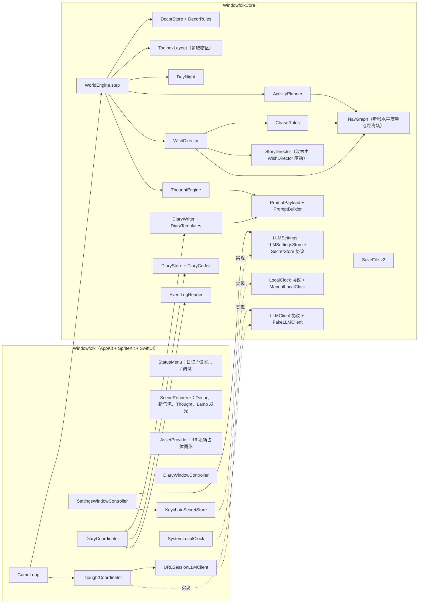
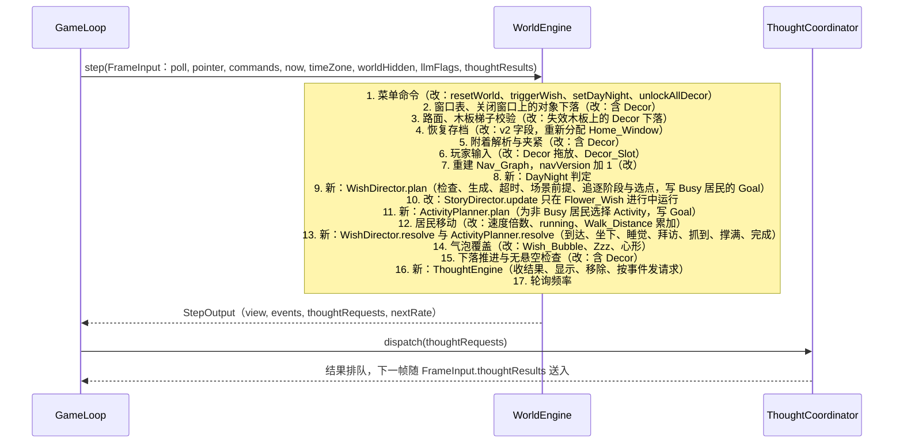
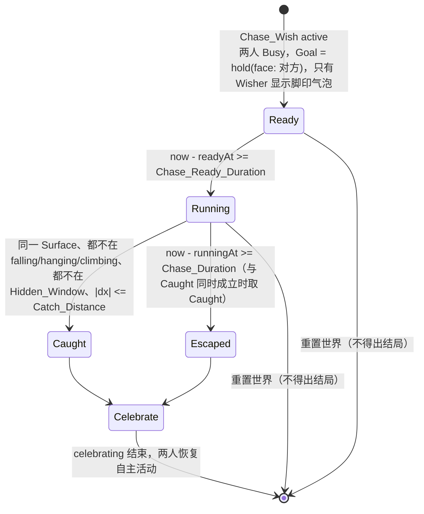

# Design Document

## Overview

本文档描述窗间 · Windowfolk V2 的技术设计，对应 `requirements.md` 中的 22 条需求。V2 以 `.kiro/specs/v1/design.md` 和现有代码（`Sources/WindowfolkCore`、`Sources/Windowfolk`、`Tests/WindowfolkCoreTests`）为基线，本文只写新增组件和对 v1 组件的改动。没有提到的 v1 设计（坐标系、窗口读取、路面、物理、木板梯子、命中穿透、轮询策略等）保持不变。

### 设计目标

- **沿用 v1 的架构约束**：新逻辑全部放进 `WindowfolkCore`，仍是同步的 `WorldEngine.step`，不导入 AppKit 和 SpriteKit（Requirement 19.1）。应用层只增加窗口、菜单、钥匙串、网络和文件读写。
- **确定性**：Wish 生成、Activity 选择、`wander` 时长、Visit_Target 选择全部使用注入的 `RandomSource`；Night 判定使用注入的 Local_Clock；LLM 用注入的 `LLMClient`。同样的种子、初始状态和时钟序列得到同样的 Wish 序列与 Activity 序列（Requirement 19.3）。
- **网络完全在 Game_Loop 之外**：`WorldEngine.step` 只输出「请求」并在之后的帧接收「结果」，从不等待网络（Requirement 12.5）。
- **隐私靠构造保证**：Prompt_Payload 只能由白名单枚举值和时间构造，类型上无法放入应用名称、窗口 ID 或坐标（Requirement 12.1、12.2）。
- **WorldEngine 不再变胖**：`WorldEngine.swift` 已有 1661 行。V2 的规则写在独立的纯函数组件里（`DecorRules`、`ActivityPlanner`、`WishDirector`、`ChaseRules`、`ThoughtEngine` 等），`WorldEngine` 只按顺序调用它们，编排代码放在新文件 `WorldEngine+V2.swift`。

### 研究结论

- **钥匙串**：用 Security 框架的 `SecItemAdd`、`SecItemCopyMatching`、`SecItemUpdate`、`SecItemDelete`，`kSecClass = kSecClassGenericPassword`，以 `kSecAttrService` 加 `kSecAttrAccount` 唯一定位一项（[Apple: Storing keys in the keychain](https://developer.apple.com/documentation/security/storing-keys-in-the-keychain)，[SecItemAdd](https://developer.apple.com/documentation/security/secitemadd(_:_:))）。SwiftPM 构建的可执行文件没有 keychain-access-groups 授权，因此不设 `kSecUseDataProtectionKeychain`，使用默认的登录钥匙串。ad-hoc 签名的二进制每次重新构建后签名会变，系统可能弹出一次「允许访问钥匙串」对话框，这是开发期的已知现象，不影响需求。
- **请求超时**：`URLRequest.timeoutInterval` 是两次收到数据之间的空闲超时，不是整个请求的总时长。LLM_Request_Timeout 要求 15 秒总时长，因此用 `withThrowingTaskGroup` 让请求与 `Task.sleep(for: .seconds(15))` 竞争，先完成者胜出，另一个被取消（Requirement 12.3、12.4）。
- **字素计数**：Swift 的 `String.count` 和 `String.prefix(_:)` 以扩展字素簇（`Character`）为单位，正好是需求中的「按 Unicode 字素计」，Thought_Max_Length 和 Diary_Max_Length 直接用它们实现，不需要额外的库。
- **LLM 协议**：需求只规定了服务地址、模型名和 API Key。设计采用 OpenAI 兼容的 Chat Completions 格式（`POST` 到服务地址，`Authorization: Bearer <API Key>`，请求体 `{"model", "messages"}`，取 `choices[0].message.content`），因为大多数服务商和本地推理服务（如 Ollama、LM Studio）都提供这一接口。服务地址填完整的端点 URL，例如 `https://api.openai.com/v1/chat/completions`。项目所有者已确认采用这一格式，见文末「已确认决策」。
- **应用窗口**：Settings_Window 和 Diary_Window 用 SwiftUI 视图放进 `NSWindow`（`NSHostingController`），macOS 14 可用。应用的激活策略是 `.accessory`，打开窗口时需要 `NSApp.activate()` 才能拿到焦点。这两个窗口属于本进程，`WindowFilter` 已按 pid 过滤，不会成为 Eligible_Window（Requirement 11.11）。

### 关键设计决策

- **两类时钟**：Story_Clock 仍是 `FrameInput.now`（墙上时间）。Wish_Timeout、Wish_Cooldown、Round_Interval、Chase 计时、Activity 计时、Thought_Min_Interval 都记录为 `Date` 时间点，按 `now - 起点` 判定，因此 Hidden_Window 暂停、下落、`waiting` 期间都继续累计，跨重启也成立。Local_Clock 是新增的协议，提供 `now` 和 `timeZone`，只用于 Night 判定和日记日期。应用层的 Story_Clock 和 Local_Clock 读同一个系统时间。
- **一位居民同时只有一个「控制者」**：Flower_Wish 参与者由 Story_Director 分配 Goal；其他 Wish 的 Busy_Resident 由 Wish_Director 分配；其余居民由 Activity_Planner 分配。控制者由当前 `active` Wish 推出，不单独存储，避免两个组件同时写 Goal。
- **Goal 扩展而不是另写移动代码**：v1 的 `ResidentController` 已有寻路、重新规划、`waiting`、小跳和爬梯。V2 只给 `Goal` 增加几个取值、给 `Resident` 增加速度倍数，所有移动仍走 v1 的代码路径。
- **两种路线度量**：v1 寻路代价包含边的固定代价（小跳 8、往下跳 12、木板长度、梯子高度）。需求中目标选择和追逐都按「水平总长度」比较（Requirement 7.2、7.5、9.4、21.2、21.4）。`NavGraph` 增加 `RouteMetric.horizontal`：边的代价为 `|exit.x - entry.x|`，Surface 上的代价为水平行走距离。v1 行为使用默认的 `.standard`，不变。
- **Home_Window 在恢复后重新分配**：v1 不保存 Home_Window（窗口 ID 重启后会变），恢复后 `homes` 为空。V2 中 Wish 调度和 `go_home` 都依赖 Home_Window，因此恢复后的第一次成功轮询起，只要有两个合格窗口，就用 v1 的 `selectHomes` 重新分配 Home_Window，但不移动居民（居民仍按 v1 R22.7 落位），存档格式不变。这是设计补充，项目所有者已确认，见文末「已确认决策」。
- **Decor 先进存储再拖动**：从 Decor_Slot 拖出时立即在 `DecorStore` 中新建一个 `dragged(fresh: true)` 的 Decor，因此「场上 Decor 数量」天然包含拖动中的那个（Requirement 2.6），上限判断只看 `DecorStore.count`。
- **坐着的居民让出椅腿**：Chair 24×24pt，居民 32×32pt。居民坐下时图形底边画在椅面高度（距 Surface 10pt），命中矩形同样上移，椅子下方 10pt 露出来，玩家按在这里能拖动椅子（Requirement 3.8）。居民的 Attachment 不变，无悬空不变量不受影响。

## Architecture

### 模块与新增组件



依赖方向仍只有 App → Core。Core 中的 `LLMClient`、`SecretStore`、`LLMSettingsStore`、`LocalClock`、`DiaryStorage` 都是协议，应用层提供真实实现，测试提供替身（Requirement 19.2、19.4）。

### 新增源文件

| 位置 | 文件 | 内容 |
|---|---|---|
| Core | `Decor.swift` | `DecorType`、`DecorID`、`DecorPlacement`、`Decor`、`DecorStore` |
| Core | `DecorRules.swift` | 松手判定、Toolbox 收回距离、上限、Chair 占用 |
| Core | `DayNight.swift` | `LocalClock`、`SystemLocalClock`、`ManualLocalClock`、`DayNightOverride`、`DayNight.isNight` |
| Core | `Activity.swift`、`ActivityPlanner.swift` | Activity 状态与选择、推进、到达判定 |
| Core | `Wish.swift`、`WishDirector.swift` | Wish 模型、`WishBook`、生成与推进 |
| Core | `ChaseRules.swift` | Chase_Candidate_Point、Flee_Target 选择、抓到与撑满判定 |
| Core | `NavGraph+Horizontal.swift` | `RouteMetric`、`HorizontalField` |
| Core | `Thought.swift`、`ThoughtEngine.swift` | Thought 状态机与文本规整 |
| Core | `LLM.swift` | `LLMClient`、`LLMResult`、`LLMRequestConfig`、`FakeLLMClient`、`LLMTimeout` |
| Core | `PromptPayload.swift` | `PromptPayload`、`PromptBuilder` |
| Core | `LLMSettings.swift` | `LLMSettings`、`LLMSettingsValidation`、`LLMSettingsStore`、`FileLLMSettingsStore`、`SecretStore`、`InMemorySecretStore` |
| Core | `Diary.swift`、`DiaryWriter.swift`、`DiaryStore.swift` | `LocalDate`、`DiaryEntry`、模板、生成调度、JSONL 编解码与存储 |
| Core | `EventLogReader.swift` | 读取 `events.jsonl`，跳过坏行 |
| Core | `WorldEngine+V2.swift` | V2 的 step 编排 |
| App | `SettingsWindowController.swift`、`SettingsView.swift` | Settings_Window |
| App | `DiaryWindowController.swift`、`DiaryView.swift` | Diary_Window |
| App | `KeychainSecretStore.swift` | 钥匙串读写 |
| App | `URLSessionLLMClient.swift` | Chat Completions 请求与 15 秒总超时 |
| App | `DiaryCoordinator.swift`、`ThoughtCoordinator.swift` | 异步调度日记与小心思请求 |

### 每帧更新顺序（V2）

v1 的 `step` 顺序保持，V2 在其中插入以下阶段。标「新」的是新增，标「改」的是修改。



- 第 9 步在第 12 步之前，第 13 步在第 12 步之后，因此「到达目标」和「完成 Wish」都发生在同一次世界更新中（Requirement 7.3、7.6、9.6、22.1、22.3）。
- 第 8 步每帧都执行。Game_Loop 最低以 Idle_Poll_Rate（10Hz）运行，Night 变化和昼夜覆盖修改都在 0.1 秒内生效，满足「1 秒内」（Requirement 5.2、17.4）。
- 第 16 步在全部事件产生之后执行，能看到本帧的 `wish_fulfilled`、`landed`、`woke`、`visited`（Requirement 14.1）。

### 线程模型（新增部分）

- `WorldEngine`、`ThoughtEngine` 状态都在主线程上，由 `GameLoop` 独占。
- `ThoughtCoordinator` 是 `@MainActor` 类，对每个 `ThoughtRequest` 启动一个 `Task`，在 Task 内 `await client.complete(...)`。结果回到主线程后放进队列，下一帧作为 `FrameInput.thoughtResults` 交给 `step`。`step` 本身从不等待（Requirement 12.5）。
- `DiaryCoordinator` 是一个 `actor`。读取 `events.jsonl`、生成日记和写入 `diary.jsonl` 都在它内部执行，不占主线程。为了避免读到写了一半的行，读取请求经由 `EventLogWriter` 现有的后台串行队列排队；即使读到不完整的末行，`EventLogReader` 也会把它当坏行跳过（Requirement 13.1）。
- `URLSessionLLMClient` 和 `KeychainSecretStore` 都是 `Sendable` 的 `final class`，内部没有可变状态。

## Components and Interfaces

### Core：Decor 与 DecorStore（Requirement 1、2、3）

```swift
public enum DecorType: String, Hashable, Sendable, Codable, CaseIterable, Comparable {
  case chair, lamp                                     // 声明顺序即 Toolbox 顺序：先 chair 后 lamp
}
public struct DecorID: Hashable, Sendable, Codable, Comparable { public var rawValue: UInt64 }
public enum DecorPlacement: Hashable, Sendable {
  case attached(Attachment)                            // .window / .plank / .ground
  case falling(FallState, byPlayer: Bool)              // byPlayer：落地时写 decor_placed
  case dragged(grabOffset: Point, fresh: Bool)         // fresh：刚从 Decor_Slot 拖出、从未放置过
}
public struct Decor: Hashable, Sendable {
  public var id: DecorID
  public var type: DecorType
  public var placement: DecorPlacement
  public var placedSeq: UInt64                         // 最近一次落到某条 Surface 上的序号，越小越早
}
public struct DecorStore: Hashable, Sendable {
  public var decors: [DecorID: Decor]
  public var unlocked: Set<DecorType>                  // Unlocked_Decor
  public private(set) var nextID: UInt64
  public private(set) var nextSeq: UInt64
  public var count: Int { decors.count }               // 含拖动中的 Decor（Requirement 2.6）
  public mutating func unlock(_ t: DecorType) -> Bool  // 新加入时返回 true，用于写 decor_unlocked
  public mutating func makeDecor(_ t: DecorType, grabOffset: Point, max: Int) -> DecorID?   // 已满返回 nil
  public mutating func markPlaced(_ id: DecorID)       // 更新 placedSeq
  public var sortedIDs: [DecorID] { get }
}
```

- `unlock` 只增不减。`DecorStore` 没有任何移除解锁项的方法，只有 `resetWorld` 整体重建 `DecorStore()`（Requirement 1.5、1.6）。
- `Attachment` 复用 v1 的 `.window(id, offset)`、`.plank(id, t)`、`.ground(x)`。Decor 跟随、隐藏、关闭、失效下落的处理写进 v1 处理 Item 的同一批函数（`dropOnClosed`、`failPlank`、`resolveItemAttachments`、`advanceFallingItems`、`enforceSupport`），每处都在 Item 循环之后加一个 Decor 循环（Requirement 3.9、3.12）。被动下落的 `byPlayer` 为 false。
- Decor 不进入 `SurfaceBuilder` 和 `NavGraph.build` 的输入，因此不阻挡任何边，重叠也不受限（Requirement 3.11）。

### Core：DecorRules（Requirement 2.3 至 2.6、3.2 至 3.6、4.13）

```swift
public enum DecorRelease: Hashable, Sendable {
  case discard                                          // 新建的 Decor 放回 Toolbox：不写事件
  case remove                                           // 已放置过的 Decor 收回 Toolbox：写 decor_removed
  case attach(Attachment, surface: SurfaceKindTag)      // 写 decor_placed
  case fall(FallState)                                  // byPlayer = true，落地时写 decor_placed
}
public enum SurfaceKindTag: String, Sendable { case windowLedge = "window_ledge", plank, ground }
public enum DecorRules {
  /// 点到矩形的欧氏距离；点在矩形内（含边）时为 0。
  public static func distance(_ p: Point, to r: Rect) -> Double
  /// 松手判定。顺序：先 Toolbox 收回，再 Drop_Snap_Distance 内吸附，最后自由下落。
  public static func release(at pointer: Point, grabOffset: Point, fresh: Bool,
                             toolbox: Rect, surfaces: [Surface], windows: WindowTable,
                             screen: ScreenInfo, constants: Tunables) -> DecorRelease
  /// Chair 是否可用：未被占用、不在拖动中或下落中。
  public static func isFreeChair(_ d: Decor, seats: [ResidentID: DecorID]) -> Bool
}
```

`release` 的规则：

1. `distance(pointer, toolbox) <= Toolbox_Return_Distance` 时，`fresh` 为 true 返回 `.discard`，否则返回 `.remove`。这一条在吸附之前判断（Requirement 3.4、3.5）。
2. 否则在松开点正下方 `[0, Drop_Snap_Distance]` 内找 Window_Ledge 和已架设 Plank。v1 的物件只吸附 Window_Ledge，Decor 多了 Plank。取与松开点竖直距离最小的一条，距离相同时取 y 较小（位置较高）的一条；Decor 中心 x 取松开点 x 夹紧到该 Surface 线段范围（Requirement 3.2）。
3. 都没有时返回 `.fall`，起点为松开点，按 v1 `Physics` 下落（Requirement 3.3）。

Decor 的位置以底边中点定位，与 Item 一致；拖动中位置为 `pointer - grabOffset`，保证光标相对外接矩形的偏移不变（Requirement 3.1）。

### Core：ToolboxLayout 改动（Requirement 1.7、2.1、2.2、2.8）

```swift
public enum ToolboxZone: Hashable, Sendable {           // 原为 String 枚举 + CaseIterable
  case plank, ladder, decor(DecorType)
}
public enum ToolboxLayout {
  public static let rightMargin: Double = 8
  public static let zoneWidth: Double = 36              // v1 Toolbox 宽 72 = 2 × 36
  public static func zones(unlocked: Set<DecorType>) -> [ToolboxZone]  // [.plank, .ladder] + 已解锁按 chair、lamp 排序
  public static func frame(screen: ScreenInfo, unlocked: Set<DecorType>) -> Rect
  public static func zoneFrame(_ z: ToolboxZone, screen: ScreenInfo, unlocked: Set<DecorType>) -> Rect?
  public static func zone(at p: Point, screen: ScreenInfo, unlocked: Set<DecorType>) -> ToolboxZone?
}
```

- 外框宽 `zoneWidth × zones.count`，底边与 Ground 对齐，右边距 8pt。取物区从左到右等宽排列，相邻两区只共用一条边，相交面积为 0；边上的点归右边的区，每个点最多属于一个区（Requirement 2.1）。
- 新解锁的 Decor_Slot 追加在右侧，外框向左变宽，已有取物区的相对顺序不变（Requirement 2.2）。
- `WorldView.toolbox` 改为传入 `decors.unlocked`。v1 调用 `frame(screen:)` 的地方（`HitTesting.regions`、`SceneRenderer.renderToolbox`、`InteractionController`）改为新签名。`unlocked` 为空时结果与 v1 完全相同，v1 的 Toolbox 测试不需要改断言。
- Decor_Slot 达到上限时的晃动（Requirement 2.4）由 `WorldState.toolboxShake: (zone: ToolboxZone, remaining: Double)?` 表示，时长 0.4 秒，渲染层按剩余时间画水平正弦偏移。

### Core：InteractionController 与 HitTesting 改动（Requirement 2、3、5.9、10.6、20.9、21.8）

- `HitTarget` 新增 `.decor(DecorID)`，优先级为 Resident 0、Item 1、Decor 2、Plank/Ladder 3、Toolbox 4。
- `DragSubject` 新增 `.decor(DecorID)`。Decor_Slot 拖动超过 Click_Drag_Threshold 时调用 `DecorStore.makeDecor`；返回 nil（已满）时设置 `toolboxShake`，手势转为 `.swallowed`，不新建、不预览（Requirement 2.3、2.4）。按下后不超过阈值就松开，什么都不发生（Requirement 2.5、3.6）。
- 开始拖动一把有人坐的 Chair 时，同一帧把坐着的居民设为 `idle`、清除 `seat`（Requirement 3.8）。开始拖动 Lamp 时，以它为目标的 `sleeping` 居民由 `ActivityPlanner.resolve` 在本帧唤醒（Requirement 5.8）。
- 坐着的居民的命中矩形为 `SpriteMetrics.residentRect(bottomCenter: p, lift: chairSeatHeight)`，`chairSeatHeight = 10`。
- 戳居民的状态列表扩展：`sleeping` 只显示「?」，不跳跃；Chase_Wish 进行中的 Chaser 和 Runner 也只显示「?」，不跳跃（Requirement 5.9、20.9、21.8）。v1 的 `InteractionController.poke` 增加一个参数 `jumpAllowed: Bool`，由 `WorldEngine` 根据状态和是否在追逐中给出。

### Core：Resident 与 Goal 改动

```swift
public enum ResidentState: String, ... {
  case idle, walking, carrying, waiting, falling, hanging, climbing, planting, celebrating
  case sitting, sleeping, running                         // V2 新增，共 12 个
}
public enum Goal: Hashable, Sendable {
  case none, confined, reach(ResidentID)                  // v1
  case hold(face: FaceTarget?)                            // 新：停在原地，不水平移动；可每帧朝向某位居民
  case reachPoint(SurfaceID, x: Double, arriveWithin: Double)    // 新：Chair、Lamp、Story_Flower、Flee_Target
  case reachWindow(WindowID)                              // 新：到该窗口任意一段 Window_Ledge（go_home、Visit_Wish）
}
public enum FaceTarget: Hashable, Sendable { case resident(ResidentID) }
public struct Resident {
  // v1 字段不变，新增：
  public var speedFactor: Double = 1                      // 追逐中为 1.6 或 1.5
  public var routeMetric: RouteMetric = .standard         // 追逐、选 Decor、Visit_Wish 用 .horizontal
  public var walkDistance: Double = 0                     // Walk_Distance
  public var seat: DecorID? = nil                         // 正在坐的 Chair
  public var thought: ThoughtDisplay? = nil               // 正在显示的 Thought
}
```

- `ResidentController.movingState` 改为：`speedFactor > 1` 时为 `running`，否则持有 Item 为 `carrying`，否则为 `walking`。水平速度为 `walkSpeed × speedFactor`（`speedFactor` 为 1 时持物仍乘 `carrySpeedRatio`）（Requirement 21.1）。小跳、往下跳、爬梯、悬挂、下落沿用 v1。
- `reachWindow(w)` 每次规划时对 `w` 的每一段可见 Window_Ledge 求路线，取代价最小者；站在 `w` 的任一段上即到达。
- `reachPoint` 在同一 Surface 且 `|x - targetX| <= arriveWithin` 时到达并停下（`rest`、`admire_flower` 用 Gift_Reach_Distance，`sleep` 和 Lamp_Wish 用 Lamp_Range，Flee_Target 用 1pt）。
- `hold` 下居民状态为 `idle`；不可达导致的 `waiting` 由 Wish 规则决定，不由 `hold` 产生。
- `updateResidents` 在每位居民 `update` 前后比较屏幕 x，状态为 `walking` 或 `running` 时把差的绝对值加到 `walkDistance`（Requirement 4.14）。
- `sitting` 和 `sleeping` 的居民跳过 `ResidentController.update` 的移动部分，只推进戳气泡。

### Core：NavGraph 水平度量（Requirement 7.2、7.5、9.4、20.1、21.2、21.4、21.5）

```swift
public enum RouteMetric: Hashable, Sendable { case standard, horizontal }
extension NavGraph {
  public func route(from: SurfaceID, at x: Double, to: SurfaceID, targetX: Double, metric: RouteMetric) -> Route?
  /// 从起点出发、按水平度量的单源最短距离场。
  public func horizontalField(from: SurfaceID, at x: Double) -> HorizontalField
}
public struct HorizontalField: Sendable {
  /// 到 Surface s 上 x 处的最短水平总长度；不可达时为 nil。
  public func length(to s: SurfaceID, x: Double) -> Double?
  public func isReachable(_ s: SurfaceID) -> Bool
}
```

- 水平度量下，经过一条边的代价为 `|exit.x - entry.x|`，在 Surface 上从 a 走到 b 的代价为 `|a - b|`。这正是 Requirement 21.4 对「路线水平总长度」的定义。
- `HorizontalField` 用与 v1 `route` 相同的 Dijkstra 状态（「起点」或「经由某条边到达」），记录每个状态的最短距离 `d` 和到达点 x。到 `(s, x)` 的长度为 `min(起点在 s 时的 |x0 - x|, 经由边 e 到达 s 的 d(e) + |e.entry.x - x|)`。图通常少于 50 个节点，每次计算在微秒级。
- 同一 Surface 视为可达，长度为水平距离（Requirement 20.1(d)）。
- `WorldEngine` 新增 `navVersion: Int`，每次 Nav_Graph 真正重建时加 1，供追逐判断「Nav_Graph 发生变化」（Requirement 21.2、21.4）。

### Core：DayNight 与 Local_Clock（Requirement 5.1、5.2、17.4）

```swift
public protocol LocalClock: Sendable {
  var now: Date { get }
  var timeZone: TimeZone { get }
}
public struct SystemLocalClock: LocalClock { /* Date(), TimeZone.current */ }
public final class ManualLocalClock: LocalClock, @unchecked Sendable {   // 测试替身
  public var now: Date; public var timeZone: TimeZone
  public func set(year: Int, month: Int, day: Int, hour: Int, minute: Int, second: Int)
  public func advance(by seconds: TimeInterval)
}
public enum DayNightOverride: String, Hashable, Sendable, CaseIterable { case auto, day, night }
public enum DayNight {
  /// 秒级比较：本地时刻 >= Night_Start 或 < Night_End 为 Night。
  public static func isNight(now: Date, timeZone: TimeZone, override: DayNightOverride, constants: Tunables) -> Bool
}
```

- `Tunables` 用「一天中的秒数」表示 `nightStart = 19 * 3600`、`nightEnd = 6 * 3600`。`isNight` 用 `Calendar(identifier: .gregorian)` 加传入的 `timeZone` 求出本地时、分、秒，换算成秒数后比较。只比较到秒，不受亚秒影响。
- `FrameInput` 新增 `timeZone: TimeZone`（默认 `.current`）。`GameLoop` 从 `LocalClock` 取 `now` 和 `timeZone` 填入。
- 昼夜覆盖存在 `WorldState.dayNightOverride` 中，不保存，启动时为 `.auto`；`resetWorld` 不改它（Requirement 17.4、17.6）。

### Core：ActivityPlanner（Requirement 4、5、9.8）

```swift
public enum ActivityKind: String, Hashable, Sendable, CaseIterable {
  case wander, goHome = "go_home", visitNeighbor = "visit_neighbor", rest
  case admireFlower = "admire_flower", sleep
}
public enum ActivityTarget: Hashable, Sendable {
  case none, home(WindowID), resident(ResidentID), chair(DecorID), flower(ItemID), lamp(DecorID)
}
public enum ActivityPhase: Hashable, Sendable {
  case moving                          // 前往目标；wander 时在当前 Surface 闲逛
  case staying(until: Date)            // visit_neighbor、admire_flower 到达后停留
  case sitting(until: Date)            // rest 坐满 Sit_Duration
  case sleeping                        // sleep 到达后
}
public struct Activity: Hashable, Sendable {
  public var kind: ActivityKind
  public var target: ActivityTarget
  public var startedAt: Date
  public var phase: ActivityPhase
  public var wanderUntil: Date?        // 仅 wander
  public var surface: SurfaceID?       // 仅 wander：开始时所在 Surface
}
public struct ActivityContext: Sendable {
  public var nav: NavGraph; public var locations: [ResidentID: ResidentLocation]
  public var decors: DecorStore; public var seats: [ResidentID: DecorID]
  public var items: ItemStore; public var homes: [ResidentID: WindowID]
  public var isNight: Bool; public var now: Date; public var constants: Tunables
  public var preferHome: Set<ResidentID>   // Visit_Wish 刚完成的居民（Requirement 9.8）
}
public enum ActivityPlanner {
  public static let weights: [ActivityKind: Double] = [
    .wander: 4, .goHome: 2, .visitNeighbor: 2, .rest: 2, .admireFlower: 1, .sleep: 1,
  ]
  public static func executable(_ id: ResidentID, ctx: ActivityContext) -> [ActivityKind: ActivityTarget]
  public static func choose(_ id: ResidentID, ctx: ActivityContext, rng: inout RandomSource) -> Activity
  /// 移动前：校验目标、放弃、写 Goal。
  public static func plan(_ r: inout Resident, _ a: inout Activity?, ctx: ActivityContext) -> [ActivityEvent]
  /// 移动后：到达判定、进入 sitting / sleeping、停留结束、超时。
  public static func resolve(_ r: inout Resident, _ a: inout Activity?, ctx: ActivityContext) -> [ActivityEvent]
}
public enum ActivityEvent: Hashable, Sendable {
  case sat(ResidentID, DecorID), slept(ResidentID, DecorID), woke(ResidentID, WakeReason)
  case visited(ResidentID, ResidentID)
}
public enum WakeReason: String, Sendable { case nightEnded = "night_ended", lampMoved = "lamp_moved", surfaceGone = "surface_gone", becameBusy = "became_busy" }
```

可执行条件（Requirement 4.3、5.3）：

| Activity | 条件 | 目标 |
|---|---|---|
| `wander` | 始终 | 无 |
| `go_home` | 有 Home_Window，不在其任一段窗沿上，有路线 | `home(w)` |
| `visit_neighbor` | 另一位不在 `falling`、`hanging`，有路线到其 Surface | `resident(other)` |
| `rest` | 至少一把空闲 Chair 有路线 | 标准度量下最近的一把 |
| `admire_flower` | 至少一朵 `bloom` 的 Story_Flower 有路线 | 最近的一朵 |
| `sleep` | Night，且至少一盏放在 Surface 上（不拖动、不下落）的 Lamp 有路线 | 路线最短的一盏 |

选择规则：

- Night 且 `sleep` 可执行时直接选 `sleep`，不消耗随机数（Requirement 4.4）。
- 否则在可执行集合中按 `weights` 加权随机，用一次 `rng.nextUnit()`。候选按 `ActivityKind.allCases` 的固定顺序累加权重，因此同样的种子和状态得到同样的结果（Requirement 4.5、4.15）。
- `preferHome` 中的居民：若 `go_home` 可执行，它一定在候选集合中（Requirement 9.8 只要求放入候选，权重不变）。
- `wander` 的时长为 `rng.double(in: min, max)`。`RandomSource.double(in:)` 是半开区间 `[min, max)`；需求是闭区间，`max` 只差一个最小浮点步长，测试按闭区间断言即可。`wander` 期间 Goal 为 v1 的 `.confined`，居民只在当前 Surface 上来回走（Requirement 4.6）。

推进规则：

- **放弃**（Requirement 4.11、5.5）：`plan` 中检查目标是否仍可执行（Chair 被占、被拖、被收回；花被移除；另一位进入 `falling` 或 `hanging`；路线消失；Night 结束；Lamp 被拖、被收回、下落），以及 `now - startedAt >= Activity_Reach_Timeout`（只在 `moving` 阶段）。放弃时把 Activity 设为 nil、Goal 设为 `.hold`，居民为 `idle`，不显示气泡。下一帧 `choose` 选出新的 Activity，满足「1 秒内」（Requirement 4.2）。
- **坐下**（Requirement 4.9）：`rest` 到达且 Chair 仍空闲，居民 x 设为 Chair x，状态 `sitting`，`seat = chair`，阶段 `sitting(until: now + Sit_Duration)`，产生 `.sat`。到时转 `idle`，清 `seat`，`walkDistance = 0`，Activity 结束。
- **睡觉**（Requirement 5.4、5.7、5.8）：`sleep` 到达 Lamp_Range 内，状态 `sleeping`，阶段 `sleeping`，产生 `.slept`。Night 结束、Lamp 被拖或收回或下落时转 `idle`，`walkDistance = 0`，产生 `.woke`；所在 Surface 消失时由 v1 失效处理转为 `falling`，`resolve` 看到状态从 `sleeping` 变成 `falling` 后补一条 `.woke(surfaceGone)`。
- **拜访**（Requirement 4.8）：拜访者到达后两人 Goal 都设为 `.hold(face: 对方)`（被拜访者若在 `sitting` 或 `sleeping` 则不转向、不改状态），双方显示心形气泡，阶段 `staying(until: now + Visit_Stay_Duration)`。被拜访者的 Activity 记一个 `pausedUntil`，期间不推进、不计超时。停留结束后产生 `.visited`，拜访者 Activity 结束，被拜访者从暂停处继续。
- **成为 Busy_Resident**（Requirement 4.12）：`WorldEngine` 在 `WishDirector.plan` 之后检查新的 Busy 居民，把其 Activity 设为 nil；`sitting` 的转 `idle` 并清 `seat`，`sleeping` 的转 `idle` 并产生 `.woke(becameBusy)`。
- **不维护 Activity 的情形**（Requirement 4.1）：Busy_Resident，或状态为 `falling`、`hanging`。`climbing` 中的居民保留 Activity，只是不重新选择。

### Core：Wish 模型与 WishDirector（Requirement 6 至 10、15、17、20、22）

```swift
public enum WishType: String, Hashable, Sendable, Codable, CaseIterable { case flower, chair, lamp, visit, chase }
public enum WishState: String, Hashable, Sendable, Codable { case active, fulfilled, dropped }
public struct WishID: Hashable, Sendable, Comparable { public var rawValue: UInt64 }
public struct VisitTarget: Hashable, Sendable { public var window: WindowID; public var ownerName: String }
public enum ChasePhase: String, Hashable, Sendable { case ready, running }
public enum ChaseOutcome: String, Hashable, Sendable, Codable { case caught, escaped }
public struct FleePoint: Hashable, Sendable { public var surface: SurfaceID; public var x: Double }
public struct ChaseState: Hashable, Sendable {
  public var phase: ChasePhase
  public var readyAt: Date
  public var runningAt: Date?
  public var fleeTarget: FleePoint?
  public var lastReplanAt: Date?
  public var lastNavVersion: Int
  public var celebrating: Set<ResidentID>          // 结束后正在庆祝的居民
}
public struct Wish: Hashable, Sendable {
  public var id: WishID
  public var type: WishType
  public var wisher: ResidentID
  public var createdAt: Date
  public var state: WishState
  public var visitTarget: VisitTarget?               // 仅 visit
  public var decorTarget: DecorID?                   // 仅 chair、lamp：已选定的目标
  public var chase: ChaseState?                      // 仅 chase
  public var participants: Set<ResidentID> {         // Busy_Resident
    type == .flower || type == .chase ? [.a, .b] : [wisher]
  }
}
public struct WishBook: Hashable, Sendable {
  public var active: [Wish]                          // 0 至 2 个，按 id 排序
  public var lastEnded: [ResidentID: Date]           // 上一个 Wish 结束时间（Wish_Cooldown 起点）
  public var flowerCount: Int                        // 已开始过的 Flower_Wish 次数
  public var lastFlowerDoneAt: Date?                 // 上一个 Flower_Wish 进入 Done 的时间
  public var nextCheckAt: Date?                      // 下一次检查时间；Home_Window 未分配时为 nil
  public private(set) var nextID: UInt64
  public var busy: Set<ResidentID> { get }           // active 中全部 participants 的并集
  public func wish(of r: ResidentID) -> Wish?
}
public enum WishDirector {
  public static func eligibleTypes(_ r: ResidentID, book: WishBook, world: WishContext) -> [WishType: VisitCandidates]
  public static func plan(_ book: inout WishBook, world: inout WorldState, ctx: WishContext,
                          rng: inout RandomSource) -> [WishEvent]
  public static func resolve(_ book: inout WishBook, world: inout WorldState, ctx: WishContext) -> [WishEvent]
  public static func trigger(_ t: WishType, wisher: ResidentID?, book: inout WishBook,
                             world: inout WorldState, ctx: WishContext, rng: inout RandomSource) -> [WishEvent]
}
public enum WishEvent: Hashable, Sendable {
  case started(Wish), fulfilled(Wish, ChaseOutcome?), dropped(Wish)
  case decorUnlocked(DecorType), visitedWindow(ResidentID, ownerName: String)
}
```

`WishContext` 包含 `nav`、`navVersion`、`locations`、`decors`、`seats`、`items`、`homes`、`isNight`、`now`、`constants`、`hiddenResidents`（附着在 Hidden_Window 上的居民）。

#### 检查与生成（Requirement 6.1 至 6.8、8.1、20.1）

```mermaid
flowchart TD
  T{now >= nextCheckAt?} -->|否| E[结束]
  T -->|是| N[nextCheckAt += Wish_Check_Interval<br/>落后太多时设为 now + 间隔]
  N --> A[依次检查 Resident_A、Resident_B]
  A --> C{不是 Busy、不在 falling/hanging、<br/>冷却已满、有可生成的 Wish_Type?}
  C -->|否| X[跳过]
  C -->|是| R{rng.nextUnit() < Wish_Spawn_Chance?}
  R -->|否| X
  R -->|是| P[在可生成类型中等概率选一种<br/>Visit 再等概率选 Visit_Target]
  P --> S[生成 active Wish，写 wish_started<br/>Chair / Lamp 必要时写 decor_unlocked]
```

- Home_Window 分配完成那一帧把 `nextCheckAt` 设为 `now + Wish_Check_Interval`（Requirement 6.1）。
- 两位居民按 A、B 顺序检查，A 生成的 Wish 在检查 B 时已经计入 `busy`（Requirement 20.1）。
- 各类型的生成条件（Requirement 6.3、8.1、20.1）：

| Wish_Type | 条件 |
|---|---|
| flower | 两人都不 Busy；该居民是下一次的 Giver（`flowerCount` 为偶数时 A，奇数时 B）；`lastFlowerDoneAt` 为 nil 或 `now - lastFlowerDoneAt >= Round_Interval` |
| chair | `walkDistance >= Tired_Walk_Distance`，且不存在一把空闲、有路线可达的 Chair |
| lamp | Night，且不存在一盏有路线可达的 Lamp |
| visit | 存在至少一个 Visit_Target 候选：不是任何 Home_Window、至少有一段 Window_Ledge、不是另一个 active Visit_Wish 的目标 |
| chase | 非 Night；另一位不 Busy、不在 `falling` 或 `hanging`、冷却已满；`ctx.nav.horizontalField(from: A).isReachable(B 的 Surface)` |

- 随机数用量固定：每位通过前置条件的居民用 1 次 `nextUnit()` 判定概率；抽中后用 1 次选类型（候选按 `WishType.allCases` 顺序排列后取 `Int(u * n)`）；Visit 再用 1 次选窗口（候选按窗口 ID 排序）。这样同样的种子总得到同样的 Wish 序列（Requirement 19.3）。
- 生成 Chair_Wish 或 Lamp_Wish 时调用 `decors.unlock(type)`；返回 true 才写 `decor_unlocked`，写在 `wish_started` 之后（Requirement 1.2 至 1.4、18.2）。
- 生成 Flower_Wish 时 `flowerCount += 1`，调用 `StoryDirector.beginFlowerWish(round: flowerCount)`，见下文「StoryDirector 改动」（Requirement 8.2）。

#### 各类型的推进

**Chair_Wish 和 Lamp_Wish**（Requirement 7）：

- 没有目标时 Goal 为 `.hold`。`plan` 中若存在可达目标（Chair 要求空闲），用 `horizontalField` 取水平总长度最短者，并列时取 `placedSeq` 最小者，记入 `decorTarget`，Goal 改为 `.reachPoint`，`routeMetric = .horizontal`。选定后不再更换（Requirement 7.2、7.5）。
- 没有任何可达目标时居民为 `waiting`，气泡为对应 Wish_Bubble（Requirement 6.13、7.1、7.4）。
- 途中目标失效（被占、被拖、被收回、下落、路线消失）时清 `decorTarget`，Goal 回到 `.hold`（Requirement 7.7）。
- `resolve` 中到达：Chair_Wish 让居民坐下（与 `rest` 相同的处理，产生 `sat`），同帧把 Wish 设为 `fulfilled`，不庆祝，把居民的 Activity 设为一个 `rest`、阶段 `sitting(until: now + Sit_Duration)` 的 Activity；Lamp_Wish 让居民 `sleeping`（产生 `slept`），同帧 `fulfilled`，Activity 设为 `sleep`、阶段 `sleeping`（Requirement 7.3、7.6）。事件顺序为 `sat`/`slept` 在前、`wish_fulfilled` 在后（Requirement 18.2）。
- 这两种 Wish 不受 Activity_Reach_Timeout 约束（Requirement 7.8）。

**Visit_Wish**（Requirement 9）：Goal 为 `.reachWindow(target)`，`routeMetric = .horizontal`。不可达时 `waiting`。Visit_Target 为 Hidden_Window 时窗沿不在 Nav_Graph 中，自然等待（Requirement 9.7）。`resolve` 中 Wisher 站在目标任一段窗沿上且不在 `falling`、`hanging` 时，先写 `visited`（`target` 为 `app:<ownerName>`，`detail.source = "visit_wish"`），再 `fulfilled`。完成后把 Wisher 放进下一次 `ActivityContext.preferHome`（Requirement 9.8）。

**Flower_Wish**（Requirement 8）：见「StoryDirector 改动」。Story_Stage 进入 `done` 的那次更新中 `fulfilled`，两人恢复自主活动。

**Chase_Wish**：见下一节。

#### 超时、场景前提与完成（Requirement 6.9 至 6.12、10）

- `plan` 中，非 flower、非 chase 的 Wish 满足 `now - createdAt >= Wish_Timeout` 时 `dropped`（Requirement 6.11）。
- 场景前提消失时下一次更新 `dropped`：Visit_Target 关闭或没有窗沿；Lamp_Wish 进行中 Night 结束（Requirement 6.12）。
- `dropped`：移除 Wish，`lastEnded[wisher] = now`，Wisher 转 `idle`，Goal 设为 `.hold`，Activity 由 Activity_Planner 下一帧重选。不改变 Decor、Unlocked_Decor 和任何计数（Requirement 6.11、10.5）。
- `fulfilled`：移除 Wish，全部参与者 `lastEnded = now`。需要庆祝时 Wisher 播放 v1 的 `celebrating`（时长沿用 v1 Done 阶段的庆祝时长）。
- 两个 Wish 同时 active 时各自独立推进，一个结束不改另一个的任何字段（Requirement 10.2、10.3）。
- 点击 Wisher 不经过 `WishDirector`，只走 v1 的戳逻辑，因此不改变 Wish（Requirement 10.7）。

#### Debug 触发（Requirement 17.2、17.3）

`trigger` 跳过冷却、概率、Walk_Distance、Night、Round_Interval 检查，只检查 Requirement 17.2 的前提；前提不满足时返回空事件、不改任何状态。`wisher` 为 nil 只用于送花，此时取下一次的 Giver。

### Core：Chase_Wish 与 ChaseRules（Requirement 20、21、22）

```swift
public enum ChaseRules {
  public static let chaser: ResidentID = .a
  public static let runner: ResidentID = .b
  /// Runner 可达的每条 Surface 各给出 1 或 2 个候选点（Chase_Candidate_Point）。
  public static func candidates(runnerField: HorizontalField, surfaces: [Surface], inset: Double) -> [FleePoint]
  /// Flee_Target 选择：chaser 长度降序（不可达视为 +∞），runner 长度升序，x 升序。
  public static func selectFleeTarget(_ c: [FleePoint], chaserField: HorizontalField,
                                      runnerField: HorizontalField) -> FleePoint?
  /// 抓到判定（Requirement 22.1）。
  public static func isCaught(chaser: ResidentLocation?, runner: ResidentLocation?,
                              chaserState: ResidentState, runnerState: ResidentState,
                              hidden: Set<ResidentID>, distance: Double) -> Bool
}
```

阶段流转：



`running` 阶段每帧的处理（`WishDirector.plan` 中）：

1. 计算 `chaserField = nav.horizontalField(from: Chaser 位置)`。`reachable = chaserField.isReachable(Runner 的 Surface)`。附着在 Hidden_Window 上的居民没有位置，视为不可达，并跳过移动（Requirement 21.10）。
2. 需要重新规划的条件：`lastReplanAt` 为 nil，或 `now - lastReplanAt >= Chase_Replan_Interval`，或 `navVersion != lastNavVersion`，或 Runner 已到达当前 Flee_Target。重新规划时：
   - Chaser：`reachable` 时 Goal 为 `.reach(Runner)`、`speedFactor = 1.6`、`routeMetric = .horizontal`；否则 Goal 为 `.hold(face: Runner)`、状态 `waiting`，不显示「...」（Requirement 21.2、21.3）。v1 的 `.reach` 在目标 Surface 不变时只更新 `targetX`，目标 Surface 变化时重新寻路，因此 Chaser 实际每帧都追踪 Runner 的最新位置，比 0.5 秒更快。
   - Runner：`reachable` 时计算 `runnerField`、候选点和 Flee_Target，Goal 为 `.reachPoint(target, arriveWithin: 1)`、`speedFactor = 1.5`；到达后状态 `idle`，Goal `.hold(face: Chaser)`，下次规划若选出不同的点再出发（Requirement 21.4、21.11）。不可达时 Goal 为 `.hold(face: Chaser)`、`idle`（Requirement 21.6）。
3. 下落、悬挂、爬梯中的居民 Goal 照写，v1 在它们落地后按 Goal 继续，满足落地后 1 秒内继续（Requirement 21.9）。

候选点（Requirement 名词 Chase_Candidate_Point）：对 `runnerField` 可达的每条 Surface `[lo, hi]`，`hi - lo > 2 × Flee_Edge_Inset` 时取 `lo + inset` 和 `hi - inset`，否则取中点。候选按 `(SurfaceID, x)` 排序后再选择，保证确定性。

结局处理在 `WishDirector.resolve` 中（居民移动之后）：先判 `caught`，否则判 `escaped`；得出结局后同帧 `fulfilled`、写一条 `wish_fulfilled`（`detail` 含 `wish_type: chase`、`chase_outcome`），两人 `lastEnded = now`、`speedFactor = 1`、`routeMetric = .standard`、离开 `running` 和 `waiting`。可以庆祝的居民（不在 `falling`、`hanging`、`climbing`，不在 Hidden_Window）同帧停下、播放 `celebrating` 并显示心形气泡（Requirement 22.3）。两种结局的显示完全相同（Requirement 22.4）。结局只在 Wish 仍为 active 时判定一次，判定后 Wish 已从 `active` 移除，不会再判（Requirement 22.9）。

庆祝结束或未庆祝的居民恢复正常状态后，Activity_Planner 照常选择 Activity（Requirement 22.6）。

### Core：StoryDirector 改动（Requirement 8）

v1 的 `StoryDirector.update` 在 `stage == nil` 时调用 `tryBegin` 开局，在 `done` 阶段等 Round_Interval 后自动开始下一轮。V2 拆分如下：

```swift
extension StoryDirector {
  /// 只分配 Home_Window 并落位（v1 R15.1 至 15.4、15.7），不开始送花。返回是否分配成功。
  public static func assignHomes(_ s: inout StoryState, world: inout WorldState, constants: Tunables,
                                 placeResidents: Bool) -> Bool
  /// Flower_Wish 变为 active 时调用：stage = .wish，round = n，Giver 和 Receiver 按 v1 规则。
  public static func beginFlowerWish(_ s: inout StoryState, round: Int, world: inout WorldState,
                                     constants: Tunables, now: Date) -> [StoryEvent]
}
```

- `update` 只在 `stage != nil` 时推进；`stage == nil` 表示没有进行中的 Flower_Wish，`update` 不再调用 `tryBegin`。
- `updateDone` 不再等 Round_Interval 开新一轮。进入 `done` 时记 `doneAt`，WishDirector 在同一次更新中看到 `stage == .done`，把 Flower_Wish 设为 `fulfilled`、`lastFlowerDoneAt = doneAt`，然后把 `stage` 置为 nil（Requirement 8.4）。v1 进入 `done` 时的心形和 `celebrating` 照常播放，作为 Requirement 6.10 的庆祝动画，不再另外播放一次。
- `assignGoals` 只在 `stage != nil` 时写 Goal，因此没有 Flower_Wish 时居民的 Goal 归 Activity_Planner。
- `giver(round:)` 不变：第 n 次 Flower_Wish 的 Story_Round 就是 n，奇数为 A、偶数为 B，满足 Requirement 8.6。`flowerCount` 只在 Flower_Wish 开始时加 1，与其他 Wish 和 `dropped` 无关。
- Home_Window 分配：没有存档时由 `WorldEngine` 在每帧调用 `assignHomes(placeResidents: true)`，直到成功；恢复存档后调用 `assignHomes(placeResidents: false)`。成功那一帧设置 `WishBook.nextCheckAt`。
- 「快进」：`Growing` 时按 v1 推进生长阶段；否则若没有 active Flower_Wish、`lastFlowerDoneAt` 非空且未满 Round_Interval，把 `lastFlowerDoneAt` 设为 `now - Round_Interval`；其余情况不改任何状态（Requirement 8.8 至 8.10）。
- 「重置世界」：调用 v1 `restart` 删除全部 Flower 和 Fruit，然后清 `stage`、`round = 1`，并执行 Requirement 17.6 的其余清理（见「WorldEngine 编排」）。

### Core：ThoughtEngine（Requirement 14）

```swift
public struct ThoughtRequest: Hashable, Sendable { public var id: UInt64; public var resident: ResidentID; public var payload: PromptPayload }
public enum ThoughtResult: Hashable, Sendable { case text(String), failure }
public struct ThoughtDisplay: Hashable, Sendable { public var text: String; public var until: Date }
public struct ThoughtEngine: Hashable, Sendable {
  public var inFlight: (id: UInt64, resident: ResidentID)?
  public var lastShownAt: Date?                    // 本次启动内最近一次开始显示的时间
  public var recent: [EventRecord]                 // 最近 20 条事件（环形）
  public private(set) var nextID: UInt64
  /// 文本规整：换行段变一个空格，去首尾空白，截断到 Thought_Max_Length 个 Character。空串返回 nil。
  public static func normalize(_ raw: String, maxLength: Int) -> String?
  public mutating func step(events: [EventRecord], results: [(UInt64, ThoughtResult)], enabled: Bool,
                            residents: inout [ResidentID: Resident], suppressed: Set<ResidentID>,
                            now: Date, constants: Tunables) -> (requests: [ThoughtRequest], shown: [EventRecord])
}
```

`step` 依次做四件事：

1. **关闭**：`enabled` 为 false 时丢弃 `inFlight`，移除全部正在显示的 Thought（Requirement 14.10）。
2. **收结果**：只接受 `id == inFlight.id` 的结果，其他 id（包括超时后迟到的、关闭后返回的）全部丢弃（Requirement 12.4、14.10）。`failure` 或 `normalize` 返回 nil：清 `inFlight`，不改 `lastShownAt`（Requirement 14.5）。成功且该居民不在 `suppressed` 中：设置 `resident.thought`，`lastShownAt = now`，产生一条 `thought_shown`（`detail.text` 为规整后的文本）（Requirement 14.2、14.8）。居民在 `suppressed` 中则丢弃，不写记录，不更新 `lastShownAt`（Requirement 14.3）。
3. **移除**：显示到时，或居民进入 `suppressed`，同帧清除 `thought`（Requirement 14.2、14.3）。
4. **发请求**：把本帧的 `events` 追加到 `recent`（保留最后 20 条）。`enabled`、`inFlight == nil`、`lastShownAt` 为 nil 或已满 Thought_Min_Interval 时，取本帧第一条类型为 `wish_fulfilled`、`landed`、`woke`、`visited` 且 `actor` 是居民的事件，用 `PromptBuilder.thought(actor:recent:)` 生成请求（Requirement 14.1、14.9）。不满足时本帧事件不排队。

`suppressed` 由 `WorldEngine` 给出：状态为 `falling`、`hanging`、`sleeping`，或附着在 Hidden_Window 上，或 `FrameInput.worldHidden` 为 true（全屏隐藏）时两位居民都在其中（Requirement 14.3）。

`normalize` 的实现：用正则 `[\r\n]+` 替换为一个空格（`\r\n` 是一个 Character，同样被匹配），`trimmingCharacters(in: .whitespacesAndNewlines)`，`String(s.prefix(maxLength))`，再去一次尾部空白（截断可能留下尾部空格），为空返回 nil（Requirement 14.7）。

### Core：PromptPayload 与 PromptBuilder（Requirement 12）

```swift
public struct PromptEvent: Hashable, Sendable, Codable {
  public var type: EventType
  public var time: Date
  public var actor: ResidentName?                  // 只允许都都、嘟嘟
  public var target: ResidentName?
  public var decorType: DecorType?
  public var wishType: WishType?
  public var wishState: WishState?
  public var chaseOutcome: ChaseOutcome?
  public var growthStage: GrowthStage?
}
public enum ResidentName: String, Hashable, Sendable, Codable { case dudu = "都都", doodoo = "嘟嘟" }
public enum PromptPurpose: Hashable, Sendable { case diary(ResidentName), thought(ResidentName) }
public struct PromptPayload: Hashable, Sendable {
  public var purpose: PromptPurpose
  public var localDate: LocalDate
  public var events: [PromptEvent]
  public var systemText: String { get }            // 内置固定提示文本，按 purpose 选择
  public func messages() -> [(role: String, content: String)]   // 由以上字段渲染成 Chat 消息
}
public enum PromptBuilder {
  public static func event(_ r: EventRecord) -> PromptEvent?   // 无法映射的类型返回 nil
  public static func diary(resident: ResidentID, date: LocalDate, events: [EventRecord], timeZone: TimeZone) -> PromptPayload
  public static func thought(actor: ResidentID, recent: [EventRecord], date: LocalDate) -> PromptPayload
}
```

- `PromptEvent` 的每个字段都是封闭枚举或 `Date`，没有任何 `String` 字段。`EventRecord` 中的 `actor` 和 `target` 只有等于 `resident_a` 或 `resident_b` 时才映射到 `ResidentName`，其他（`app:<名称>`、`plank:3`、`decor:5`、`player`）都变成 nil。`detail` 只读取 `decor_type`、`wish_type`、`wish_state`、`chase_outcome`、`stage` 五个键，且值必须能解析成对应枚举，否则为 nil。`thought_shown` 记录的 `detail.text` 不在白名单中，永远不会进入 Payload（Requirement 12.1）。
- `messages()` 的输出只由 `systemText`（代码里的常量）、`ResidentName.rawValue`、`EventType.rawValue`、各枚举的 `rawValue`、ISO 8601 时间和本地日期拼成。因此对任意事件序列，事件里的应用名称和窗口 ID 都不可能出现在输出中，隐私不变量由类型保证，再用属性测试验证（Requirement 12.2）。
- 日记的 Payload 不含窗口标题。v1 的 `EventRecord` 本来就没有标题（Requirement 13.6）。

### Core：LLMClient、设置与密钥（Requirement 11、12）

```swift
public struct LLMRequestConfig: Hashable, Sendable { public var endpoint: URL; public var model: String; public var apiKey: String }
public enum LLMFailure: Hashable, Sendable, Error { case timeout, httpStatus(Int), emptyText, transport, invalidResponse }
public protocol LLMClient: Sendable {
  func complete(_ payload: PromptPayload, config: LLMRequestConfig) async -> Result<String, LLMFailure>
}
public enum LLMTimeout {
  /// 让 operation 与 sleep(timeout) 竞争；超时返回 .timeout 并取消 operation。
  public static func run(_ timeout: Duration, _ op: @Sendable @escaping () async -> Result<String, LLMFailure>) async -> Result<String, LLMFailure>
  /// 空文本和只含空白的文本判为 .emptyText。
  public static func validate(_ r: Result<String, LLMFailure>) -> Result<String, LLMFailure>
}
public actor FakeLLMClient: LLMClient {           // 测试替身
  public enum Script: Sendable { case text(String), failure(LLMFailure), timeout }
  public init(_ script: [Script])                 // 依次返回；用完后重复最后一项
  public private(set) var requestCount: Int
  public private(set) var payloads: [PromptPayload]
}

public struct LLMSettings: Hashable, Sendable, Codable {
  public var diaryEnabled = false, thoughtsEnabled = false
  public var endpoint = "", model = ""
  public var diaryDisclosureAcknowledged = false, thoughtsDisclosureAcknowledged = false
}
public enum LLMSettingsIssue: Hashable, Sendable { case missingEndpoint, missingModel, missingAPIKey, invalidEndpoint, keychainFailure }
public enum LLMSettingsValidation {
  public static func issues(_ s: LLMSettings, apiKey: String?) -> [LLMSettingsIssue]
  public static func config(_ s: LLMSettings, apiKey: String?) -> LLMRequestConfig?   // 有任何问题时为 nil
  public static func effective(_ s: LLMSettings, apiKey: String?) -> LLMSettings     // 有问题时两个开关强制关闭
}
public protocol LLMSettingsStore: Sendable { func load() -> LLMSettings; func save(_ s: LLMSettings) -> Bool }
public struct FileLLMSettingsStore: LLMSettingsStore { public init(directory: URL) }   // settings.json，不含 API Key
public protocol SecretStore: Sendable {
  func readAPIKey() -> Result<String?, SecretStoreError>
  func writeAPIKey(_ key: String?) -> Result<Void, SecretStoreError>   // nil 表示删除
}
public final class InMemorySecretStore: SecretStore, @unchecked Sendable { /* 测试用 */ }
```

- `LLMSettings` 中没有 `apiKey` 字段，`settings.json` 和 `world.json` 在类型上就无法写入 API Key（Requirement 11.3、15.7）。API Key 只存在于 `SecretStore` 和每次请求的 `LLMRequestConfig` 中。`LLMRequestConfig` 不实现 `Codable`，也不实现 `CustomStringConvertible` 的默认输出（自定义 `description` 把 Key 显示为 `***`），避免被打进日志。
- `issues` 的规则：三项任一去掉首尾空白后为空，记对应的 `missing*`；服务地址用 `URLComponents` 解析，scheme 必须是 `http` 或 `https`，且 `host` 非空，否则记 `invalidEndpoint`；钥匙串读取失败记 `keychainFailure` 并按 Key 为空处理（Requirement 11.5、11.6、11.9）。
- `effective` 让任何发起请求的地方都只能拿到合法配置：有问题时两个开关视为关闭（Requirement 12.6）。
- 应用层的 `URLSessionLLMClient.complete` 把 `payload.messages()` 编码成 Chat Completions 请求体，`POST` 到 `config.endpoint`，只在请求头里放 `Authorization: Bearer <apiKey>`（Requirement 12.7）。状态码不在 200 至 299 时返回 `.httpStatus`；解析 `choices[0].message.content` 失败返回 `.invalidResponse`；整体包在 `LLMTimeout.run(.seconds(15))` 里，结果再过 `validate`（Requirement 12.3）。
- 不重试。任何失败只交给调用方的回退规则（Requirement 12.3、13.7、14.5）。

### Core：日记（Requirement 13、22.8）

```swift
public struct LocalDate: Hashable, Sendable, Comparable, Codable {   // 编码为 "yyyy-MM-dd"
  public var year: Int, month: Int, day: Int
  public static func of(_ d: Date, timeZone: TimeZone) -> LocalDate
  public func range(timeZone: TimeZone) -> Range<Date>             // [当天 00:00:00, 次日 00:00:00)
}
public enum DiaryMethod: String, Hashable, Sendable, Codable { case template, llm }
public struct DiaryEntry: Hashable, Sendable, Codable {
  public var date: LocalDate; public var resident: ResidentID; public var text: String; public var method: DiaryMethod
}
public enum DiaryCodec {
  public static func encodeLine(_ e: DiaryEntry) -> Data        // 一行 JSON + "\n"，键排序
  public static func decodeLine(_ d: Data) throws -> DiaryEntry
}
public protocol DiaryStorage: Sendable {
  func readAll() -> Data?                                        // 文件不存在时为 nil
  func append(_ line: Data) -> Bool                              // 失败返回 false，不抛出
}
public struct FileDiaryStorage: DiaryStorage { public init(directory: URL) }   // diary.jsonl
public struct DiaryStore: Sendable {
  public init(storage: DiaryStorage)
  public func entries() -> [DiaryKey: DiaryEntry]                // 跳过坏行；同键取最后一行
  public func append(_ e: DiaryEntry) -> Bool
}
public struct DiaryKey: Hashable, Sendable { public var date: LocalDate; public var resident: ResidentID }
public enum EventLogReader {
  public static func parse(_ data: Data) -> [EventRecord]       // 按行 decodeLine，失败的行跳过
}
public enum DiaryTemplates {
  public static func sentence(for r: EventRecord, writer: ResidentID) -> String?   // 每种事件类型一个固定句式
  public static func text(writer: ResidentID, events: [EventRecord]) -> String
}
public struct DiaryWriter: Sendable {
  public init(client: LLMClient?, maxLength: Int)
  /// 相关事件：actor 或 target 等于该居民标识的记录。
  public static func relevant(_ events: [EventRecord], resident: ResidentID, date: LocalDate, timeZone: TimeZone) -> [EventRecord]
  /// 需要补写的 (日期, 居民)：早于 today、有相关事件、Diary_Store 中没有。
  public static func pending(events: [EventRecord], existing: Set<DiaryKey>, before today: LocalDate, timeZone: TimeZone) -> [DiaryKey]
  public func write(_ key: DiaryKey, events: [EventRecord], config: LLMRequestConfig?, timeZone: TimeZone) async -> DiaryEntry
}
```

- `write`：`config` 为 nil（「日记使用 LLM」关闭或设置不完整）时用模板，`method = .template`。否则调用 LLM；失败时改用模板，`method = .template`（Requirement 13.5 至 13.7）。正文最后用 `String(text.prefix(maxLength))` 截断（Requirement 13.8）。
- 模板：每种 `EventType` 一个固定句式，用写日记的居民的视角，提到另一位时用其名字。Chase_Wish 的 `wish_fulfilled` 按 `chase_outcome` 和写日记者是 Chaser 还是 Runner 选 4 种句式之一（Requirement 22.8）：

| 写日记者 | caught | escaped |
|---|---|---|
| 都都（Chaser） | 「和嘟嘟玩追逐，我抓到嘟嘟啦。」 | 「和嘟嘟玩追逐，我没抓到嘟嘟，它跑得真快。」 |
| 嘟嘟（Runner） | 「和都都玩追逐，我被都都抓到了。」 | 「和都都玩追逐，我没被都都抓到。」 |

  四句都不含「输」「赢」「失败」。句子按事件在文件中的顺序拼接，同样的输入逐字符相同。`thought_shown` 等不适合写进日记的类型返回 nil，不产生句子。
- 时区：`events.jsonl` 中的 `time` 带偏移，解析得到绝对时间，再用 Local_Clock 当前时区换算成 `LocalDate`（Requirement 13.1）。
- `DiaryCodec` 用 `JSONEncoder`（`.sortedKeys`、`.withoutEscapingSlashes`）编码，换行和引号被转义，一篇总是一行（Requirement 13.9）。

应用层 `DiaryCoordinator`（actor）的触发：

| 时机 | 处理 | 需求 |
|---|---|---|
| 启动 | 读全部事件和日记，对 `pending(before: 今天)` 逐篇生成并追加 | 13.3 |
| 本地日期从 D 变为下一天 | `GameLoop` 每帧比较 `LocalDate.of(now)`，变化时通知；只处理日期 D | 13.2 |
| 「写今天的日记」 | 只用今天 00:00:00 到此刻的事件；为今天有相关事件的居民生成，追加一行（读取时同键取最后一行，即替换） | 13.4 |

同一时刻只运行一个批次，新触发排在后面。写入失败只丢弃该篇（Requirement 13.11）。生成完成后通知 Diary_Window 刷新。

### Core：EventType 扩充（Requirement 18）

`EventType` 新增 11 个取值：`decor_unlocked`、`decor_placed`、`decor_removed`、`wish_started`、`wish_fulfilled`、`wish_dropped`、`visited`、`sat`、`slept`、`woke`、`thought_shown`，共 25 个。`EventRef` 新增 `decor(_ id: DecorID) -> "decor:<n>"`。各记录的字段：

| type | actor | target | detail |
|---|---|---|---|
| `decor_unlocked` | null | null | `decor_type` |
| `decor_placed` | `player` | `decor:<id>` | `decor_type`、`surface`（`window_ledge` / `plank` / `ground`） |
| `decor_removed` | `player` | `decor:<id>` | `decor_type` |
| `wish_started` / `wish_dropped` | Wisher | flower：Receiver；chase：另一位；visit：`app:<名称>`；chair、lamp：null | `wish_type`、`wish_state` |
| `wish_fulfilled` | 同上 | 同上 | `wish_type`、`wish_state`，chase 另含 `chase_outcome` |
| `visited` | 拜访者或 Wisher | 被拜访者或 `app:<名称>` | `source`（`visit_neighbor` / `visit_wish`） |
| `sat` | 居民 | `decor:<id>` | 空 |
| `slept` | 居民 | `decor:<id>` | 空 |
| `woke` | 居民 | null | `reason`（`night_ended` / `lamp_moved` / `surface_gone` / `became_busy`） |
| `thought_shown` | 居民 | null | `text` |

`detail` 中 `wish_state` 是设计补充，便于 Prompt_Payload 直接取 Wish_State。同一帧内的顺序由 `WorldEngine` 写入顺序保证：`wish_started` 在 `decor_unlocked` 前；`sat`、`slept`、Visit_Wish 的 `visited` 在 `wish_fulfilled` 前（Requirement 18.2）。Requirement 21.7 要求记录中不出现「帮哪一方」的字段，上表没有这样的字段。

### Core：WorldEngine 编排改动

```swift
public enum Command: Hashable, Sendable {
  case toggleSurfaces, debugSeek, debugGiveFlower, fastForward   // v1
  case resetWorld                                                // 改：原 restartStory
  case triggerWish(WishType, ResidentID?)                        // 新
  case setDayNight(DayNightOverride)                             // 新
  case unlockAllDecor                                            // 新
}
public struct FrameInput {
  // v1 字段不变，新增：
  public var timeZone: TimeZone = .current
  public var worldHidden: Bool = false               // 全屏隐藏（v1 R23）
  public var thoughtsEnabled: Bool = false           // 已按 LLMSettingsValidation.effective 处理
  public var thoughtResults: [(UInt64, ThoughtResult)] = []
}
public struct StepOutput {
  // v1 字段不变，新增：
  public var thoughtRequests: [ThoughtRequest]
}
public struct WorldState {
  // v1 字段不变，新增（都有默认值）：
  public var decors = DecorStore()
  public var wishes = WishBook()
  public var activities: [ResidentID: Activity] = [:]
  public var dayNightOverride: DayNightOverride = .auto
  public var isNight = false
  public var toolboxShake: (zone: ToolboxZone, remaining: Double)?
  public var thoughts = ThoughtEngine()
}
```

- `WorldView` 新增 `decors: [DecorView]`、`isNight`、`unlockedDecor`、`toolboxShake`、`visitFlags: [Point]`；`ResidentView` 新增 `thought: String?`、`seatLift: Double`；`Bubble` 新增 `.wishIcon(WishIcon)`（`chair`、`lamp`、`flag(arrow: Facing)`、`footprints`）、`.flower`、`.zzz`。`WorldView` 不含任何倒计时、计数或结局字段，渲染层没有数据可以显示这些内容（Requirement 10.4、22.5）。
- `resetWorld`（Requirement 17.6、22.7）：v1 `restart` 的处理，加上 `decors = DecorStore()`、`wishes = WishBook()`（含清空 `lastEnded`、`flowerCount = 0`、`lastFlowerDoneAt = nil`）、`activities = [:]`、全部居民 `walkDistance = 0`、`speedFactor = 1`、`seat = nil`，处于 `sitting`、`sleeping`、`running`、`waiting` 的居民转 `idle`。不写任何 Wish 记录。`dayNightOverride` 保持。随后在同一帧重新分配 Home_Window。
- `unlockAllDecor`：对 `chair`、`lamp` 依次 `unlock`，新加入的才写 `decor_unlocked`（Requirement 17.5）。
- `activeResidentStates` 加入 `.running`。`sitting`、`sleeping` 不加入：静止时 `WorldView` 不变，Game_Loop 可以降到 Idle_Poll_Rate（Requirement 19.7、19.8）。

### Core：Persistence v2（Requirement 15）

见 Data Models 中的「world.json（格式版本 2）」。`SaveCodec.currentVersion` 改为 2。v1 存档的版本号为 1，`decode` 抛 `.versionMismatch`，`FileSaveStore.loadSave` 按 v1 R22.12 备份后首次开局，这条路径无需修改（Requirement 15.5）。

`SaveSnapshot.snapshot` 新增：

- 每个 Decor 写成 `SavedObject(kind: .chair / .lamp, x)`。x 取当前屏幕 x；附着在 Hidden_Window 上取最后可见快照；拖动中取 `pointer - grabOffset`；下落中取下落 x（Requirement 15.1）。
- 居民的 `walkDistance` 和 `lastWishEndedAt`。
- `wishBook`：`unlockedDecor`（排序后的字符串数组）、`flowerCount`、`lastFlowerDoneAt`、`activeWishes`（Chase_Wish 不写）（Requirement 15.1、15.11）。

`SaveSnapshot.restore` 新增：

- Decor 与 v1 Ground_Object 相同，从屏幕上方落到 Ground 的保存 x 处，x 夹紧到屏幕宽度，`byPlayer = false`，落地不写 `decor_placed`（Requirement 15.2、18.4）。
- 居民状态不会是 `sitting`、`sleeping`、`running`（v1 恢复时居民为下落），恢复 `walkDistance`（Requirement 15.10）。
- Unlocked_Decor 恢复时不写记录；未知值和重复值在解码时处理（Requirement 1.8、1.9）。
- Wish：Flower_Wish 无条件恢复，Story_Stage 按 v1 恢复；Chair_Wish、Lamp_Wish 在 `now - createdAt < Wish_Timeout` 时恢复；Visit_Wish 在未超时时按应用名称匹配窗口（排除 Home_Window，取 zIndex 最小者），找不到则 `dropped`；超时的非 Flower Wish 一律 `dropped`，`lastEnded = now`（Requirement 15.3、15.4、15.8）。恢复在第一次成功轮询的帧执行，此时窗口表已知；Home_Window 在同一帧先重新分配，再匹配 Visit_Target。
- `restore` 后 1 秒内显示 Wish_Bubble：恢复在一帧内完成，下一帧的气泡覆盖即显示（Requirement 15.3）。
- 冷却从保存的 `lastWishEndedAt` 起算（Requirement 15.9）。

### Core：AssetCatalog 与 SpriteMetrics 扩充（Requirement 16）

- `AssetCatalog.frameCount(for:)` 增加 `sitting: 2`、`sleeping: 4`、`running: 6`。两位居民各 3 个新状态素材由现有的 `residentKey(_:_:)` 自动得到（`resident_a_sitting` 等）。
- `BubbleIcon` 增加 `chair`、`lamp`、`flag`、`flower`、`zzz`、`footprints`；`bubbleKey` 不变，得到 `bubble_chair` 等。
- 新增键：`decor_chair`、`decor_lamp_off`、`decor_lamp_on`、`visit_flag`。
- `AssetCatalog.all` 追加这 16 项。v1 的 `ArchitectureTests` / `AssetCatalogTests` 中校验总数的断言随之更新。
- `SpriteMetrics` 新增 `chair`（24×24）、`lamp`（16×32）、`visitFlag`（16×24）、`chairSeatHeight = 10`、`decorRect(type:bottomCenter:)`。
- `docs/art-spec.md` 追加 16 行（Requirement 16.3）。

### 应用层改动

- **GameLoop**：持有 `LocalClock`、`ThoughtCoordinator`、`DiaryCoordinator`、`LLMSettingsModel`。每帧把 `timeZone`、`worldHidden`、`thoughtsEnabled`、`thoughtResults` 填进 `FrameInput`；把 `StepOutput.thoughtRequests` 交给 `ThoughtCoordinator`；每帧比较本地日期，变化时通知 `DiaryCoordinator`。
- **ThoughtCoordinator**：`thoughtsEnabled` 和合法配置都满足时才把请求交给 `LLMClient`；否则直接丢弃请求，不建网络连接（Requirement 11.10、12.6）。设置关闭时取消进行中的 Task。
- **StatusMenu**：菜单依次为「显示路面」「日记」「设置…」「调试」「退出」。调试子菜单为「让都都去找嘟嘟」「给都都一个花盆」「快进」「重置世界」「触发心愿 ▸」「昼夜 ▸」「解锁全部物件」。「触发心愿」子菜单为「送花」「椅子 ▸ 都都 / 嘟嘟」「台灯 ▸ 都都 / 嘟嘟」「去看看 ▸ 都都 / 嘟嘟」「追逐 ▸ 都都 / 嘟嘟」。「昼夜」子菜单为「自动」「白天」「夜晚」，用 `NSMenuItem.state` 显示勾选，每次启动为「自动」（Requirement 17.1、17.4）。
- **SettingsWindowController**：单例，已打开时 `makeKeyAndOrderFront` 并 `NSApp.activate()`（Requirement 11.2）。SwiftUI 表单：服务地址、模型名用 `TextField`，API Key 用 `SecureField`，长度在输入时截断到 2048、128、512。每项修改后 0.3 秒防抖保存：设置写 `FileLLMSettingsStore`，Key 写 `KeychainSecretStore`（Requirement 11.4）。开关的可用状态和提示由 `LLMSettingsValidation.issues` 驱动（Requirement 11.5、11.6、11.9）。首次打开某开关时用 `.alert` 显示说明，「确认」后置 `*DisclosureAcknowledged = true` 再打开（Requirement 11.7、11.8）。
- **KeychainSecretStore**：service `com.windowfolk.llm`，account `api-key`。写入先 `SecItemUpdate`，返回 `errSecItemNotFound` 时 `SecItemAdd`；Key 为空时 `SecItemDelete`。任何非成功状态返回 `.failure`，不改存到别处（Requirement 11.3、11.9）。
- **DiaryWindowController**：单例窗口，SwiftUI `List` 按日期从新到旧、同日按居民排序，每篇显示日期、名字、正文；没有日记时显示空状态文字；顶部有「写今天的日记」按钮（Requirement 13.12）。
- **SceneRenderer**：新增 Decor 节点（Night 时用 `decor_lamp_on`，否则 `decor_lamp_off`）、Visit_Flag 节点、新气泡图标、「小旗」气泡的箭头（按 `flag(arrow:)` 水平翻转）、Thought 文字气泡（`SKLabelNode` 单行，宽度为文字宽度加左右各 8pt 内边距，最小为图标气泡宽度；有 Wish_Bubble 时画在其上方并留 2pt 间隔）（Requirement 5.6、5.10、9.2、9.3、14.4、16.5 至 16.7）。坐着的居民按 `seatLift` 上移。Toolbox 左侧 72pt 画 v1 `toolbox` 图，右侧每个 Decor_Slot 画同色木箱底和该 Decor 的缩小图标。
- **AssetProvider**：为 16 项新素材各写一个占位绘制函数，居民的三个新状态沿用 `palette(for:)` 的颜色和耳形（Requirement 16.1、16.2、16.4）。

## Data Models

### Tunables 新增

```swift
extension Tunables {   // 实际写进 Tunables 的存储属性，带默认值
  var wishCheckInterval = 10.0, wishCooldown = 180.0, wishTimeout = 1800.0, wishSpawnChance = 0.3
  var tiredWalkDistance = 2000.0
  var nightStart = 19 * 3600, nightEnd = 6 * 3600           // 一天中的秒数
  var lampRange = 80.0, sitDuration = 20.0
  var activityMinDuration = 15.0, activityMaxDuration = 60.0, activityReachTimeout = 60.0
  var visitStayDuration = 5.0
  var maxDecorCount = 20, toolboxReturnDistance = 24.0
  var thoughtMinInterval = 600.0, thoughtDisplayDuration = 6.0, thoughtMaxLength = 24
  var llmRequestTimeout = 15.0, diaryMaxLength = 300
  var chaseReadyDuration = 2.0, chaseDuration = 60.0
  var chaserSpeedFactor = 1.6, runnerSpeedFactor = 1.5
  var catchDistance = 16.0, chaseReplanInterval = 0.5, fleeEdgeInset = 8.0
  // 设计新增
  var toolboxShakeDuration = 0.4, recentEventCount = 20
}
```

### world.json（格式版本 2）

```json
{
  "version": 2,
  "savedAt": 1792500000.0,
  "story": { "stage": null, "round": 3, "doneAt": 1792499000.0 },
  "residents": [
    { "id": "resident_a", "x": 412.0, "heldItem": null, "walkDistance": 1530.5, "lastWishEndedAt": 1792499000.0 },
    { "id": "resident_b", "x": 1180.5, "heldItem": null, "walkDistance": 220.0, "lastWishEndedAt": null }
  ],
  "groundObjects": [
    { "id": "A1B2…", "kind": "flower", "x": 1175.0, "flower": { "storyRound": 1, "plantedAt": 1792499900.0, "reached": "bloom" } },
    { "id": "decor:3", "kind": "chair", "x": 640.0 },
    { "id": "decor:4", "kind": "lamp", "x": 702.0 }
  ],
  "wishBook": {
    "unlockedDecor": ["chair", "lamp"],
    "flowerCount": 3,
    "lastFlowerDoneAt": 1792499000.0,
    "activeWishes": [
      { "type": "visit", "wisher": "resident_b", "createdAt": 1792499800.0, "visitTargetApp": "Notes" }
    ]
  }
}
```

```swift
public struct SavedResident {   // 新增两个字段
  public var walkDistance: Double
  public var lastWishEndedAt: Date?
}
public enum SavedObjectKind: String { case flower, fruit, plank, ladder, chair, lamp }   // 新增 chair、lamp
public struct SavedWish: Hashable, Sendable, Codable {
  public var type: WishType            // 解码时拒绝 chase；未知类型跳过
  public var wisher: ResidentID
  public var createdAt: Date
  public var visitTargetApp: String?   // 仅 visit
}
public struct SavedWishBook: Hashable, Sendable, Codable {
  public var unlockedDecor: [DecorType]   // 解码：读成 [String]，丢弃未知值，去重，排序
  public var flowerCount: Int
  public var lastFlowerDoneAt: Date?
  public var activeWishes: [SavedWish]    // 按 (createdAt, wisher) 排序
}
public struct SaveFile { /* v1 字段 + */ public var wishBook: SavedWishBook }
```

- `story.stage` 为 null 表示没有进行中的 Flower_Wish。`story.round` 等于 `flowerCount`（至少为 1，v1 的约束），恢复时以 `wishBook.flowerCount` 为准。
- 时间仍用 `SaveTime.normalized` 取整到毫秒，保证往返相等（Requirement 15.6）。
- `wishBook.activeWishes` 不含 Chase_Wish；追逐进行中保存时，两位居民的 `lastWishEndedAt` 保持追逐开始前的值（Requirement 15.11）。

### diary.jsonl

```json
{"date":"2026-10-20","method":"template","resident":"resident_a","text":"今天我在台灯旁睡了一觉。和嘟嘟玩追逐，我抓到嘟嘟啦。"}
{"date":"2026-10-20","method":"llm","resident":"resident_b","text":"今天都都追了我好久……"}
```

### settings.json

```json
{"diaryDisclosureAcknowledged":true,"diaryEnabled":true,"endpoint":"https://api.openai.com/v1/chat/completions","model":"gpt-4o-mini","thoughtsDisclosureAcknowledged":false,"thoughtsEnabled":false}
```

位于 `~/Library/Application Support/Windowfolk/settings.json`。API Key 不在这里，只在钥匙串中。测试传入临时目录和 `InMemorySecretStore`（Requirement 19.4）。

### 新增素材清单

| 素材键 / 文件名 | 尺寸（pt） | 帧数 | 占位图形 |
|---|---|---|---|
| `resident_a_sitting.png` / `resident_b_sitting.png` | 32×32 | 2 | 身体压扁、腿向前伸 |
| `resident_a_sleeping.png` / `resident_b_sleeping.png` | 32×32 | 4 | 横躺、闭眼 |
| `resident_a_running.png` / `resident_b_running.png` | 32×32 | 6 | 前倾、耳朵向后 |
| `decor_chair.png` | 24×24 | 1 | 棕色椅背加椅面加四条腿 |
| `decor_lamp_off.png` | 16×32 | 1 | 灰色灯罩加细杆 |
| `decor_lamp_on.png` | 16×32 | 1 | 黄色灯罩，外圈半透明光晕 |
| `visit_flag.png` | 16×24 | 1 | 竖杆加红色三角旗 |
| `bubble_chair.png` / `bubble_lamp.png` / `bubble_flag.png` | 24×24 | 1 | 白色气泡内画椅子、台灯、小旗 |
| `bubble_flower.png` / `bubble_zzz.png` / `bubble_footprints.png` | 24×24 | 1 | 白色气泡内画花朵、三个 Z 字形、两枚脚印 |

「Zzz」是图形线条，不是文字（Requirement 5.6）。PNG 规则沿用 v1：@2x 像素，帧水平排列。

## Correctness Properties

*A property is a characteristic or behavior that should hold true across all valid executions of a system-essentially, a formal statement about what the system should do. Properties serve as the bridge between human-readable specifications and machine-verifiable correctness guarantees.*

属性是对系统所有合法执行都应成立的特征或行为，也就是对系统应该做什么的形式化陈述。以下属性全部针对 `WindowfolkCore`，用 swift-property-based 随机生成输入验证。「模拟」指用 `FakeWindowSource`、`ManualLocalClock`、固定种子的 `RandomSource` 驱动 `WorldEngine.step`（`demoResident: false`，居民用 `place(_:)` 放置或由剧情开局）。

### Property 1: Unlocked_Decor 单调且每种只记一次

*For any* 不含「重置世界」的操作序列（触发任意 Wish、放置与收回 Decor、Wish 超时与完成、Decor 达到上限、「解锁全部物件」），每次 step 结束时 Unlocked_Decor 包含上一次 step 结束时的全部取值；每个 Chair_Wish（Lamp_Wish）开始的那次 step 结束时 `chair`（`lamp`）已在集合中；每个 Decor_Type 的 `decor_unlocked` 记录总数等于 1（若它在集合中）或 0（若不在），且该记录 `detail.decor_type` 等于这个类型；「解锁全部物件」后集合等于 `{chair, lamp}`。

**Validates: Requirements 1.2, 1.3, 1.4, 1.5, 17.5**

### Property 2: Unlocked_Decor 解码容错

*For any* 由合法值、任意未知字符串和重复项组成的 `unlockedDecor` 数组（其余字段合法），解码得到的 Unlocked_Decor 恰好等于数组中合法 Decor_Type 的集合，存档的其他字段与不含未知值时解码的结果相同。

**Validates: Requirements 1.9**

### Property 3: Toolbox 布局

*For any* 主显示器 `visibleFrame` 和 Unlocked_Decor 子集 S，`ToolboxLayout.zones(S)` 等于 `[plank, ladder]` 后接 S 中按 `chair`、`lamp` 顺序排列的 Decor_Slot；各取物区两两相交面积为 0；外框底边等于 `visibleFrame` 底边，右边缘与 `visibleFrame` 右边缘距离在 [0, 16]pt；对任意 `t ∉ S`，`zones(S)` 是 `zones(S ∪ {t})` 的子序列。

**Validates: Requirements 1.7, 2.1, 2.2, 2.8**

### Property 4: Decor_Slot 拖出与上限

*For any* 已有 Decor 数量 n（0 到 Max_Decor_Count）和在某个 Decor_Slot 内开始的指针轨迹：最大位移超过 Click_Drag_Threshold 且 n < Max_Decor_Count 时，恰好新建 1 个该类型的 Decor，此后每帧其位置等于指针减抓取偏移；否则 Decor 数量不变、没有拖动预览，n 等于上限时设置一次时长不超过 0.5 秒的晃动；任意时刻 `DecorStore.count`（含拖动中的 Decor）不超过 Max_Decor_Count。

**Validates: Requirements 2.3, 2.4, 2.5, 2.6**

### Property 5: Decor 拖动跟随与点击不变

*For any* 世界中的 Decor 和从其命中区域内开始的指针轨迹：最大位移不超过 Click_Drag_Threshold 时，松开后 Decor 的 placement 与按下前相同且本次没有任何事件记录；超过阈值时，拖动期间每帧 Decor 位置等于指针减按下时的抓取偏移（误差 ≤ 1pt），placement 为 `dragged`，不附着任何 Surface。

**Validates: Requirements 3.1, 3.6**

### Property 6: Decor 松手判定

*For any* Surface 集合、Toolbox 外框、松开点和 `fresh` 标记，`DecorRules.release` 的结果与参考实现一致：松开点到外框距离 ≤ Toolbox_Return_Distance 时为 `discard`（fresh）或 `remove`（非 fresh）；否则若正下方 Drop_Snap_Distance 内存在 Window_Ledge 或已架设 Plank，则附着到竖直距离最小（并列取较高）的那条，水平中心为松开点 x 夹紧到该线段，底边与 Surface 的竖直距离 ≤ 1pt；否则为从松开点开始的下落。

**Validates: Requirements 3.2, 3.3, 3.4, 3.5**

### Property 7: Decor 遵守 v1 的跟随、隐藏、掉落与无悬空规则

*For any* 初始窗口布局、Decor 布局和由窗口移动、缩放、层级调整、关闭、隐藏、显示、木板失效、玩家拖放组成的操作序列：附着在可见窗口上的 Decor 随窗口平移且 offset 不变；所附着窗口隐藏期间 Decor 不下落、窗口原位显示后 Attachment 与隐藏前相同；窗口关闭、所在窗沿消失或所在木板失效时 Decor 开始下落；每次 step 结束时每个 Decor 处于拖动中、下落中、附着在 Hidden_Window 上，或底边与某条 Surface 竖直距离 ≤ 1pt 且水平中心在该线段范围内。

**Validates: Requirements 3.9, 3.12**

### Property 8: Decor 不影响通路

*For any* 窗口布局、木板梯子布局和任意 Decor 集合（包括互相重叠的 Decor），重建得到的 Nav_Graph 的节点和边集合与同一布局下没有任何 Decor 时完全相同。

**Validates: Requirements 3.11**

### Property 9: 每位空闲居民恰好一个 Activity

*For any* 模拟，在每次 step 结束时：是 Busy_Resident 或处于 `falling`、`hanging` 的居民没有当前 Activity；其余居民在其最近一次「Activity 结束或放弃、离开 `falling`/`hanging`、不再是 Busy_Resident」之后至多 1 秒内就有恰好一个当前 Activity，此后一直有。

**Validates: Requirements 4.1, 4.2**

### Property 10: Activity 可执行判定

*For any* 世界状态（居民位置、Home_Window、Chair 的占用与拖动状态、Story_Flower 的阶段、Lamp 的状态、Night、Nav_Graph），`ActivityPlanner.executable` 返回的集合与按 Requirement 4.3 和 5.3 写成的参考谓词一致；`sleep` 的目标 Lamp 是满足条件的 Lamp 中路线最短者。

**Validates: Requirements 4.3, 5.3**

### Property 11: Activity 选择

*For any* 世界状态和随机种子，`ActivityPlanner.choose` 选出的 Activity 属于可执行集合；Night 且 `sleep` 可执行时一定是 `sleep`；用同一种子和同一状态调用两次得到相同结果；选出 `wander` 时其持续时长在 [Activity_Min_Duration, Activity_Max_Duration] 内。

**Validates: Requirements 4.4, 4.5, 4.6, 4.15**

### Property 12: Chair 占用不变量

*For any* 包含多位居民 `rest`、Chair_Wish、拖动或收回 Chair、Busy 切换和窗口操作的模拟，每次 step 结束时每把 Chair 最多被 1 位居民占用，每位处于 `sitting` 状态的居民恰好占用 1 把 Chair，且每个 `seat` 指向的 Chair 都存在、不在拖动中也不在下落中。

**Validates: Requirements 4.13, 3.8**

### Property 13: Walk_Distance 累加

*For any* 模拟，每位居民 `walkDistance` 在两次归零之间的增量，等于这段时间内该居民处于 `walking` 或 `running` 状态的每一帧水平位移绝对值之和；`falling`、`hanging`、`climbing` 帧的位移不计入。

**Validates: Requirements 4.14**

### Property 14: 成为 Busy 时同帧结束 Activity

*For any* 居民状态（包括 `sitting` 和 `sleeping`）和使其成为 Busy_Resident 的 Wish 触发，在该 Wish 变为 active 的同一次 step 结束时，该居民没有当前 Activity；原为 `sitting` 的居民为 `idle` 且没有占用 Chair；原为 `sleeping` 的居民为 `idle`，并且本次 step 恰好有一条该居民的 `woke` 记录，`detail.reason` 为 `became_busy`。

**Validates: Requirements 4.12**

### Property 15: Night 判定

*For any* 时间点、时区和昼夜覆盖，`DayNight.isNight` 在覆盖为 `night` 时为真、为 `day` 时为假、为 `auto` 时当且仅当该时区下的本地时刻（秒）≥ Night_Start 或 < Night_End。

**Validates: Requirements 5.1, 17.4**

### Property 16: 戳居民的扩展状态

*For any* 处于 `sleeping` 状态的居民，或 Chase_Wish 进行中（`ready` 或 `running`）的 Chaser 和 Runner，以及任意点击时间序列：每次点击后「?」气泡剩余时间为 1.5 秒，不产生跳跃；该居民的 Resident_State、位置、朝向、Goal、路线、Walk_Distance、Chase_Phase、Flee_Target 和追逐计时与没有点击的对照模拟相同；不产生 `woke` 记录。

**Validates: Requirements 5.9, 20.9, 21.8**

### Property 17: 气泡与状态一致

*For any* 模拟，在每次 step 结束且居民没有「?」气泡时：`sleeping` 的居民气泡为 Zzz；非 Flower_Wish、非 Chase_Wish 的 active Wish 的 Wisher 气泡为对应的 Wish_Bubble（包括处于 `waiting` 时，此时不是「...」）；Chase_Wish 进行中只有 Wisher 显示脚印气泡；没有 active Wish、不在拜访停留、赏花停留、庆祝或睡觉中的居民没有 Wish_Bubble。

**Validates: Requirements 5.6, 6.9, 6.13, 20.3**

### Property 18: Wish 生成合法

*For any* 世界状态序列、随机种子和 Wish_Spawn_Chance ∈ {0, 1, 随机值}，每个由检查生成的 Wish 满足：生成时刻是某次检查时刻（首次检查在 Home_Window 分配后满一个 Wish_Check_Interval）；Wisher 当时不是 Busy_Resident、不在 `falling` 或 `hanging`、冷却已满；Wish_Type 属于该居民当时的可生成集合；Visit_Wish 的 Visit_Target 属于当时的候选窗口集合，且直到该 Wish 结束都不更换。Wish_Spawn_Chance 为 0 时从不生成，为 1 时每次检查中通过前置条件的居民都生成。

**Validates: Requirements 6.1, 6.2, 6.4, 6.5, 6.6, 9.1**

### Property 19: 生成条件判定

*For any* 世界状态，`WishDirector.eligibleTypes` 对每位居民返回的 Wish_Type 集合与按 Requirement 6.3、8.1 和 20.1 写成的参考谓词一致（含 Flower_Wish 的 Giver 轮换和 Round_Interval，Chase_Wish 的非 Night、另一位的状态与冷却、两人之间的路线）。

**Validates: Requirements 6.3, 8.1, 20.1**

### Property 20: Wish 结构不变量

*For any* Wish 生成、Debug 触发、完成、放弃和重置的序列，每次 step 结束时：每位居民最多参与 1 个 active Wish；最多存在 1 个 active Chase_Wish；存在 active Chase_Wish 时不存在其他 active Wish；active Chase_Wish 的 Chaser 为 Resident_A、Runner 为 Resident_B。

**Validates: Requirements 6.7, 20.5, 20.7**

### Property 21: Wish_Timeout 只放弃普通 Wish

*For any* active Wish 和任意时钟推进序列，Chair_Wish、Lamp_Wish、Visit_Wish 在 `now - createdAt` 首次达到 Wish_Timeout 的那次 step 中变为 `dropped`（若此前未完成）；Flower_Wish 和 Chase_Wish 不因时长变为 `dropped`；放弃时 Decor 集合、Unlocked_Decor、Item、Plank、Ladder 与放弃前相同，Wisher 的上一个 Wish 结束时间等于放弃时刻。

**Validates: Requirements 6.11, 8.5, 20.6**

### Property 22: Decor 目标选择

*For any* Nav_Graph、Wisher 位置和 Chair（或 Lamp）集合，Chair_Wish（Lamp_Wish）选出的目标是可选对象中水平路线总长度最小者，并列时 `placedSeq` 最小；Chair 只在未被占用时可选；没有可达对象时不选目标；选定后在目标仍有效期间不因出现更近的对象而更换。

**Validates: Requirements 7.2, 7.5**

### Property 23: 送花轮换

*For any* 交错着任意数量的其他类型 Wish、`dropped` 的 Wish 和存档往返的序列，第 n 次 Flower_Wish 的 Giver 在 n 为奇数时为 Resident_A、偶数时为 Resident_B，Receiver 为另一位，其 Story_Round 编号等于 n。

**Validates: Requirements 8.2, 8.6**

### Property 24: 快进

*For any* 世界状态，选择「快进」后：若存在 Story_Stage 为 `Growing` 的 active Flower_Wish，其 Story_Flower 恰好进入下一个 Growth_Stage；否则若没有 active Flower_Wish、至少有过 1 个 fulfilled Flower_Wish 且 Round_Interval 未满，则 Flower_Wish 条件 (c) 立即成立，而 Wish_Check_Interval、Wish_Cooldown、Wish_Spawn_Chance 的判定结果不变；其余情况下全部 Growth_Stage、Story_Stage、Wish_State 和下一次 Giver 不变。

**Validates: Requirements 8.8, 8.9, 8.10**

### Property 25: Visit_Flag 位置与箭头方向

*For any* Visit_Target 几何（任意被遮挡情况）和 Wisher 位置，Visit_Target 可见时 Visit_Flag 位于其当前最长一段 Window_Ledge 中点的正上方，隐藏时不出现在 `WorldView` 中；「小旗」气泡的箭头在旗中点 x 小于 Wisher x 时朝左，否则朝右。

**Validates: Requirements 9.2, 9.3, 9.7**

### Property 26: 水平距离场

*For any* Surface 集合、已架设的木板和梯子、起点 Surface 与 x，`HorizontalField.length(to:x:)` 等于参考实现（在同一张图上对「起点水平距离 + 各边 |exit.x − entry.x| + 终点水平距离」做暴力枚举或 Floyd–Warshall）得到的最小值，不可达时为 nil；`route(metric: .horizontal)` 返回的路线的水平总长度等于该最小值。

**Validates: Requirements 9.4, 21.2, 21.4**

### Property 27: 玩家操作不受 Wish 影响

*For any* 世界状态和玩家拖放操作序列，在「存在 0 至 2 个任意 active Wish」和「没有 active Wish」两个副本上执行同样的操作，两边得到的 Plank、Ladder、Item 和 Decor 的状态完全相同。

**Validates: Requirements 10.1**

### Property 28: Wish 互相独立且点击不改变 Wish

*For any* 两个同时 active 的 Wish 和任意点击居民序列：其中一个变为 `fulfilled` 或 `dropped` 时，另一个的 Wish_State、Wish_Type、Wisher、Visit_Target 和 createdAt 不变；点击任何居民都不改变任何 Wish 的这些字段，也不使其结束。

**Validates: Requirements 10.2, 10.3, 10.7**

### Property 29: LLM 设置校验

*For any* 服务地址、模型名、API Key 字符串（包括空串、只含空白、无 scheme、`ftp://`、无主机名的 URL）和开关状态，`LLMSettingsValidation.issues` 与参考规则一致；有任一问题时 `effective` 的两个开关都为关闭，`config` 为 nil；没有问题时 `config` 的 endpoint、model、apiKey 等于去掉首尾空白后的输入。

**Validates: Requirements 11.5, 11.6, 11.9**

### Property 30: LLM 设置往返

*For any* `LLMSettings`，用 `FileLLMSettingsStore` 保存后再加载得到相等的值。

**Validates: Requirements 11.4**

### Property 31: API Key 不出现在文件和 Payload 中

*For any* API Key 字符串（长度 ≥ 8）、`LLMSettings`、世界状态和事件序列，`settings.json` 的编码结果、`world.json` 的编码结果、全部事件行、全部日记行和 `PromptPayload.messages()` 的文本中都不包含该 API Key 子串。

**Validates: Requirements 11.3, 12.7, 15.7**

### Property 32: 开关关闭时不发请求

*For any* 设置组合和事件序列，当「日记使用 LLM」关闭或设置不完整时，用 `FakeLLMClient` 运行日记批次后其请求计数为 0；当「小心思」关闭或设置不完整时，模拟期间 `StepOutput.thoughtRequests` 始终为空。

**Validates: Requirements 11.10, 12.6**

### Property 33: Prompt_Payload 隐私不变量

*For any* 事件记录序列（`actor`、`target`、`detail` 中包含任意应用名称字符串、任意窗口 ID 数字、坐标数字和 `thought_shown` 文本），`PromptBuilder` 为任意居民生成的日记 Payload 和小心思 Payload 满足：`messages()` 文本中不含任何长度 ≥ 3 且不是内置文本子串的应用名称；不含 `thought_shown` 的文本；每个 `PromptEvent` 的字段只取自居民名、EventType、Decor_Type、Wish_Type、Wish_State、Chase_Outcome、Growth_Stage 和时间。

**Validates: Requirements 12.1, 12.2, 13.6**

### Property 34: LLM 返回值校验

*For any* 字符串 s，`LLMTimeout.validate(.success(s))` 为失败当且仅当 s 去掉首尾空白后为空；任何 `.failure` 输入保持失败。

**Validates: Requirements 12.3**

### Property 35: Thought 状态机

*For any* 事件流、Thought 结果序列（包括 id 不匹配的迟到结果）、开关切换序列、居民状态序列和时钟推进：任意时刻进行中的请求至多 1 个；只有 id 等于进行中请求的结果可能被显示；开关关闭的那次 step 起不存在显示中的 Thought，直到下一次请求成功；处于 `falling`、`hanging`、`sleeping`、附着在 Hidden_Window 上或世界隐藏时，该居民没有显示中的 Thought；相邻两次 Thought 开始显示的间隔 ≥ Thought_Min_Interval；每次开始显示恰好对应一条 `thought_shown` 记录且其 `detail.text` 等于显示文本，被丢弃的 Thought 没有记录。

**Validates: Requirements 12.4, 14.1, 14.3, 14.5, 14.6, 14.8, 14.9, 14.10**

### Property 36: LLM 请求不影响世界推进

*For any* 输入序列，在「小心思」打开且请求一直未返回的副本，与「小心思」关闭的副本中，每次 step 结束时除 `ThoughtEngine` 状态外的世界状态完全相同。

**Validates: Requirements 12.5**

### Property 37: Thought 文本规整

*For any* 字符串（包含 `\r`、`\n`、`\r\n`、连续换行、首尾空白、emoji 和组合字符），`ThoughtEngine.normalize` 的结果要么为 nil（规整后为空），要么不含换行符、首尾无空白、非空、字素数不超过 Thought_Max_Length，并且是「把每段连续换行换成一个空格并去掉首尾空白后的字符串」的前缀（去掉尾部空白后）。

**Validates: Requirements 14.2, 14.7**

### Property 38: Thought 气泡布局

*For any* 文字宽度 w ≥ 0 和是否存在 Wish_Bubble，布局函数给出的 Thought 气泡宽度等于 max(w + 2 × 内边距, 图标气泡宽度)，对 w 单调不减；存在 Wish_Bubble 时两者的外接矩形不相交。

**Validates: Requirements 14.4, 16.7**

### Property 39: 日记事件归类

*For any* 事件行序列（时间带任意时区偏移，混入非法 JSON、缺字段、时间无法解析的行）、Local_Clock 时区、居民和本地日期，`DiaryWriter.relevant` 的结果恰好是合法行中换算到该时区后落在该日期 [00:00:00, 次日 00:00:00) 内、`actor` 或 `target` 等于该居民标识的记录，保持文件中的顺序。

**Validates: Requirements 13.1**

### Property 40: 需要补写的日记

*For any* 事件序列、已有 Diary_Entry 集合和「今天」，`DiaryWriter.pending` 恰好返回所有满足「日期早于今天、该居民在该日期有至少 1 条相关事件、Diary_Store 中没有该日期该居民的日记」的（日期，居民），每个最多一次。

**Validates: Requirements 13.2, 13.3, 13.13**

### Property 41: 日记模板确定且保序

*For any* 居民和事件序列，模板生成的正文两次调用逐字符相同，并且等于对每条事件依次取 `DiaryTemplates.sentence` 的非空结果后拼接、再截断到 Diary_Max_Length 的字符串；生成方式为 `template`。

**Validates: Requirements 13.5, 22.8**

### Property 42: 日记截断

*For any* 文本，写入 Diary_Entry 的正文字素数不超过 Diary_Max_Length，且是原文的前缀；原文不超过 Diary_Max_Length 时正文等于原文。

**Validates: Requirements 13.8**

### Property 43: Diary_Store 编解码与读取

*For any* 合法 Diary_Entry（正文含引号、反斜杠、换行、非 ASCII 字符），`DiaryCodec.encodeLine` 的结果恰好一行且 `decodeLine(encodeLine(e)) == e`；*for any* 由合法行和坏行组成的文件内容，`DiaryStore.entries()` 跳过坏行，对每个（日期，居民）取文件中最后一条合法行。

**Validates: Requirements 13.9, 13.10**

### Property 44: 存档 v2 往返

*For any* 合法 V2 世界状态（0 到 Max_Decor_Count 个 Decor，满足 Wish 结构不变量的 active Wish，含或不含 active Chase_Wish），`SaveCodec.decode(SaveCodec.encode(snapshot(world)))` 等于 `snapshot(world)`；快照包含 Unlocked_Decor、每个 Decor 的类型和 x、每位居民的 Walk_Distance 和上一个 Wish 结束时间、每个非 chase 的 active Wish 的类型、Wisher、创建时间（Visit_Wish 另含应用名称）、Flower_Wish 次数和上一个 Flower_Wish 进入 Done 的时间；快照中没有 Chase_Wish，追逐中保存时两位居民的上一个 Wish 结束时间等于追逐开始前的值。

**Validates: Requirements 1.8, 15.1, 15.6, 15.11**

### Property 45: Wish 恢复规则

*For any* 保存的 active Wish（Chair、Lamp、Flower、Visit）、保存的创建时间和恢复时刻，恢复后：Flower_Wish 一定为 active；其他类型在 `now - createdAt < Wish_Timeout` 时为 active（Visit_Wish 还需找到匹配窗口），否则为 `dropped` 且 Wisher 的上一个 Wish 结束时间等于恢复时刻；`dropped` 的 Wish 不显示 Wish_Bubble 和 Visit_Flag；恢复过程中不写 `decor_unlocked`；恢复后不存在 Chase_Wish。

**Validates: Requirements 15.3, 15.8, 15.9, 15.11**

### Property 46: Visit_Target 恢复匹配

*For any* 当前窗口集合、Home_Window 分配和保存的应用名称，恢复得到的 Visit_Target 是「所属应用名称与保存值完全相同、不是 Home_Window」的窗口中 zIndex 最小的一个；没有这样的窗口时该 Visit_Wish 为 `dropped`。

**Validates: Requirements 15.4**

### Property 47: 启动落位扩展到 Decor

*For any* v2 存档和当前屏幕与窗口布局，恢复并推进到全部落地后，每个 Decor 位于 Ground 上，x 等于保存 x 夹紧到屏幕范围；所有居民都不处于 `sitting`、`sleeping` 或 `running`，Walk_Distance 等于保存值；落地过程不产生 `decor_placed` 记录。

**Validates: Requirements 15.2, 15.10**

### Property 48: 非 v2 存档回退

*For any* 版本号不等于 2 的合法 JSON（包括按 v1 格式生成的存档）和任意无法解析的字节，启动流程把原文件重命名为带时间戳的备份（内容不变），并以新开局启动：Unlocked_Decor 为空，Ground 上没有 Decor。

**Validates: Requirements 15.5**

### Property 49: Debug 触发心愿

*For any* 世界状态和「触发心愿」子项，前提满足时选择后 1 秒内存在一个以该子项居民为 Wisher（送花为下一次 Giver）的该类型 active Wish；前提不满足时所有 Wish、Busy_Resident 身份、Unlocked_Decor、Resident_State 不变且没有 Wish 相关事件记录。

**Validates: Requirements 17.2, 17.3**

### Property 50: 重置世界

*For any* 世界状态（任意 Wish 组合包括 `ready` 或 `running` 的 Chase_Wish、任意 Decor、`sitting`、`sleeping`、`running`、`waiting` 中的居民），选择「重置世界」后：场上没有 Decor、Flower、Fruit；没有任何 Wish、Busy_Resident、Visit_Flag 或 Wish_Bubble；Unlocked_Decor 为空；Flower_Wish 次数为 0，每位居民 Walk_Distance 为 0 且上一个 Wish 结束时间为空，上一个 Flower_Wish 进入 Done 的时间为空；没有居民处于 `sitting`、`sleeping`、`running`；Plank 和 Ladder 与重置前相同；本次没有 `wish_fulfilled` 或 `wish_dropped` 记录；昼夜覆盖不变；两个只在 Wish 和 Story_Stage 上不同的世界重置后的状态相同。

**Validates: Requirements 1.6, 17.6, 22.7**

### Property 51: 事件编码往返覆盖新类型

*For any* 合法事件记录，其类型取自 25 种 EventType 中任意一种（应用名称与 Thought 文本可含非 ASCII、引号、反斜杠和换行），`EventCodec.decodeLine(encodeLine(r)) == r`，编码结果恰好一行且键集合恰好为五个字段。

**Validates: Requirements 18.1**

### Property 52: 事件记录一致

*For any* 模拟，收集全部事件记录后：`wish_started` 条数等于 Wish 创建次数，每个 Wish 至多有一条 `wish_fulfilled` 或 `wish_dropped`；各条 Wish 记录的 `actor`、`target`、`detail` 符合「EventType 扩充」表；同一次 step 中 `wish_started` 在由它引起的 `decor_unlocked` 之前，`sat`、`slept` 和 Visit_Wish 的 `visited` 在由它们引起的 `wish_fulfilled` 之前；`sat` 条数等于进入 `sitting` 的次数，`woke` 条数等于离开 `sleeping` 的次数，`slept` 条数等于进入 `sleeping` 的次数；`decor_placed` 条数等于玩家松手后 Decor 附着或落地的次数，被动下落和启动落位不计；任何记录的 `detail` 键都属于允许的键集合（没有表示帮助哪一方的键）。

**Validates: Requirements 3.10, 6.8, 6.10, 18.2, 18.3, 18.4, 18.5, 18.6, 21.7, 22.9**

### Property 53: 确定性

*For any* 随机种子、初始世界状态和 Local_Clock 推进序列（以及相同的窗口与玩家输入序列），两个独立的 `WorldEngine` 实例产生的 Wish 序列（类型、Wisher、创建时间、Visit_Target）和 Activity 序列（居民、类型、开始时间、`wander` 时长）完全相同。

**Validates: Requirements 19.3**

### Property 54: 静止时降到 Idle_Poll_Rate

*For any* 窗口布局不变、没有拖拽、Decor 不变、每位居民处于 `idle`、`waiting`、`sitting` 或 `sleeping` 且位置不变的连续 step 序列，持续满 2 秒后 `StepOutput.nextRate` 为 `idle`，并在此后保持 `idle`。

**Validates: Requirements 19.8**

### Property 55: 追逐 ready 阶段的朝向

*For any* 两位居民的位置和朝向，在 Chase_Phase 为 `ready` 的每次 step 结束时，不处于 `falling`、`hanging`、`climbing` 的居民不水平移动、处于 `idle`，并在对方 x 较小时朝左、较大时朝右、相等时保持原朝向。

**Validates: Requirements 20.3, 20.8**

### Property 56: 追逐速度

*For any* 足够长的水平 Surface、起点和目标，Chase_Phase 为 `running` 时 Chaser（Runner）沿 Surface 水平移动的任意连续 1 秒内，状态为 `running`，水平位移与 `walkSpeed × Chaser_Speed_Factor`（`× Runner_Speed_Factor`）× 时长之差不超过 5%。

**Validates: Requirements 21.1**

### Property 57: 追逐中的可达性一致

*For any* Nav_Graph 和由搭拆木板梯子、移动、隐藏、关闭窗口组成的操作序列，在 Chase_Phase 为 `running` 期间、每次重新规划之后：若 Chaser 有路线可达 Runner 所在 Surface，则 Chaser 不处于 `waiting`、其剩余路线的每条边都在当前 Nav_Graph 中，Runner 有 Flee_Target；否则 Chaser 处于 `waiting` 且面朝 Runner、没有「...」气泡，Runner 处于 `idle` 且面朝 Chaser；相邻两次重新规划的时间间隔不超过 Chase_Replan_Interval，Nav_Graph 变化后的第一次 step 内会重新规划。

**Validates: Requirements 21.2, 21.3, 21.6**

### Property 58: Flee_Target 选择

*For any* Nav_Graph、Chaser 位置和 Runner 位置（Chaser 可达 Runner 所在 Surface），`ChaseRules.selectFleeTarget` 的结果等于按「Chaser 水平路线长度降序（不可达视为 +∞）、Runner 水平路线长度升序、x 升序」对全部 Chase_Candidate_Point 排序后的第一个；候选点集合恰好是 Runner 可达的每条 Surface 两端各内收 Flee_Edge_Inset 的点（线段长度 ≤ 2 × Flee_Edge_Inset 时为中点）；对同一输入重复调用结果相同。

**Validates: Requirements 21.4, 21.5**

### Property 59: 抓到判定

*For any* 两位居民的位置、Resident_State、所在窗口是否隐藏和 Chase_Phase，`ChaseRules.isCaught` 为真当且仅当 Chase_Phase 为 `running`、两人在同一 Surface、都不处于 `falling`、`hanging`、`climbing`、都不在 Hidden_Window 上，且 x 差的绝对值 ≤ Catch_Distance；同一次 step 中抓到与撑满同时成立时结局为 `caught`。

**Validates: Requirements 22.1, 22.2**

### Property 60: 两种结局看起来相同

*For any* 处于 `running` 的追逐世界，分别以 `caught` 和 `escaped` 结束后，两个副本在结束后的每一帧 `WorldView` 中居民的 Resident_State、气泡和动画进度序列相同，只有 `wish_fulfilled` 记录中的 `chase_outcome` 不同。

**Validates: Requirements 22.4**

### v1 属性的调整

V2 改变了部分 v1 行为，以下 v1 属性需要按 V2 调整实现（测试注释仍标 `Feature: v1`）：

- v1 Property 12（命中检测）：加入 Decor，优先级为 Resident > Item > Decor > Plank/Ladder > Toolbox；坐着的居民用上移后的矩形。
- v1 Property 15（Toolbox 布局）：被本文 Property 3 取代，`unlocked` 为空时两者等价。
- v1 Property 14（戳居民）：`sleeping`、追逐中的居民按本文 Property 16。
- v1 Property 24（活动限定在当前 Surface）：只对 `Goal.none` 和 `Goal.confined` 成立，`wander` 使用 `confined`。
- v1 Property 28、32、34（剧情阶段、轮换、重新开始）：剧情不再自动开局和换轮，测试改为通过 `triggerWish(.flower, nil)` 启动送花；轮换由本文 Property 23 覆盖；「重新开始剧情」改为「重置世界」，由本文 Property 50 覆盖。
- v1 Property 35（事件编码往返）：被本文 Property 51 取代。
- v1 Property 37 至 40（存档）：版本号为 2，生成器加入 v2 字段；由本文 Property 44、47、48 覆盖。
- v1 Property 41（轮询频率）：`activeResidentStates` 加入 `running`。
- v1 Property 42（无悬空）：对象集合加入 Decor（本文 Property 7）。

## Error Handling

| 情况 | 处理 | 需求 |
|---|---|---|
| 存档 `unlockedDecor` 含未知值或重复值 | 解码时丢弃未知值、去重，其余照常恢复 | 1.9 |
| 存档 `activeWishes` 含未知类型或 `chase` | 跳过该项（复用 v1 `Lossy` 方式） | 15.1、15.11 |
| 存档版本号不是 2 | 按 v1 R22.12 备份后新开局 | 15.5 |
| Decor_Slot 拖出时已满 | 不新建，晃动 0.4 秒 | 2.4 |
| 恢复后合格窗口不足两个 | Home_Window 保持未分配，Wish 不调度，居民按 Activity 活动（`go_home` 不可执行）；窗口足够时分配，不移动居民 | 6.1、6.2 |
| 恢复的 Visit_Wish 找不到同名窗口 | 设为 `dropped`，不显示气泡和旗 | 15.4 |
| Activity 目标失效或超时 | 放弃，不显示气泡，下一帧重选 | 4.11、5.5 |
| Wish 所需路线不存在 | `waiting` 加 Wish_Bubble，计时继续 | 6.13 |
| 追逐中路线不存在 | Chaser `waiting` 无气泡，Runner `idle`，计时继续 | 21.3、21.6 |
| LLM 超时、HTTP 错误、空文本、解析失败 | 判为失败，不重试，不弹窗；日记改用模板，小心思不显示 | 12.3、13.7、14.5 |
| 超时后迟到的响应 | `LLMTimeout.run` 已取消请求；`ThoughtEngine` 只接受进行中请求的 id | 12.4 |
| 钥匙串读写失败 | Settings_Window 显示提示，按 Key 为空处理，开关关闭，不改存别处 | 11.9 |
| `settings.json` 读取失败或损坏 | 使用默认设置（两个开关关闭），下次修改时覆盖 | 11.1 |
| 服务地址格式无效 | 显示格式提示，开关关闭 | 11.6 |
| `events.jsonl` 中的坏行或不完整末行 | `EventLogReader` 跳过该行 | 13.1 |
| `diary.jsonl` 中的坏行 | 跳过 | 13.10 |
| `diary.jsonl` 写入失败 | 丢弃该篇，不重试，不提示 | 13.11 |
| 设置窗口或日记窗口重复打开 | 把已有窗口移到最前 | 11.2 |
| 系统时区在运行中改变 | 下一帧 `FrameInput.timeZone` 取新值；Night 和日记日期都按新时区判定 | 5.1、13.1 |
| Story_Clock 回拨（改系统时间） | Wish、Activity、追逐的计时 `now - 起点` 为负时按 0 处理，不提前触发；Growth 按 v1 单调规则 | 6.11、20.4 |
| 不变量违反（Chair 双占、悬空 Decor） | Debug 构建 `assertionFailure`；Release 构建释放多余占用、让悬空 Decor 下落 | 3.12、4.13 |

## Testing Strategy

### 双重测试方式

- **属性测试**：上文 Property 1 至 60，覆盖 Decor 规则、Toolbox 布局、Activity 选择与不变量、Night 判定、Wish 生成与生命周期、追逐选点与判定、设置校验、隐私过滤、Thought 状态机、日记、存档 v2 和事件记录。
- **单元测试（例子）**：prework 中标为 EXAMPLE 和 EDGE_CASE 的情形，主要是需要特定场景的流程：拜访停留、坐满 Sit_Duration、赏花、入睡与醒来、Chair_Wish 和 Lamp_Wish 的完成、Visit_Wish 隐藏与关闭、送花完成后恢复活动、追逐 ready 到 running 的 2 秒边界、追逐中下落和隐藏、60 秒到时与抓到同时成立、四种追逐日记句式、LLM 失败时日记为 `template`（Requirement 19.5 指定）、钥匙串失败、写入失败、首次开局、Debug 菜单命令。
- **场景测试**：`V2ScenarioTests` 用 `FakeWindowSource`、`ManualLocalClock` 和固定种子复现一段完整的 V2 演示：开局分配家；居民散步；触发 Chair_Wish 解锁椅子，玩家放椅子，居民坐下；切到夜晚触发 Lamp_Wish，放灯后入睡；切回白天醒来；触发 Visit_Wish，搭木板后到达；触发 Chase_Wish，搭拆木板改变路线，以 `caught` 结束；送花完整一轮；最后检查事件序列和模板日记。
- **手动验收**：prework 中标为 SMOKE 和 INTEGRATION 的条目，包括 Settings_Window 和 Diary_Window 的外观与交互、菜单结构和勾选、钥匙串提示、实际 LLM 服务联通（Requirement 12.7）、Lamp 发光与图形区分、Thought 气泡单行显示、CPU 占用（Requirement 19.7），写入 `docs/demo-script.md` 的 V2 检查清单。

### 属性测试配置

- 库：继续使用 swift-property-based（`import PropertyBased`），在 Swift Testing 的 `@Test` 中调用 `propertyCheck(count: 100, ...)`，每条属性至少 100 次迭代，不自行实现属性测试框架。
- 每条属性用一个 `@Test` 函数实现，函数上方注释标签格式为 `// Feature: V2, Property {编号}: {属性标题}`，例如 `// Feature: V2, Property 58: Flee_Target 选择`。
- 失败时用库输出的 `.fixedSeed(...)` 复现，修复后保留该种子作为回归用例。
- 测试中 `WorldEngine` 用 `demoResident: false` 构造；`Testing.Attachment` 与 Core 的 `Attachment` 重名，继续用 `Generators/CoreTypeAliases.swift` 中的 `CoreAttachment`。

### 新增生成器

| 生成器 | 内容 | 用于 |
|---|---|---|
| `Gen.decorType`、`Gen.unlockedSet` | Decor_Type 与其子集 | Property 1 至 4 |
| `Gen.decorLayout` | 0 到 20 个 Decor，附着在窗沿、Plank、Ground 上，允许重叠 | Property 6 至 8、12、44 |
| `Gen.localTime` | 任意日期、时刻（含 18:59:59、19:00:00、05:59:59、06:00:00）和时区 | Property 15、39、40 |
| `Gen.wishOps` | 触发心愿、玩家放 Decor、推进时钟 0 到 40 分钟、切换昼夜、存档往返 | Property 18 至 24、28、52、53 |
| `Gen.chaseWorld` | 1 到 12 个窗口、随机木板梯子、两位居民位置 | Property 26、55 至 60 |
| `Gen.llmSettings` | 含空白、无 scheme、无主机名的地址，随机模型名和 Key | Property 29 至 32 |
| `Gen.eventRecordV2` | 25 种类型，`target` 与 `detail` 混入应用名、窗口 ID、坐标、Thought 文本 | Property 33、39 至 41、51 |
| `Gen.thoughtScript` | 结果序列（文本、失败、迟到的错误 id）、开关切换、居民状态变化 | Property 35 至 37 |
| `Gen.diaryEntry`、`Gen.diaryFile` | 正文含引号、换行、emoji；文件混入坏行和重复键 | Property 42、43 |
| `Gen.saveFileV2` | v1 字段加 `wishBook`、Decor、居民新字段 | Property 2、44 至 48 |

应用名称生成器使用至少 3 个字符、且不是内置提示文本子串的字符串，避免 Property 33 的偶然误报。

### 运行时间预算

Requirement 19.6 要求 `swift test` 总耗时不超过 90 秒（v1 为 60 秒）。新增的模拟类属性（Property 9、12、13、17、18、20、21、35、52、53、57）每次迭代最多推进 600 帧（30Hz 下 20 秒的世界时间），长时段（Wish_Timeout 30 分钟）用一次大步长推进时钟、`dt` 仍被限制在 0.25 秒，所以帧数不随世界时间增长。纯函数类属性每次迭代在微秒级。若超出预算，先降低单次迭代的帧数，不降低迭代次数。日记和 Thought 的异步测试只用 `FakeLLMClient`，超时由替身直接返回 `.timeout`，不实际等待 15 秒。

### 测试文件组织

```text
Tests/WindowfolkCoreTests/
  Generators/Gen+V2.swift          # V2 生成器
  DecorTests.swift                 # Property 1 至 8
  ToolboxLayoutTests.swift         # Property 3（v1 Toolbox 测试迁入）
  ActivityPlannerTests.swift       # Property 9 至 14 + 拜访、坐下、赏花、放弃例子
  DayNightTests.swift              # Property 15 + 边界例子 + ManualLocalClock 例子
  WishDirectorTests.swift          # Property 17 至 25、27、28、49 + 各 Wish 例子
  NavGraphHorizontalTests.swift    # Property 26
  ChaseTests.swift                 # Property 55 至 60 + 追逐例子
  LLMSettingsTests.swift           # Property 29 至 32 + 钥匙串失败例子
  PromptPayloadTests.swift         # Property 33、34
  ThoughtEngineTests.swift         # Property 35 至 38
  DiaryTests.swift                 # Property 39 至 43 + 回退模板例子（Requirement 19.5）+ 追逐句式例子
  PersistenceV2Tests.swift         # Property 44 至 48
  WorldResetTests.swift            # Property 50
  EventLogV2Tests.swift            # Property 51、52
  DeterminismTests.swift           # Property 53
  PollRateV2Tests.swift            # Property 54
  V2ScenarioTests.swift            # 完整演示场景
```

v1 测试按「v1 属性的调整」更新：剧情相关测试改为显式触发 Flower_Wish；存档测试的版本号改为 2；`EventType` 计数从 14 改为 25；`AssetCatalog` 清单计数加 16；`ResidentState` 计数从 9 改为 12。文件类测试使用 `FileManager.default.temporaryDirectory` 下的唯一子目录和 `InMemorySecretStore`，不访问 `~/Library/Application Support/Windowfolk/` 和钥匙串（Requirement 19.4）。测试不创建窗口、不需要系统权限、不发起网络请求（Requirement 19.6）。

## 已确认决策

以下两项由项目所有者确认，与上文设计一致。

### 决策 1：LLM 服务接口格式

采用 OpenAI 兼容的 Chat Completions 格式发送请求，服务地址填完整端点 URL（例如 `https://api.openai.com/v1/chat/completions`）。这一格式兼容 OpenAI、DeepSeek、Ollama、LM Studio 等多数服务，设置中不增加「服务类型」选项。

### 决策 2：恢复存档后重新分配 Home_Window

恢复存档后，从第一次成功轮询起按 v1 的选家规则（`selectHomes`）重新分配 Home_Window，不移动居民，不改存档格式，`world.json` 中不保存家窗口。
