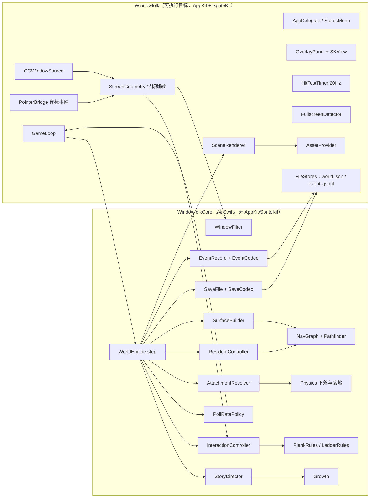
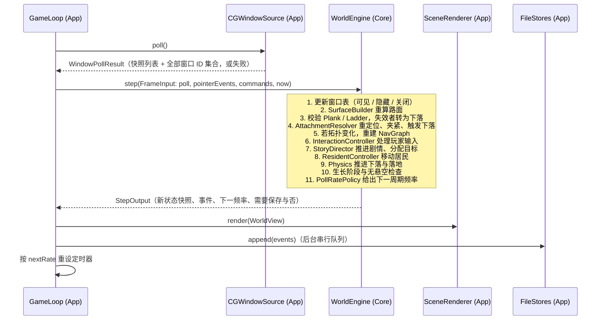
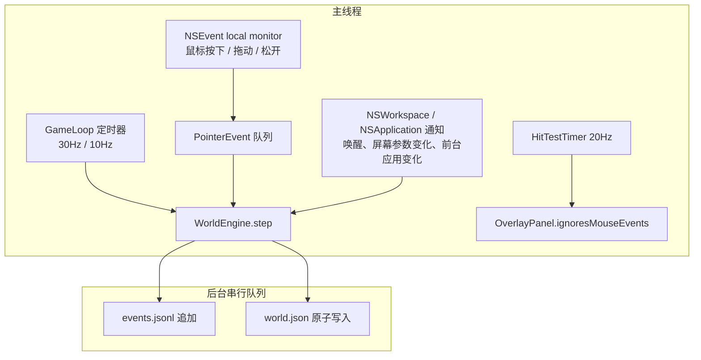
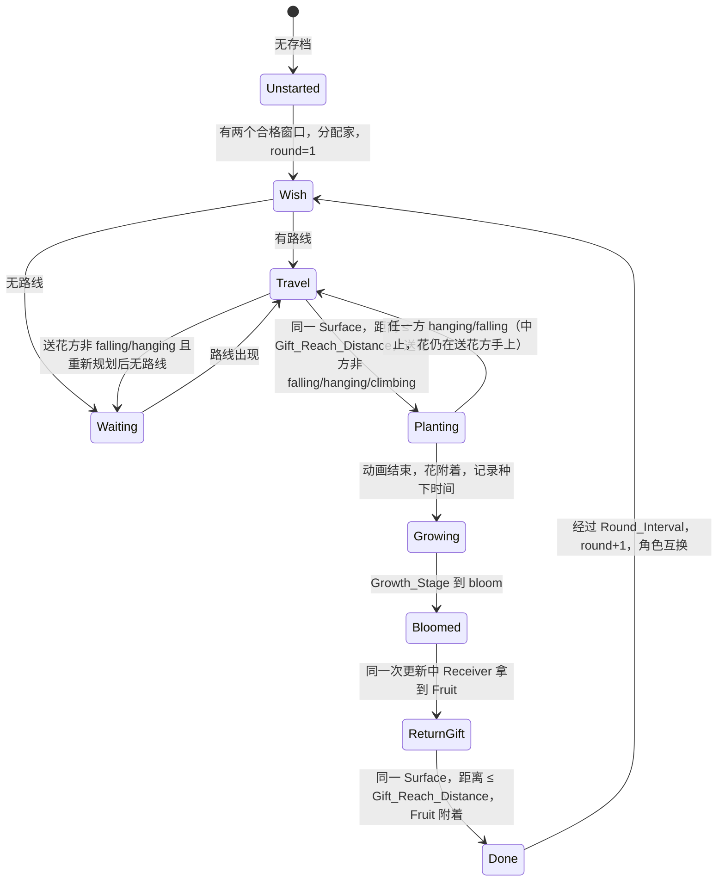

# Design Document

## Overview

本文档描述窗间 · Windowfolk v1「送花过桥」的技术设计，对应 `requirements.md` 中的 29 条需求。实现计划草案见 `docs/plan-v1.md`，本设计在其基础上把模块边界、数据结构、每帧更新顺序和测试方案定下来。

### 设计目标

- **核心逻辑可测**：地形、物理、寻路、交互判定、剧情、事件记录和存档全部放在纯 Swift 库 `WindowfolkCore` 中，用 `swift test` 验证（Requirement 27）。
- **应用层尽量薄**：`Windowfolk` 可执行目标只负责读系统窗口、坐标翻转、鼠标事件转发、SpriteKit 绘制、菜单和文件位置。
- **确定性**：同样的输入（窗口快照序列、玩家输入序列、时钟读数、随机种子）产生同样的世界状态。这让属性测试和演示复现都可靠。
- **无权限**：只用 `CGWindowListCopyWindowInfo` 读窗口 ID、所属应用、边界和层级，不读标题，不申请屏幕录制和辅助功能权限（Requirement 2.2、2.3）。

### 技术选型

| 项目 | 选择 | 说明 |
|---|---|---|
| 语言与构建 | Swift 6（语言模式 6，严格并发），SwiftPM | 不建 Xcode 工程。本机工具链为 Swift 6.3.3。 |
| 最低系统 | macOS 14 | `Package.swift` 中 `platforms: [.macOS(.v14)]`。 |
| 渲染 | SpriteKit `SKView` 铺满 Overlay | 占位图形用 `SKShapeNode` 或程序生成的 `SKTexture`。 |
| 窗口读取 | `CGWindowListCopyWindowInfo` | 参考项目 DesktopPetMac（MIT）采用同样方案。 |
| 测试框架 | Swift Testing | 工具链自带，`swift test` 直接运行。 |
| 属性测试库 | [swift-property-based](https://github.com/x-sheep/swift-property-based)（MIT，`from: "2.0.0"`） | 项目所有者已确认。见下文「属性测试库选择」。 |

### 属性测试库选择

项目所有者在三个方案中选了 swift-property-based：

- **swift-property-based**：专为 Swift 6 和 Swift Testing 设计，提供可组合的生成器、自动缩小反例、`.fixedSeed(...)` 复现。要求 Swift 6.2 及以上，本机满足。只作为测试目标的依赖，不进入 `WindowfolkCore` 和应用。
- SwiftCheck 基于 XCTest，最后一次提交在 2021 年，Swift 6 严格并发下可能需要补丁，因此未选。
- 自写生成器零依赖，但没有反例缩小，需要额外维护约 200 行基础设施，因此未选。

### 关键设计决策

- **世界更新是一个同步的 `step` 函数**：应用层每个 Game_Loop 周期把「窗口快照 + 玩家输入 + 当前时间」交给 `WorldEngine.step`，得到新的世界状态和事件列表。Core 中没有定时器、线程或 I/O，测试只要构造输入并调用 `step`。
- **一个时钟两种用途**：Story_Clock 读取墙上时间（`Date`），这样应用未运行期间花照常生长（Requirement 22.10），`Done` 的倒计时也能按保存的进入时间计算（Requirement 19.7）。物理和动画使用每帧传入的 `dt`，`dt` 由同一时钟的相邻读数相减得到并限制在 0 到 0.25 秒之间，避免睡眠唤醒后一帧跳太远。时钟回拨由 Growth_Stage 单调性兜底（Requirement 17.4）。
- **快进改数据而不改时钟**：「快进」把当前 Story_Flower 的种下时间往前挪到下一阶段的起点，或把 `Done` 进入时间往前挪 Round_Interval。时钟始终是真实时间，存档里也只存这些时间点。
- **Attachment 扩展**：需求中的 Attachment 只有「窗口 + 偏移」和「地面 + x」两种。为了表示站在木板上、爬梯子、下落和悬挂中的对象，设计中增加 `plank`、`ladder`、`free` 三种内部取值。需求中涉及 Attachment 偏移量的条款都只针对 `window` 取值。
- **交互判定在 Core**：点击和拖动的区分、木板和梯子的吸附与预览颜色、物件松手落点都由 Core 的 `InteractionController` 计算。应用层只把鼠标事件翻译成 Core 坐标下的 `PointerEvent`。
- **鼠标穿透用独立的轻量计时器**：命中检测每 50ms 读一次 `NSEvent.mouseLocation`，与上一帧缓存的命中矩形比较后切换 `ignoresMouseEvents`，满足 100ms 的切换要求（Requirement 7.4），且不受 Game_Loop 降频影响。
- **随机性可注入**：居民闲逛的停顿和转向使用注入的 `RandomSource`（带种子的 SplitMix64）。测试固定种子，应用用系统随机种子。

## Architecture

### 模块与目标



依赖方向只有 App → Core。`WindowfolkCore` 只导入 Foundation（用于 `Date`、`JSONEncoder`、`UUID`），满足 Requirement 27.2。

`Package.swift` 结构：

```swift
// swift-tools-version: 6.0
let package = Package(
  name: "Windowfolk",
  platforms: [.macOS(.v14)],
  dependencies: [
    .package(url: "https://github.com/x-sheep/swift-property-based.git", from: "2.0.0"),
  ],
  targets: [
    .target(name: "WindowfolkCore"),
    .executableTarget(name: "Windowfolk", dependencies: ["WindowfolkCore"]),
    .testTarget(name: "WindowfolkCoreTests", dependencies: [
      "WindowfolkCore",
      .product(name: "PropertyBased", package: "swift-property-based"),
    ]),
  ]
)
```

### 坐标系

- **Core 坐标**：原点在主显示器左上角，x 向右，y 向下，单位 pt。`CGWindowListCopyWindowInfo` 返回的 `kCGWindowBounds` 本来就是这个坐标系（以主显示器左上角为原点），读取时不需要翻转（Requirement 2.4）。
- **AppKit 与 SpriteKit 坐标**：原点在左下角，y 向上。
- **唯一的转换函数**：应用层 `ScreenGeometry.flipY(_ point: CGPoint) -> CGPoint`，计算 `y' = mainScreenHeight - y`。这个函数是自身的逆，因此同一个函数既用于把 `NSScreen.visibleFrame`、鼠标位置转换成 Core 坐标，也用于把 Core 坐标转换成 SpriteKit 节点位置。其他组件都不直接做 y 翻转（Requirement 2.5）。矩形转换由 `ScreenGeometry.flipRect` 包装 `flipY`，内部调用同一函数。
- SKScene 的尺寸等于 Overlay 尺寸，`anchorPoint = (0, 0)`，因此 SpriteKit 场景坐标与 Overlay 内的 AppKit 坐标一致。

### 每帧更新顺序

Game_Loop 每个周期执行一次以下流程。顺序直接对应若干需求中「同一帧」「下一帧之前」的要求。



第 5 步在第 8 步之前，满足 Requirement 12.1「在 Resident 移动更新之前重新计算」。第 3 步和第 4 步在同一次 `step` 中完成，满足 Plank、Ladder「在检测到该情况的那次世界更新中失效」（Requirement 9.9、10.8）以及无悬空不变量（Requirement 29.5、29.6）。

### 线程模型

- 应用层所有 AppKit、SpriteKit 和 `WorldEngine` 调用都在主线程（`@MainActor`）上执行。
- Core 中的值类型都声明为 `Sendable`。`WorldEngine` 是普通 `final class`，不跨线程使用，由 `@MainActor` 的 `GameLoop` 独占持有。
- 事件追加写入在一个后台串行 `DispatchQueue` 上执行，传入的是已编码好的 `Data`，失败直接丢弃（Requirement 21.11）。
- `world.json` 的自动保存在主线程编码后交给同一个后台队列原子写入。退出时同步编码并同步写入，保证 2 秒内完成（Requirement 1.9、22.1）。

### 应用层组件概览



## Components and Interfaces

以下接口用 Swift 签名表示，省略访问修饰符。Core 中的公开类型都标注 `public`。

### Core：几何基础

```swift
struct Point: Hashable, Sendable, Codable { var x: Double; var y: Double }
struct Rect: Hashable, Sendable, Codable {
  var minX: Double; var minY: Double; var width: Double; var height: Double
  var maxX: Double { minX + width }; var maxY: Double { minY + height }
}
struct Interval: Hashable, Sendable { var lo: Double; var hi: Double }   // 闭区间，lo <= hi
enum IntervalMath {
  static func subtract(_ base: Interval, _ cuts: [Interval]) -> [Interval]  // 结果按 lo 升序、互不重叠、长度 > 0
}
struct ScreenInfo: Hashable, Sendable, Codable {
  var frame: Rect          // 主显示器完整 frame（Core 坐标，原点 0,0）
  var visibleFrame: Rect   // 去掉菜单栏和 Dock 后的区域（Core 坐标）
  var groundY: Double { visibleFrame.maxY }
}
```

Core 使用自己的 `Point` 和 `Rect`，避免依赖 CoreGraphics 的类型在不同平台上的差异，也让生成器更容易编写。应用层在 `ScreenGeometry` 中和 `CGPoint`、`CGRect` 互相转换。

### Core：Window_Source 接口与窗口过滤

```swift
struct WindowSnapshot: Hashable, Sendable {
  var id: WindowID          // UInt32
  var ownerName: String
  var ownerPID: Int32
  var frame: Rect           // Core 坐标
  var zIndex: Int           // 0 为最前，数值越大越靠后
}
struct RawWindowInfo: Hashable, Sendable {   // CGWindowList 条目的纯数据版本
  var id: WindowID; var ownerName: String; var ownerPID: Int32
  var bounds: Rect; var layer: Int; var alpha: Double; var isOnScreen: Bool
}
enum WindowPollResult: Sendable {
  case success(eligible: [WindowSnapshot], existingIDs: Set<WindowID>)
  case failure
}
protocol WindowSource {
  mutating func poll() -> WindowPollResult
}
enum WindowFilter {
  /// onScreen: 按从前到后排序的屏上窗口列表；all: 含最小化和其他桌面空间的全部窗口
  static func makeResult(onScreen: [RawWindowInfo], all: [RawWindowInfo],
                         ownPID: Int32, screen: ScreenInfo, minSize: Double) -> WindowPollResult
}
```

`WindowFilter.makeResult` 是纯函数，规则如下：

- 只保留 `layer == 0`、`alpha > 0`、宽高都不小于 Min_Window_Size、`ownerPID != ownPID`、边界中心点落在 `screen.frame` 内的窗口（Requirement 2.1、2.6、1.6）。
- 保持输入顺序，`zIndex` 取过滤后的序号，因此输出按从前到后排序。
- `existingIDs` 来自 `all` 列表的全部窗口 ID（Requirement 2.7）。

`FakeWindowSource`（Core 提供，Requirement 27.3、27.4）：

```swift
struct FakeWindowSource: WindowSource {
  var windows: [FakeWindow]          // 按从前到后排列；FakeWindow 含 snapshot 字段和 isHidden 标记
  var failNextPoll: Bool
  mutating func add(_ w: WindowSnapshot)
  mutating func move(_ id: WindowID, to origin: Point)
  mutating func resize(_ id: WindowID, to size: (Double, Double))
  mutating func bringToFront(_ id: WindowID)
  mutating func sendBehind(_ id: WindowID, _ other: WindowID)
  mutating func close(_ id: WindowID)
  mutating func hide(_ id: WindowID)
  mutating func show(_ id: WindowID)
  mutating func poll() -> WindowPollResult   // 可见窗口按顺序输出并重新编号 zIndex；existingIDs 含隐藏窗口
}
```

应用层 `CGWindowSource`：

- 每次轮询调用两次 `CGWindowListCopyWindowInfo`：`[.optionOnScreenOnly, .excludeDesktopElements]` 得到屏上列表（系统按从前到后排序），`[.optionAll]` 得到全部窗口 ID。
- 只读取 `kCGWindowNumber`、`kCGWindowOwnerName`、`kCGWindowOwnerPID`、`kCGWindowBounds`、`kCGWindowLayer`、`kCGWindowAlpha`、`kCGWindowIsOnscreen`，从不读取 `kCGWindowName`（Requirement 2.2）。macOS 10.15 起读取窗口标题才需要屏幕录制权限，读取以上字段不触发授权对话框（Requirement 2.3）。
- 任一调用返回 `nil` 时返回 `.failure`（Requirement 2.8）。

### Core：WindowTable（区分关闭和隐藏）

```swift
struct WindowRecord: Sendable {
  var snapshot: WindowSnapshot          // 最近一次可见时的快照
  var visibility: Visibility            // .visible / .hidden
}
struct WindowTable: Sendable {
  var records: [WindowID: WindowRecord]
  /// 返回本次的变化：新出现、移动/缩放/层级变化、变为隐藏、重新显示、关闭
  mutating func apply(_ result: WindowPollResult) -> WindowChanges
}
```

- `.failure`：不改动任何记录，`WindowChanges` 为空（Requirement 2.8）。
- 已记录的窗口出现在 `eligible` 中：标记为 `visible`，更新快照。
- 已记录的窗口不在 `eligible` 中但在 `existingIDs` 中：标记为 `hidden`，保留最后一次可见快照（Requirement 5.2、5.8）。
- 已记录的窗口不在 `existingIDs` 中：判为 Closed_Window，删除记录并在 `WindowChanges.closed` 中报告，附带最后一次可见快照，用于 Requirement 5.8 的重新出现位置。
- 窗口被移出主显示器（中心点越界）时会从 `eligible` 中消失但仍在 `existingIDs` 中，因此按隐藏处理。此时窗口在屏幕上其实看得到（在副显示器上），这是只支持主显示器带来的取舍：附着的对象随窗口一起隐藏，窗口移回主显示器时一起回来。

### Core：SurfaceBuilder

```swift
enum SurfaceID: Hashable, Sendable, Comparable {
  case ground
  case ledge(WindowID, index: Int)   // 同一窗口的各段按 minX 升序编号
  case plank(PlankID)
}
struct Surface: Hashable, Sendable {
  var id: SurfaceID
  var start: Point                    // 左端点
  var end: Point                      // 右端点；Window_Ledge 和 Ground 的 start.y == end.y
  func y(atX x: Double) -> Double     // 线性插值，Plank 可能倾斜
  var xRange: Interval { Interval(lo: start.x, hi: end.x) }
}
enum SurfaceBuilder {
  static func ledges(for windows: [WindowSnapshot]) -> [Surface]
  static func ground(screen: ScreenInfo) -> Surface
  static func build(windows: [WindowSnapshot], planks: [PlacedPlank], screen: ScreenInfo) -> [Surface]
}
```

算法（Requirement 3.1 至 3.8）：

1. 对每个窗口 `w`，上沿 `y = w.frame.minY`，区间 `[w.frame.minX, w.frame.maxX]`。
2. 收集所有 `zIndex < w.zIndex` 且满足 `f.minY <= y <= f.maxY` 的窗口 `f` 的 `[f.minX, f.maxX]`。
3. `IntervalMath.subtract` 得到剩余区间，丢弃长度为 0 的区间，按 `lo` 升序编号为 `.ledge(w.id, index)`。
4. 追加一条 Ground，`y = visibleFrame.maxY`，x 范围为 `visibleFrame` 左右边界。
5. 追加每块已架设 Plank 的 Surface。

输入只来自当前可见的 Eligible_Window，因此 Hidden_Window、Closed_Window 和本应用窗口都不参与遮挡（Requirement 3.3）。结果按 `SurfaceID` 排序输出，同一输入总得到同一数组（Requirement 3.10）。

### Core：Attachment 与 AttachmentResolver

```swift
enum Attachment: Hashable, Sendable, Codable {
  case window(WindowID, offset: Double)     // 相对窗口左边缘的水平偏移
  case ground(x: Double)
  case plank(PlankID, t: Double)            // 0...1，沿木板从左端到右端的比例
  case ladder(LadderID, height: Double)     // 距梯子下端的竖直距离
  case free(Point)                          // 下落、悬挂、被拖动中
}
enum AttachmentResolver {
  static func screenPosition(_ a: Attachment, windows: WindowTable, planks: PlankStore,
                             ladders: LadderStore, screen: ScreenInfo) -> Point?
  /// 偏移量落在剩余窗沿外时，夹紧到同一窗口水平距离最近的窗沿上的最近点；没有剩余窗沿时返回 nil（应下落）
  static func clamp(offset: Double, window: WindowSnapshot, ledges: [Surface]) -> Double?
}
```

- 窗口可见时，`window` 取值的屏幕坐标为 `(frame.minX + offset, frame.minY)`（Requirement 4.4）。窗口平移不改写 offset（Requirement 4.5）。
- 窗口隐藏时 `screenPosition` 返回 `nil`，渲染层不绘制，ResidentController 跳过该居民（Requirement 5.2、5.3）。
- `ground` 取值的屏幕坐标为 `(x, groundY)`，与窗口无关。

### Core：PlankRules 与 LadderRules

```swift
struct PlankEnd: Hashable, Sendable { var window: WindowID; var offset: Double }
enum PlankValidity: Equatable, Sendable { case valid; case tooFar; case tooSteep; case missingLedge; case sameWindow }
enum PlankRules {
  /// 拖动时的吸附：返回两端吸附点，或 nil（少于两个不同窗口的窗沿）
  static func snap(pointer: Point, ledges: [Surface]) -> (Point, Point, WindowID, WindowID)?
  /// 唯一的有效性判定，预览颜色与架设后的失效检测共用（Requirement 9.12）
  static func validity(endA: Point, windowA: WindowID, endB: Point, windowB: WindowID,
                       ledges: [Surface], constants: Tunables) -> PlankValidity
}
enum LadderRules {
  static func snapTop(pointer: Point, ledges: [Surface]) -> (Point, SurfaceID)?
  static func bottom(below top: Point, surfaces: [Surface]) -> (Point, SurfaceID)?
  static func validity(top: Point, bottom: Point?, constants: Tunables) -> LadderValidity  // 0 < 竖直距离 <= Ladder_Length
}
```

`PlankRules.snap`：对每条 Window_Ledge 求离指针最近的点和距离，取距离最小的一条为第一端，再在其余属于其他窗口的窗沿中取最近的一条为第二端（Requirement 9.1、9.2）。距离相等时按 `SurfaceID` 顺序取前者，保证确定性。

`PlankRules.validity` 判定为 `valid` 当且仅当：两端所在窗口不同；每端都位于对应窗口某条现存 Window_Ledge 的 x 范围内且 y 等于该窗沿 y；`|xA - xB| <= Plank_Max_Span`；`|yA - yB| <= Plank_Max_Rise`（Requirement 9.3、9.4、9.9、9.12）。

### Core：NavGraph 与 Pathfinder

```swift
enum EdgeKind: Hashable, Sendable { case walk, smallJump, drop, plank, ladder(LadderID) }
struct NavEdge: Hashable, Sendable {
  var from: SurfaceID; var to: SurfaceID; var kind: EdgeKind
  var exit: Point      // 在 from 上离开的点
  var entry: Point     // 到达 to 上的点
  var cost: Double
}
struct NavGraph: Sendable {
  var nodes: [SurfaceID: Surface]
  var edges: [SurfaceID: [NavEdge]]
  static func build(surfaces: [Surface], ladders: [PlacedLadder], constants: Tunables) -> NavGraph
  func route(from: SurfaceID, at x: Double, to: SurfaceID, targetX: Double) -> Route?
  func contains(_ edge: NavEdge) -> Bool
}
struct Route: Hashable, Sendable { var steps: [NavEdge]; var targetSurface: SurfaceID; var targetX: Double }
```

建边规则（Requirement 12.2 至 12.6）：

| 边 | 条件 | 方向 |
|---|---|---|
| walk | 两条 Surface 相邻端点 y 相同、水平间隙为 0 | 双向 |
| smallJump | 相邻端点高差在 (0, Small_Jump_Max_Rise]，水平间隙 ≤ Small_Jump_Max_Gap | 双向 |
| drop | 较高 Surface 的端点 x 落在较低 Surface 范围内，较低者是该端点正下方最近的 Surface，高差在 (0, Drop_Max_Height] | 高 → 低 |
| plank | Plank Surface 与两端所在 Window_Ledge | 双向 |
| ladder | 梯子下端所在 Surface 与上端所在 Window_Ledge | 双向 |

- 「相邻端点」指一条 Surface 的右端点与另一条的左端点（或反之），间隙为两端点 x 差的绝对值。
- 隐藏窗口的窗沿不在输入 Surface 中；端点附着在隐藏窗口上的 Plank 和 Ladder 也不传入，因此 Nav_Graph 自动排除它们（Requirement 5.5）。
- 寻路用 Dijkstra。代价为同一 Surface 上的行走距离加上每条边的固定代价（walk 0，smallJump 8，drop 12，plank 为木板长度，ladder 为竖直距离）。同代价时按 `SurfaceID` 顺序选取，保证确定性。图规模很小（一般少于 50 个节点），每次重建和寻路的开销可以忽略。
- `NavGraph` 记录一个 `topologyHash`（节点几何加边集合的哈希）。`WorldEngine` 只在哈希变化时重建并校验居民路线（Requirement 12.1、12.9）。

### Core：Physics

```swift
struct FallState: Hashable, Sendable, Codable { var position: Point; var velocityY: Double }
enum Physics {
  /// 推进一帧下落；返回落地的 Surface 或 nil
  static func advance(_ s: inout FallState, dt: Double, surfaces: [Surface], gravity: Double) -> Surface?
}
```

- 下落只改变 y，x 在开始下落时夹紧到主显示器宽度范围内后保持不变（Requirement 6.3、6.7）。
- 重力加速度 `Fall_Gravity` 取 2000 pt/s²。从屏幕顶边落到 Ground 的时间为 `sqrt(2H / g)`，H = 2000pt 时约 1.41 秒，H = 3000pt 时约 1.73 秒，满足 2 秒上限（Requirement 6.4）。`Fall_Gravity` 加入 Tunable_Constant，测试中断言 `sqrt(2 * screen.frame.height / g) <= 2`。
- 落地检测用扫掠：本帧底边从 `y0` 移动到 `y1`，在水平范围包含 x 且 `y0 < surface.y(atX:x) <= y1` 的 Surface 中取 y 最小（最高）的一条（Requirement 6.5）。Ground 横跨 `visibleFrame` 宽度，且 x 已被夹紧，所以一定会被扫到（Requirement 6.7）。下落起点已经在某条 Surface 上（y 相等）时，该 Surface 不算落点，避免原地落地。

### Core：ResidentController

```swift
enum ResidentState: String, Sendable, Codable, CaseIterable {
  case idle, walking, carrying, waiting, falling, hanging, climbing, planting, celebrating
}
enum ResidentID: String, Sendable, Codable, CaseIterable { case a = "resident_a", b = "resident_b" }   // a：都都，b：嘟嘟
enum Goal: Hashable, Sendable {
  case none                                         // 在当前 Surface 内闲逛
  case confined                                     // 剧情要求：只在当前 Surface 内 idle / walking
  case reach(ResidentID)                            // 每帧追踪另一位居民的当前位置
}
struct Resident: Sendable {
  var id: ResidentID
  var state: ResidentState
  var attachment: Attachment
  var facing: Facing                                // .left / .right
  var goal: Goal
  var route: Route?
  var traversal: Traversal?                         // 正在执行的小跳 / 往下跳 / 爬梯动画
  var heldItem: ItemID?
  var hangElapsed: Double                           // hanging 状态已累计时长
  var poke: PokeState?                              // 「?」气泡剩余时间与跳跃进度
  var bubble: Bubble?                               // 剧情气泡（图标，不含文字）
  var wander: WanderState                           // 闲逛停顿计时、地面等待中心
}
enum ResidentController {
  static func update(_ r: inout Resident, world: WorldContext, dt: Double, rng: inout RandomSource) -> [WorldEvent]
}
```

行为要点：

- **状态显示规则**：沿路线水平移动时，持有 Item 为 `carrying`，否则为 `walking`；在梯子上为 `climbing`（Requirement 12.7、14.1）。小跳和往下跳期间保持 `walking` 或 `carrying`，用 `traversal` 表示抛物线动画，不进入 `falling`。
- **速度**：`Walk_Speed` 40 pt/s，`Carry_Speed_Ratio` 0.7，`Climb_Speed` 30 pt/s。两者都是 Tunable_Constant；测试断言 `0 < Carry_Speed_Ratio <= 0.8`（Requirement 14.2）。
- **闲逛**：`Goal.none` 和 `Goal.confined` 下，居民在当前 Surface 上随机走走停停，走到端点就掉头，不使用任何 Nav_Graph 边（Requirement 12.13、16.8、18.3、18.9）。
- **追踪目标**：`Goal.reach(other)` 每帧把目标更新为对方当前的 Surface 和 x（Requirement 16.6、18.5、20.4）。只有目标 Surface 变化或现有路线失效时才重新寻路；同一 Surface 上目标 x 变化只更新 `route.targetX`。
- **路线失效**：Nav_Graph 重建后，剩余步骤中的任一边不再存在时，下一帧从当前位置重新寻路（Requirement 12.9）。正在执行的 `traversal` 会先完成，因为它不依赖图中的边。
- **等待**：寻路失败且不在 Ground 上时进入 `waiting`，原地朝向目标并显示「...」气泡（Requirement 12.10）。在 Ground 上时进入 `waiting`，先走到 Ground 上离目标 x 最近的点，记为 `wander.groundCenter`，再在 `[center - Ground_Wander_Range, center + Ground_Wander_Range]` 内来回走动并抬头张望（Requirement 6.9）。每帧重新检查可达性，可达后下一帧离开 `waiting`（Requirement 6.10、12.11）。
- **戳**：点击 `idle`、`walking`、`carrying`、`waiting` 状态的居民时，`poke` 记录一次 0.4 秒、最高 12pt 的原地跳跃和 1.5 秒「?」气泡。跳跃只是渲染层的 y 偏移，Attachment、状态、路线和剧情都不变；跳跃期间居民暂停移动，结束后继续（Requirement 7.6、7.7）。其他状态只显示气泡（Requirement 7.8）。跳跃或气泡未结束时再点只重置气泡时间（Requirement 7.9）。
- **悬挂与下落**：见下文「失效处理顺序」。

### Core：Items、Planks、Ladders

```swift
enum ItemKind: Sendable, Codable { case flower(storyRound: Int?), fruit }
struct Item: Sendable {
  var id: ItemID                          // UUID
  var kind: ItemKind
  var placement: ItemPlacement            // .attached(Attachment) / .held(ResidentID) / .falling(FallState) / .dragged(grabOffset)
  var growth: FlowerGrowth?               // 仅 Flower 有
}
struct FlowerGrowth: Sendable, Codable {
  var plantedAt: Date?                    // nil 表示还没种下（抱在手上）
  var reached: GrowthStage                // 已达到的最高阶段
}
struct PlacedPlank: Sendable { var id: PlankID; var endA: PlankEnd; var endB: PlankEnd }
struct PlacedLadder: Sendable { var id: LadderID; var top: PlankEnd; var bottomSurface: SurfaceID; var bottom: Point }
enum PlankState: Sendable { case placed(PlacedPlank), loose(Attachment), falling(FallState), dragged }
enum LadderState: Sendable { case placed(PlacedLadder), loose(Attachment), falling(FallState), dragged }
```

- 落下的 Plank 和 Ladder（`loose`）按中心点 x 正下方第一条 Surface 落位，可以落在窗沿上（附着在该窗口）或 Ground 上（成为 Ground_Object）（Requirement 9.8、10.6）。
- 落下的 Plank 和 Ladder 不进入 Nav_Graph。
- 架设的 Ladder 每帧按上端位置重新计算下端（Requirement 10.7）。

### Core：InteractionController

```swift
enum PointerEvent: Sendable { case down(Point), moved(Point), up(Point) }
enum DragSubject: Sendable { case newPlank, newLadder, plank(PlankID), ladder(LadderID), item(ItemID) }
enum Gesture: Sendable {
  case none
  case pressed(on: HitTarget, at: Point)          // 尚未超过 Click_Drag_Threshold
  case dragging(DragSubject, grabOffset: Point, pointer: Point)
  case swallowed                                  // 在居民身上拖动：吞掉事件，不做任何事
}
struct Preview: Sendable { var subject: DragSubject; var geometry: PreviewGeometry; var isValid: Bool }
enum InteractionController {
  static func hitTest(_ p: Point, world: WorldView) -> HitTarget?
  static func handle(_ e: PointerEvent, gesture: inout Gesture, world: inout WorldState, constants: Tunables) -> [WorldEvent]
  static func preview(gesture: Gesture, world: WorldState) -> Preview?
}
```

- **命中区域**：每个对象当前帧图形的外接矩形，尺寸来自 `SpriteMetrics`（与 `docs/art-spec.md` 中的尺寸一致）（Requirement 7.1）。命中优先级：Resident > Item > Plank / Ladder > Toolbox。
- **点击与拖动**：按下后指针移动距离 ≤ Click_Drag_Threshold 时松开算点击，超过即进入拖动（Requirement 7.5、8.5、8.6、8.8、11.1）。
- **对象**：按下在 Toolbox 的 Plank 区或 Ladder 区，拖动后新建对象；按下在 Ground_Object 或窗沿上的落下物件，拖动后拖起该对象；按下在居民身上，拖动后进入 `swallowed`（Requirement 7.11）。被居民持有的 Item 不可拖（Requirement 11.8），拖动中的 Item 不可被居民拿起（Requirement 11.9）。
- **松手**：Plank 和 Ladder 按预览有效性架设或下落（Requirement 9.5、9.8、10.5、10.6、11.7）。Item 先把 x 夹紧到屏幕宽度，再在松开点正下方 `(0, Drop_Snap_Distance]` 内找竖直距离最小的 Window_Ledge；找到就附着，否则自由下落（Requirement 11.3 至 11.6）。
- **Toolbox 位置**：`ToolboxLayout.frame(screen:)` 让底边与 Ground 对齐、右边距 8pt，每帧按当前 `visibleFrame` 计算（Requirement 8.1、8.4）。

### Core：StoryDirector

```swift
enum StoryStage: String, Sendable, Codable { case wish, waiting, travel, planting, growing, bloomed, returnGift, done }
struct StoryState: Sendable, Codable {
  var stage: StoryStage?                  // nil：未开局（窗口不足时两人在地面活动）
  var round: Int                          // >= 1
  var homes: [ResidentID: WindowID]
  var currentFlower: ItemID?
  var currentFruit: ItemID?
  var plantingElapsed: Double
  var doneAt: Date?
}
enum StoryDirector {
  static func giver(round: Int) -> ResidentID      // 奇数轮 Resident_A，偶数轮 Resident_B
  static func receiver(round: Int) -> ResidentID
  static func selectHomes(windows: [WindowSnapshot], ledges: [Surface], minSize: Double) -> (a: WindowID, b: WindowID)?
  static func update(_ s: inout StoryState, world: inout WorldState, nav: NavGraph, now: Date, dt: Double) -> [WorldEvent]
  static func fastForward(_ s: inout StoryState, world: inout WorldState, now: Date)
  static func restart(_ s: inout StoryState, world: inout WorldState)
}
```

剧情状态转换（Requirement 15 至 20）：



- **家的选择**（Requirement 15.1 至 15.3）：候选为面积 ≥ Min_Window_Size² 且至少有一段 Window_Ledge 的 Eligible_Window。在所有无序对中取水平中心距离最大者；并列时取 `zIndex` 之和最小者；仍并列时按窗口 ID 字典序，保证确定性。中心 x 较小者归 Resident_A。
- **目标分配**：`Wish`、`Waiting`、`Travel` 阶段 Giver 的 Goal 为 `reach(receiver)`，Receiver 为 `confined`；`ReturnGift` 阶段反过来；`Growing`、`Bloomed`、`Done` 阶段两人都是 `confined`；未开局时两人为 `none`。
- **送达判定**：两人站在同一 `SurfaceID` 上，且屏幕 x 差的绝对值 ≤ Gift_Reach_Distance。
- **种花计时**：`plantingElapsed` 只在两人所在窗口都可见时累加（Requirement 16.14）。
- **花数上限**：种下新花后，若场上 Story_Flower 超过 Max_Story_Flowers，移除 `plantedAt` 最早的一朵（Requirement 19.4）。
- **重新开始**：删除全部 Flower 和 Fruit（含居民持有的），保留 Plank 和 Ladder，`round = 1`，`stage = nil`，清空 homes，随后在同一帧尝试开局（Requirement 20.6）。

### Core：Growth

```swift
enum GrowthStage: Int, Sendable, Codable, Comparable { case pot = 0, sprout = 1, bloom = 2 }
enum Growth {
  static func stage(elapsed: Double, bloomDuration: Double) -> GrowthStage
  static func advance(_ g: inout FlowerGrowth, now: Date, bloomDuration: Double) -> GrowthStage?  // 返回新进入的阶段
  static func fastForward(_ g: inout FlowerGrowth, now: Date, bloomDuration: Double)
}
```

- `stage`：`elapsed < 0.5B` 为 pot，`0.5B <= elapsed < B` 为 sprout，`elapsed >= B` 为 bloom（Requirement 17.1）。
- `advance`：`reached = max(reached, stage(now - plantedAt))`，时钟回拨时不倒退（Requirement 17.4）。
- `fastForward`：`pot` 时把 `plantedAt` 设为 `now - 0.5B`；`sprout` 时设为 `now - B`；然后调用 `advance`（Requirement 17.5）。
- 生长计算不看花在哪里，窗沿、Ground、Plank、隐藏窗口上都一样（Requirement 17.3）。

### Core：PollRatePolicy

```swift
struct ActivitySample: Sendable { var time: Double; var windowsChanged: Bool; var residentsChanged: Bool; var dragging: Bool }
struct PollRatePolicy: Sendable {
  var quietSince: Double?
  mutating func next(after sample: ActivitySample) -> PollRate     // .active(30) / .idle(10)
}
```

规则（Requirement 24.1 至 24.6）：启动为 active；任一样本 `windowsChanged`、`residentsChanged` 或 `dragging` 为真时立即回到 active 并清空 `quietSince`；连续安静满 2 秒后切到 idle。`residentsChanged` 由 `WorldEngine` 比较前后两帧每位居民的状态和屏幕位置得到，居民进入 `walking`、`carrying`、`falling`、`hanging`、`climbing` 时位置必然在变，因此一定为真。

### Core：EventRecord 与 EventCodec

```swift
enum EventType: String, Sendable, Codable, CaseIterable {
  case crossedBridge = "crossed_bridge", climbedLadder = "climbed_ladder", fell, landed
  case waitingStarted = "waiting_started", roundStarted = "round_started", planted, sprouted, bloomed
  case giftDelivered = "gift_delivered", plankPlaced = "plank_placed", plankDropped = "plank_dropped"
  case ladderPlaced = "ladder_placed", ladderDropped = "ladder_dropped"
}
struct EventRecord: Hashable, Sendable {
  var time: Date            // 写入时截断到整秒
  var type: EventType
  var actor: String?        // "resident_a" / "resident_b" / "player" / nil
  var target: String?
  var detail: [String: String]
}
enum EventCodec {
  static func encodeLine(_ r: EventRecord, timeZone: TimeZone) -> Data   // 一行 JSON + "\n"
  static func decodeLine(_ d: Data) throws -> EventRecord
}
protocol EventSink { func append(_ line: Data) }   // 应用层实现为文件追加；测试实现为内存数组或临时文件
```

- 五个字段固定输出，`actor` 和 `target` 为 nil 时显式写 `null`（自定义 `encode(to:)` 用 `encodeNil`）（Requirement 21.3、21.6、21.7）。
- `time` 用 `ISO8601DateFormatter`，格式选项 `[.withInternetDateTime]`，按本机时区输出，如 `2026-10-20T21:05:33+08:00`（Requirement 21.4）。
- `JSONEncoder` 会把字符串中的换行编码为 `\n`，因此一条记录总是一行（Requirement 21.1、21.9）。
- 涉及窗口的事件 `target` 写 `app:<ownerName>`。`WindowSnapshot` 中根本没有标题字段，所以不可能写入标题（Requirement 21.8）。
- 事件和触发点的对应：`crossed_bridge` 在居民走完一条 plank 边时；`climbed_ladder` 在走完 ladder 边时；`fell` 在进入 `falling` 时；`landed` 在落地时；`waiting_started` 在进入 `waiting` 时；`round_started` 在每轮进入 `Wish` 时；`planted` 在进入 `Growing` 时；`sprouted`、`bloomed` 在 Story_Flower 进入对应阶段时；`gift_delivered` 在 Fruit 送达时；`plank_placed` 和 `ladder_placed` 在架设成功时；`plank_dropped` 和 `ladder_dropped` 在失效或红色松手时。

### Core：SaveFile 与 SaveCodec

```swift
enum SaveCodec {
  static let currentVersion = 1
  static func encode(_ s: SaveFile) throws -> Data
  static func decode(_ d: Data) throws -> SaveFile          // 版本号不匹配抛 .versionMismatch
  static func snapshot(world: WorldState, story: StoryState, screen: ScreenInfo) -> SaveFile
  static func restore(_ s: SaveFile, into world: inout WorldState, story: inout StoryState, screen: ScreenInfo)
}
protocol SaveStore {
  func load() -> Result<Data, SaveStoreError>      // .notFound / .ioError
  func write(_ d: Data) throws                      // 原子写入
  func backupCorrupt(now: Date) throws               // 重命名为 world.corrupt-yyyyMMdd-HHmmss.json
}
```

- `snapshot` 把窗沿、Plank 上的 Item 以及全部 Plank、Ladder 归一为 Ground_Object（Requirement 22.4）。Plank 取两端中点 x，Ladder 取下端 x；附着在隐藏窗口上的物件用该窗口最后一次可见的快照计算 x。被居民持有的 Item 记在居民名下（Requirement 22.8）。
- `restore` 把每个 Ground_Object 设为从 `y = -spriteHeight` 开始的 `falling`，x 夹紧到屏幕宽度（Requirement 22.6）；每位居民设为从屏幕上方开始下落，x 取离保存 x 最近的 Window_Ledge 上的最近点，没有窗沿时取保存 x（Requirement 22.7）。
- 应用层 `FileSaveStore.write` 使用 `Data.write(to:options: .atomic)`，先写临时文件再替换，失败时原文件不变（Requirement 1.10、22.5）。

### Core：WorldEngine

```swift
struct FrameInput: Sendable {
  var poll: WindowPollResult
  var screen: ScreenInfo
  var pointer: [PointerEvent]
  var commands: [Command]          // 菜单命令：toggleSurfaces、debugSeek、debugGiveFlower、fastForward、restartStory
  var now: Date
}
struct StepOutput: Sendable {
  var view: WorldView              // 给渲染和命中检测用的只读快照
  var events: [EventRecord]
  var nextRate: PollRate
}
final class WorldEngine {
  init(constants: Tunables, clockStart: Date, rng: RandomSource, restored: SaveFile?)
  func step(_ input: FrameInput) -> StepOutput
  func makeSave() -> SaveFile
  func invariantViolations() -> [String]     // 测试用：无悬空不变量检查
}
```

#### 失效处理顺序（一次 step 内）

1. `WindowTable.apply` 得到可见、隐藏、关闭三类变化。
2. 对关闭的窗口，先用最后可见快照把附着对象换算成屏幕坐标，转为 `free` 再开始下落（Requirement 5.1、5.8）。
3. `SurfaceBuilder` 重算 Window_Ledge 和 Ground。
4. 对每块架设的 Plank 用 `PlankRules.validity` 校验；失效的 Plank 转为下落，站在它上面的居民（`attachment == .plank`）转为 `hanging`，`free` 到当前屏幕坐标，`hangElapsed = 0`（Requirement 9.9、13.1、13.6）。木板上未被持有的 Item 随即下落。
5. 对每架 Ladder 校验，失效的转为下落；`climbing` 中的居民直接 `falling`（Requirement 10.8、13.5）。
6. 对附着在可见窗口上的居民和 Item 执行 `AttachmentResolver.clamp`；没有剩余窗沿时转为下落（Requirement 4.6、4.7、29.6）。
7. 重建 Plank Surface 和 Nav_Graph（拓扑哈希变化时）。

这个顺序保证同一 step 结束时，所有不在 `falling` 或 `hanging` 的对象都有支撑（Requirement 29.5）。

### 应用层组件

- **AppDelegate**：`NSApp.setActivationPolicy(.accessory)`，Info.plist 中 `LSUIElement = YES`，没有 Dock 图标，也不出现在 Command-Tab 中（Requirement 1.1）。`applicationShouldTerminate` 中同步保存后返回 `.terminateNow`（Requirement 1.9）。
- **StatusMenu**：`NSStatusItem` 菜单依次为「显示路面」（`state` 为 on 或 off，默认 off）、「调试」子菜单（「让都都去找嘟嘟」「给都都一个花盆」「快进」「重新开始剧情」）、「退出」（Requirement 1.7、1.8、26.1）。
- **OverlayPanel**：`NSPanel` 子类，`styleMask = [.borderless, .nonactivatingPanel]`，`canBecomeKey` 和 `canBecomeMain` 返回 false，`isOpaque = false`，`backgroundColor = .clear`，`hasShadow = false`，`level = .floating`，`collectionBehavior = [.canJoinAllSpaces, .stationary, .ignoresCycle]`，frame 等于主显示器 `NSScreen.screens.first` 的 `frame`（不用 `NSScreen.main`，它指的是当前 key window 所在的屏幕）（Requirement 1.2 至 1.5）。`SKView.allowsTransparency = true`，场景 `backgroundColor = .clear`。
- **HitTestTimer**：每 50ms 读取 `NSEvent.mouseLocation`，用 `ScreenGeometry.flipY` 转为 Core 坐标，与 `WorldView.hitRects` 比较；命中且世界未隐藏时 `ignoresMouseEvents = false`，否则为 true（Requirement 7.2 至 7.4、23.2）。拖动进行中保持接收。
- **PointerBridge**：在 SKView 上接收 `mouseDown`、`mouseDragged`、`mouseUp`，转换坐标后加入下一帧的 `PointerEvent` 队列。Overlay 接收事件时这些事件不会传给下方应用（Requirement 7.3、7.11）。
- **GameLoop**：主线程 `Timer`（加入 `.common` run loop 模式，菜单打开时也继续运行），间隔按 `nextRate` 调整。SKView 设 `preferredFramesPerSecond` 与当前频率一致，并在 `nextRate` 为 idle 且画面不变时把 `isPaused` 设为 true，以满足 Idle_CPU_Budget（Requirement 29.1）。
- **FullscreenDetector**：监听 `NSWorkspace.didActivateApplicationNotification` 和 `activeSpaceDidChangeNotification`，并在每次轮询后检查：前台应用（`NSWorkspace.shared.frontmostApplication` 的 pid）是否有 Eligible_Window 的边界等于主显示器完整 frame，或屏上列表中除前台应用和系统进程之外没有其他 layer 0 窗口（全屏桌面空间的特征）。判为全屏时隐藏 SKView 根节点并保持 `ignoresMouseEvents = true`（Requirement 23.1 至 23.4）。世界照常更新，此时其他窗口都不在屏上，会被判为 Hidden_Window，附着在上面的对象自然暂停。
- **ScreenObserver**：监听 `NSWorkspace.didWakeNotification` 和 `NSApplication.didChangeScreenParametersNotification`，重设 Overlay frame，下一帧以新的 `ScreenInfo` 调用 `step`；`WorldEngine` 检测到 `ScreenInfo` 变化时把 Ground 上的对象夹紧到新的 Ground 范围内（Requirement 23.5 至 23.8）。
- **SceneRenderer**：按 `WorldView` 增量更新 `SKSpriteNode`（以对象 ID 为键复用节点）。「显示路面」打开时用 `SKShapeNode` 绘制 Surface，窗沿蓝色、Ground 棕色、Plank 橙色（Requirement 3.11 至 3.13）。
- **AssetProvider**：见 Data Models 中的素材清单。
- **FileStores**：`FileSaveStore` 和 `FileEventSink`，根目录默认 `~/Library/Application Support/Windowfolk/`，构造时可传入其他目录（Requirement 27.6）。`FileEventSink` 每次追加时打开 `FileHandle(forWritingTo:)`，`seekToEnd` 后写入；目录或文件不存在时先创建（Requirement 21.10）。

## Data Models

### Tunable_Constant

```swift
struct Tunables: Sendable, Codable {
  var minWindowSize = 120.0
  var smallJumpMaxRise = 24.0, smallJumpMaxGap = 16.0
  var dropMaxHeight = 120.0
  var plankMaxSpan = 160.0, plankMaxRise = 40.0
  var ladderLength = 200.0
  var hangDuration = 1.5
  var bloomDuration = 180.0
  var activePollRate = 30.0, idlePollRate = 10.0
  var autosaveInterval = 30.0
  var giftReachDistance = 32.0
  var roundInterval = 120.0
  var maxStoryFlowers = 5
  var clickDragThreshold = 4.0
  var dropSnapDistance = 24.0
  var groundWanderRange = 40.0
  var plantAnimationDuration = 2.0
  // 设计新增
  var fallGravity = 2000.0
  var walkSpeed = 40.0, carrySpeedRatio = 0.7, climbSpeed = 30.0
  var pokeJumpHeight = 12.0, pokeJumpDuration = 0.4, pokeBubbleDuration = 1.5
}
```

Idle_CPU_Budget 是验收指标，不放进代码常量。

### WorldState

```swift
struct WorldState: Sendable {
  var screen: ScreenInfo
  var windows: WindowTable
  var surfaces: [Surface]
  var residents: [ResidentID: Resident]
  var items: [ItemID: Item]
  var planks: [PlankID: PlankState]
  var ladders: [LadderID: LadderState]
  var story: StoryState
  var gesture: Gesture
  var showSurfaces: Bool
  var lastSaveAt: Date
}
```

### world.json（格式版本 1）

```json
{
  "version": 1,
  "savedAt": 1792500000.0,
  "story": {
    "stage": "growing",
    "round": 1,
    "doneAt": null
  },
  "residents": [
    { "id": "resident_a", "x": 412.0, "heldItem": null },
    { "id": "resident_b", "x": 1180.5, "heldItem": { "id": "6F1C…", "kind": "fruit" } }
  ],
  "groundObjects": [
    { "id": "A1B2…", "kind": "flower", "x": 1175.0,
      "flower": { "storyRound": 1, "plantedAt": 1792499900.0, "reached": "pot" } },
    { "id": "C3D4…", "kind": "plank", "x": 800.0 },
    { "id": "E5F6…", "kind": "ladder", "x": 640.0 }
  ]
}
```

```swift
struct SaveFile: Hashable, Sendable, Codable {
  var version: Int
  var savedAt: Date
  var story: SavedStory                  // stage: StoryStage?, round: Int, doneAt: Date?
  var residents: [SavedResident]         // 按 ResidentID 排序
  var groundObjects: [SavedObject]       // 按 id 排序
}
struct SavedResident: Hashable, Sendable, Codable { var id: ResidentID; var x: Double; var heldItem: SavedHeldItem? }
struct SavedObject: Hashable, Sendable, Codable {
  var id: String; var kind: SavedObjectKind; var x: Double; var flower: FlowerGrowth?
}
```

- 日期用 `JSONEncoder.dateEncodingStrategy = .secondsSince1970`（Double），保证往返时精确相等（Requirement 22.13）。
- `story.stage` 为 `null` 表示未开局（Requirement 22.3）。
- Home_Window 的窗口 ID 不保存，因为重启后窗口 ID 会变；家的概念只在开局时用于落位，之后剧情只依赖居民当前位置。
- 剧情处于 `planting` 时保存为 `travel`，花仍在 Giver 手上；处于 `bloomed` 时保存为 `returnGift` 并带上 Fruit。这两个阶段持续时间都很短，这样恢复时不需要动画中间状态。
- `currentFlower` 和 `currentFruit` 通过 `SavedObject.flower.storyRound == story.round` 或居民持有的 Item 恢复。

### events.jsonl 示例

```json
{"actor":"resident_a","detail":{"from":"app:Safari","to":"app:Notes"},"target":"plank:C3D4","time":"2026-10-20T21:05:33+08:00","type":"crossed_bridge"}
{"actor":null,"detail":{},"target":"flower:A1B2","time":"2026-10-20T21:08:33+08:00","type":"bloomed"}
```

键使用 `.sortedKeys` 输出，便于比对；字段集合固定为五个。

### 素材清单与占位图形

| 素材键 | 尺寸（pt） | 帧数 | 占位图形 |
|---|---|---|---|
| `resident_a_<state>` × 9 | 32×32 | idle 4、walking 6、carrying 6、waiting 4、falling 2、hanging 2、climbing 4、planting 6、celebrating 6 | 银灰色圆角方块 + 三角猫耳 + 眼睛 |
| `resident_b_<state>` × 9 | 32×32 | 同上 | 金黄色圆角方块 + 圆耳 + 眼睛 |
| `flower_pot` / `flower_sprout` / `flower_bloom` | 20×24 | 1 | 棕色梯形，加绿芽或红色花朵 |
| `fruit` | 16×16 | 1 | 橙色圆形 |
| `plank` | 16×6（水平平铺） | 1 | 浅棕色矩形 |
| `ladder` | 16×16（竖直平铺） | 1 | 两条竖线加横档 |
| `toolbox` | 72×40 | 1 | 木箱，左半 Plank 取物区，右半 Ladder 取物区 |
| `bubble_wish` / `bubble_dots` / `bubble_question` / `bubble_heart` | 24×24 | 1 | 白色圆形气泡内画花盆、三个点、问号字形、心形 |

- 占位图形和 PNG 尺寸一致，替换后显示位置不变（Requirement 25.3）。「?」气泡的问号是图形而不是文字，「花盆 + 头像」气泡把 Receiver 的小头像画在花盆旁边（Requirement 15.9）。
- PNG 要求 @2x 像素（例如居民每帧 64×64 像素），sprite sheet 为水平排列，宽度 = 每帧宽 × 帧数。
- 素材目录查找顺序：环境变量 `WINDOWFOLK_ASSETS`；`.app` 内的 `Contents/Resources/Assets/`；当前工作目录下的 `Assets/`（用于 `swift run`）。只使用第一个存在的目录。
- `AssetProvider` 在 Overlay 首次渲染前同步扫描一次。每一项独立校验文件名、解码（`NSImage(contentsOf:)` 后取 `CGImage`）、像素宽高和帧数；任一项不合格只回退该项（Requirement 25.4 至 25.6）。
- `docs/art-spec.md` 按此表列出每项文件名，如 `resident_a_walking.png`（Requirement 25.7、25.8）。素材清单本身定义在 Core 的 `AssetCatalog` 中，测试可以校验清单覆盖全部 9 个状态、3 个生长阶段和其他物件。

## Correctness Properties

*A property is a characteristic or behavior that should hold true across all valid executions of a system-essentially, a formal statement about what the system should do. Properties serve as the bridge between human-readable specifications and machine-verifiable correctness guarantees.*

属性是对系统所有合法执行都应成立的特征或行为，也就是对系统应该做什么的形式化陈述。它连接人能读懂的需求和机器能验证的正确性。以下属性全部针对 `WindowfolkCore`，用 swift-property-based 随机生成输入验证。凡是提到「step」，都指用 `FakeWindowSource` 和手动时钟驱动 `WorldEngine.step`。

### Property 1: 窗口过滤

*For any* 屏上原始窗口列表、全部窗口列表、本进程 pid 和屏幕信息，`WindowFilter.makeResult` 输出的 `eligible` 恰好是屏上列表中满足「`layer == 0`、`alpha > 0`、宽高 ≥ Min_Window_Size、pid 不是本进程、中心点在主显示器内」的窗口，保持原有的前后顺序，`zIndex` 从 0 连续编号；`existingIDs` 恰好等于全部窗口列表的 ID 集合。

**Validates: Requirements 1.6, 2.1, 2.6, 2.7**

### Property 2: 读取失败不改变世界

*For any* 世界状态，插入任意次数的失败轮询后，窗口表、全部 Attachment 和 Plank/Ladder 状态都与插入前相同，且没有任何对象因为这些轮询进入下落。

**Validates: Requirements 2.8**

### Property 3: 窗沿逐点刻画

*For any* 窗口快照列表（包括空列表、完全覆盖、上下边恰好相等的情况）、任一窗口 `w` 和其上沿 x 区间内的任一 x，「x 落在 `w` 的某段 Window_Ledge 内」当且仅当「不存在 zIndex 更小、满足 `f.minY ≤ w.minY ≤ f.maxY` 且 `f.minX ≤ x ≤ f.maxX` 的窗口 `f`」（区间端点处允许 0 宽度的误差）。

**Validates: Requirements 3.1, 3.2, 3.4, 3.5, 3.8**

### Property 4: 路面结构不变量

*For any* 窗口快照列表和屏幕信息，SurfaceBuilder 的输出恰好包含一条 Ground（y 等于 `visibleFrame` 底边，x 范围等于 `visibleFrame` 左右边界）；每条 Window_Ledge 长度大于 0、y 等于所属窗口上边、x 区间落在所属窗口 `[minX, maxX]` 内；同一窗口的各段两两交集长度为 0。

**Validates: Requirements 3.6, 3.7, 3.9**

### Property 5: 路面计算确定性

*For any* 窗口快照列表，对它计算两次，或在 zIndex 不变的前提下打乱数组顺序后再计算，得到的 Surface 数组完全相同（类型、ID、坐标和数量）。

**Validates: Requirements 3.10**

### Property 6: 平移跟随

*For any* 世界状态和对可见窗口 `w` 的任意平移，step 之后所有 Attachment 为 `window(w, offset)` 的 Item、Plank 端点和 Ladder 上端的 offset 不变，屏幕坐标等于 `(w.新minX + offset, w.新minY)`；Attachment 为 `ground` 的对象屏幕坐标不变。

**Validates: Requirements 4.4, 4.5, 9.7, 23.7**

### Property 7: 夹紧或下落

*For any* 附着在窗口 `w` 上的 Resident 或 Item，以及让 `w` 变窄、被前方窗口遮挡、或在隐藏期间被缩放后重新显示的任意操作，step 之后：若 `w` 仍有 Window_Ledge，对象的新 offset 落在某段剩余窗沿内；原 offset 已在窗沿内时 offset 不变，否则新 offset 等于离原 offset 水平距离最近的那个点；若 `w` 没有剩余窗沿，对象处于下落中且不再附着在 `w` 上。

**Validates: Requirements 4.6, 4.7, 5.7**

### Property 8: 隐藏再显示的往返

*For any* 世界状态、任一可见窗口 `w` 和任意隐藏时长（期间其他窗口可以任意移动），隐藏 `w` 时附着在 `w` 上的对象既不下落也不失效，居民的 Resident_State、所持 Item、`hangElapsed` 保持不变；`w` 在原位置重新显示后，这些对象的 Attachment 与隐藏前完全相同；隐藏期间 Nav_Graph 中不出现 `w` 的窗沿和端点附着在 `w` 上的 Plank、Ladder。

**Validates: Requirements 5.2, 5.3, 5.4, 5.6, 28.8, 28.9**

### Property 9: 关闭即下落

*For any* 世界状态和任一被关闭的窗口 `w`（无论关闭前是可见还是隐藏），step 之后附着在 `w` 上的每个 Resident 进入 `falling`，每个未被持有的 Item 开始下落，至少一端附着在 `w` 上的 Plank 和 Ladder 失效并下落，被居民持有的 Item 仍由该居民持有；下落起点等于由 `w` 最后一次可见的快照和原 offset 算出的屏幕位置；Story_Stage 不因关闭而改变（`Planting` 中有居民掉落时按 Property 29）。

**Validates: Requirements 5.1, 5.8, 14.9, 14.10, 20.3**

### Property 10: 下落与落地

*For any* Surface 集合、屏幕尺寸（高度不超过 3000pt）和下落起点（包括 x 超出屏幕的情况），逐帧推进下落时 x 恒等于夹紧到屏幕宽度后的起点 x，y 严格增加直到落地；落地发生在 2 秒内；落点是起点下方、水平范围包含该 x 的最高一条 Surface；落地后的 Attachment 在落点为 Window_Ledge 时为该窗口加偏移，为 Ground 时为地面加 x。

**Validates: Requirements 4.2, 4.3, 6.3, 6.4, 6.5, 6.6, 6.7**

### Property 11: 地面等待范围

*For any* 位于 Ground 上、目标不可达的居民和任意目标位置，居民到达 Ground 上离目标 x 最近的点之后，只要仍处于 `waiting`，其 x 始终在 `[center − Ground_Wander_Range, center + Ground_Wander_Range]` 与 Ground 范围的交集内。

**Validates: Requirements 6.9**

### Property 12: 命中检测

*For any* 对象集合和屏幕上任一点，`hitTest` 返回非空当且仅当该点落在某个 Resident、Item、Plank、Ladder 或 Toolbox 的外接矩形内；多个矩形重叠时按 Resident > Item > Plank/Ladder > Toolbox 的优先级返回。

**Validates: Requirements 7.1**

### Property 13: 手势判定

*For any* 按下点和随后的指针轨迹，按下到松开期间相对按下点的最大位移不超过 Click_Drag_Threshold 时判为点击，否则判为拖动；从 Toolbox 点击不新建任何对象；在 Resident 上拖动时，该 Resident 的位置、Attachment、Resident_State 与不拖动时逐帧相同；拖动 Ground_Object 时，每帧对象位置等于指针位置减去按下时的抓取偏移。

**Validates: Requirements 7.5, 7.10, 7.11, 8.8, 11.1, 11.2**

### Property 14: 戳居民不改变行动

*For any* 居民状态和任意点击时间序列，点击 `idle`、`walking`、`carrying`、`waiting` 状态的居民会开始一次最高不超过 16pt、0.5 秒内结束的原地跳跃，同一时间最多只有一次跳跃在进行；点击其他状态的居民不产生跳跃且 `hangElapsed` 不受影响；每次点击后「?」气泡剩余时间为 1.5 秒；跳跃结束后居民的 Resident_State、目标、所持 Item、Attachment 类型和 Story_Stage 与点击前相同。

**Validates: Requirements 7.6, 7.7, 7.8, 7.9**

### Property 15: Toolbox 布局

*For any* 主显示器 `visibleFrame`，`ToolboxLayout.frame` 的底边等于 `visibleFrame` 底边，右边缘与 `visibleFrame` 右边缘的距离在 [0, 16]pt 内，Plank 取物区和 Ladder 取物区不重叠。

**Validates: Requirements 8.1, 8.4**

### Property 16: 木板吸附

*For any* Window_Ledge 集合和指针位置，若窗沿来自至少两个不同窗口，`PlankRules.snap` 的第一端是所有窗沿中离指针最近的点，第二端是其他窗口的窗沿中离指针最近的点，两端属于不同窗口；否则返回空，预览以指针为中心并判为无效。

**Validates: Requirements 8.7, 9.1, 9.2**

### Property 17: 木板统一判定

*For any* 两端位置组合和窗口布局，拖动预览的颜色、架设后的失效检测都与参考谓词「两端位于两个不同窗口的现存 Window_Ledge 上，水平距离 ≤ Plank_Max_Span，高差 ≤ Plank_Max_Rise」一致；对已架设的 Plank 施加任意窗口操作序列，它在某次 step 中失效当且仅当这次 step 时参考谓词为假。

**Validates: Requirements 9.3, 9.4, 9.9, 9.12**

### Property 18: 放置结果与预览一致

*For any* 窗口布局和拖动对象（新 Plank、新 Ladder、落下的 Plank 或 Ladder），在任一点松手：预览有效时，得到一个已架设对象，其 Surface 或爬梯边在本次 step 结束前已出现在 Nav_Graph 中；预览无效时，得到一个下落中的对象，最终停在其中心 x 正下方第一条 Surface 上，且不在 Nav_Graph 中贡献任何节点或边。

**Validates: Requirements 9.5, 9.6, 9.8, 9.11, 10.5, 10.6, 10.10, 11.7**

### Property 19: 梯子吸附与判定

*For any* Surface 集合和指针位置，存在 Window_Ledge 时，Ladder 上端位于离指针最近的 Window_Ledge 上，x 等于指针 x 夹紧到该窗沿两端之间；下端是上端正下方第一条水平范围包含该 x 的 Surface 上的点；预览有效当且仅当上下端竖直距离在 (0, Ladder_Length] 内；对已架设的 Ladder 施加任意窗口操作，下端始终等于按当前上端重新计算的结果，Ladder 失效当且仅当上端窗口关闭、上端窗沿消失或竖直距离超过 Ladder_Length。

**Validates: Requirements 10.1, 10.2, 10.3, 10.4, 10.7, 10.8**

### Property 20: 物件松手

*For any* Window_Ledge 集合和松手点（包括屏幕外的点），先把 x 夹紧到屏幕宽度；若正下方 (0, Drop_Snap_Distance] 内有 Window_Ledge，Item 附着到其中竖直距离最小的一条所属窗口上，offset 等于夹紧后的 x 减去窗口左边缘；否则 Item 进入下落。

**Validates: Requirements 11.3, 11.4, 11.5, 11.6**

### Property 21: 通路图建边

*For any* Surface 集合、已架设的 Plank 和 Ladder，`NavGraph.build` 的边集合恰好等于参考实现按 walk、smallJump、drop、plank、ladder 五条规则枚举出的边集合；图中不含隐藏窗口的窗沿，也不含端点附着在隐藏窗口上的 Plank 和 Ladder。

**Validates: Requirements 5.5, 12.2, 12.3, 12.4, 12.5, 12.6**

### Property 22: 路线有效且完整

*For any* Nav_Graph、起点 Surface 和目标 Surface，`route` 返回非空当且仅当参考 BFS（drop 边单向）判定可达；返回的路线从起点开始、在目标结束，每相邻两步之间都有图中的边，drop 边只从高到低使用。

**Validates: Requirements 12.7, 12.12**

### Property 23: 居民只走当前有效路线

*For any* 有目标的居民和任意窗口与玩家操作序列，每次 step 结束时，不处于 `falling`、`hanging` 的居民满足以下之一：持有一条路线，其剩余步骤全部是当前 Nav_Graph 中的边，且路线终点是目标居民当前所在的 Surface；或目标在当前 Nav_Graph 中不可达，居民处于 `waiting`；或正在完成一个已开始的小跳、往下跳或爬梯动作。目标变为可达后，居民在下一次 step 结束时离开 `waiting`。

**Validates: Requirements 6.10, 12.1, 12.9, 12.10, 12.11, 14.8, 16.6, 18.4, 18.5, 20.4**

### Property 24: 活动限定在当前 Surface

*For any* Goal 为 `none` 或 `confined` 的居民、它所在的 Surface 和任意随机种子，在该 Surface 不变的前提下模拟任意时长，居民始终位于该 Surface 上，只处于 `idle` 或 `walking` 状态，不使用任何 Nav_Graph 边。

**Validates: Requirements 12.13, 16.8, 18.3, 18.9**

### Property 25: 支撑失效时的状态转换

*For any* 已架设的 Plank 或 Ladder 和任意数量、位置、状态的居民，使其失效后：站在 Plank 上的居民在同一次 step 中进入 `hanging`，在随后的 Hang_Duration（±100ms）内屏幕坐标不变，之后进入 `falling`；在失效的 Ladder 上 `climbing` 的居民同一次 step 中进入 `falling`；位于 Window_Ledge 或 Ground 上的居民 Resident_State 和 Attachment 不变。

**Validates: Requirements 10.9, 13.1, 13.2, 13.4, 13.5, 13.6, 13.7**

### Property 26: 搬运不变量

*For any* 世界状态和任意操作序列，每次 step 结束时：每个 Item 最多被一位居民持有，每位居民最多持有一个 Item；被持有的 Item 屏幕位置等于持有者位置加固定偏移；持有者经历 `hanging`、`falling`、落地前后，持有关系不变；持有 Item 并沿 Surface 水平移动的居民状态为 `carrying` 而不是 `walking`；玩家对被持有 Item 的按下和拖动不改变持有关系；拖动中的 Item 不会被居民拿起。

**Validates: Requirements 11.8, 11.9, 13.3, 14.1, 14.3, 14.4, 14.5, 14.6, 18.6, 20.1**

### Property 27: 家的选择

*For any* 窗口快照列表，`selectHomes` 的结果与暴力枚举一致：候选为面积 ≥ Min_Window_Size² 且至少有一段 Window_Ledge 的窗口，在所有候选对中选水平中心距离最大者，并列时选 zIndex 之和最小者；中心 x 较小的窗口归 Resident_A；候选少于两个时返回空。开局后每位居民位于其家窗口最长窗沿的中点，状态为 `idle`。

**Validates: Requirements 15.1, 15.2, 15.3, 15.4**

### Property 28: 剧情阶段与可达性一致

*For any* 世界状态，Story_Stage 为 `Wish`、`Waiting` 或 `Travel` 且 Giver 不处于 `falling`、`hanging`、`planting` 时，一次 step 结束后 Story_Stage 为 `Travel` 当且仅当当前 Nav_Graph 中存在从 Giver 所在 Surface 到 Receiver 所在 Surface 的路线，否则为 `Waiting`（送达判定触发的 `Planting` 除外）。

**Validates: Requirements 16.3, 16.4, 16.5, 16.7, 20.2**

### Property 29: 种花中断

*For any* 处于 `Planting` 的世界和动画中的任一时刻，让任一位居民进入 `hanging` 或 `falling` 后，同一次 step 结束时 Story_Stage 为 `Travel`，Giver 持有 Growth_Stage 为 `pot` 且 `plantedAt` 为空的 Story_Flower，场上没有新增附着的 Story_Flower。

**Validates: Requirements 16.13, 20.5**

### Property 30: 生长单调且只依赖时间

*For any* 种下时间和任意 Story_Clock 读数序列（允许回拨），每次 `advance` 后 Growth_Stage 等于序列前缀中各读数对应 `stage(now − plantedAt)` 的最大值；因此阶段只按 `pot → sprout → bloom` 前进；同一读数序列下，花放在窗沿、Ground、Plank 或隐藏窗口上得到的阶段序列相同；从存档恢复后按当前时间计算的阶段与不中断运行时相同。

**Validates: Requirements 17.1, 17.3, 17.4, 22.10**

### Property 31: 快进

*For any* 世界状态和当前时间：Story_Stage 为 `Growing` 时，快进让当前 Story_Flower 进入恰好下一个 Growth_Stage，且快进后的已生长时长等于该阶段的起点（`sprout` 为 0.5 × Bloom_Duration，`bloom` 为 Bloom_Duration）；Story_Stage 既不是 `Growing` 也不是 `Done` 时，快进前后全部 Story_Flower 的 Growth_Stage 和 Story_Stage 不变。

**Validates: Requirements 17.5, 17.7**

### Property 32: 送花方轮换

*For any* 轮次编号 n ≥ 1，`giver(n)` 在 n 为奇数时为 Resident_A、偶数时为 Resident_B，`receiver(n)` 是另一位；对任意 n，`giver(n + 1) == receiver(n)`；把 n 写入存档再恢复后，Giver 和 Receiver 与恢复前相同。

**Validates: Requirements 15.5, 19.2, 19.5, 19.6**

### Property 33: 花数上限

*For any* 轮数 k 和每轮任意的种下时间，k 轮完成后场上 Story_Flower 数量为 `min(k, Max_Story_Flowers)`，保留的是种下时间最晚的那些；全部 Fruit 都保留；新一轮开始前后，已有 Story_Flower 和 Fruit 的数量、Attachment 和 Growth_Stage 不变。

**Validates: Requirements 19.3, 19.4**

### Property 34: 重新开始剧情

*For any* 世界状态（任意 Story_Stage、任意 Flower 和 Fruit 位置，包括被持有），执行「重新开始剧情」后场上没有任何 Flower 和 Fruit，所有 Plank 和 Ladder 的状态与执行前相同，Story_Round 为 1；若当前有两个合格窗口，Story_Stage 为 `Wish` 或 `Waiting` 或 `Travel`，否则为未开局；对两个只在 Story_Stage 上不同的世界执行后得到相同的剧情状态。

**Validates: Requirements 20.6**

### Property 35: 事件编码往返

*For any* 合法事件记录（应用名称包含非 ASCII 字符、引号、反斜杠或换行，时间截断到整秒，actor 和 target 可为空），`encodeLine` 的结果恰好以一个换行符结尾且中间没有其他换行符；解析为 JSON 对象后键集合恰好为 `time`、`type`、`actor`、`target`、`detail`；`time` 匹配带时区偏移的 ISO 8601 秒级格式；空的 actor 和 target 编码为 `null`；`decodeLine(encodeLine(r)) == r`。

**Validates: Requirements 21.1, 21.3, 21.4, 21.5, 21.6, 21.7, 21.9**

### Property 36: 事件追加保序

*For any* 已有文件内容（任意若干行）和任意事件记录序列，依次追加后，文件内容等于原内容后接按顺序编码的各行。

**Validates: Requirements 21.2**

### Property 37: 存档往返

*For any* 合法 SaveFile（任意 Story_Stage 或未开局、任意轮次、任意 Ground_Object 和居民持有物），`SaveCodec.decode(SaveCodec.encode(s)) == s`，且编码结果包含版本号、Ground_Object 列表、Story_Stage、Story_Round、每朵花的阶段与种下时间、`doneAt`、每位居民的 x 和持有物。

**Validates: Requirements 22.3, 22.9, 22.13**

### Property 38: 保存时归一为地面物件

*For any* 世界状态，`SaveCodec.snapshot` 的 Ground_Object 集合恰好包含所有未被持有的 Item 和全部 Plank、Ladder，每个对象只出现一次；x 坐标分别取其当前屏幕 x（Plank 取两端中点，Ladder 取下端，隐藏窗口上的对象按最后可见快照计算）；被持有的 Item 只出现在持有者的记录中。

**Validates: Requirements 22.4, 22.8**

### Property 39: 启动落位与屏幕夹紧

*For any* SaveFile 和当前屏幕与窗口布局，恢复并推进到全部落地后，每个 Ground_Object 位于 Ground 上，x 等于保存 x 夹紧到屏幕范围；每位居民位于离保存 x 水平距离最近的 Window_Ledge 上的最近点，没有窗沿时位于 Ground 上保存 x 处（夹紧后）；被保存为持有的 Item 仍由该居民持有。*For any* 屏幕尺寸变化，变化后的 step 结束时所有 Ground 上的对象完整位于新 Ground 范围内，x 为离原 x 最近的合法位置。

**Validates: Requirements 22.6, 22.7, 23.8**

### Property 40: 损坏存档回退

*For any* 无法解析的字节序列或版本号不等于当前版本的合法 JSON，启动流程会把原文件重命名为带时间戳的备份（内容不变），并以无存档的方式开局：Story_Round 为 1，没有 Ground_Object。

**Validates: Requirements 22.12**

### Property 41: 轮询频率策略

*For any* 活动样本序列，`PollRatePolicy` 在启动时为 active；任一样本含窗口变化、居民变化或拖拽时，紧接着的下一周期为 active；拖拽进行中始终为 active；当且仅当最近连续 2 秒的样本都安静时为 idle。

**Validates: Requirements 24.2, 24.3, 24.4, 24.5, 24.6, 29.2**

### Property 42: 无悬空不变量

*For any* 初始窗口布局和由窗口移动、缩放、调整层级、关闭、隐藏、显示、移出屏幕、玩家拖放、时间推进组成的任意操作序列，每次 step 结束时，每个不处于 `falling` 或 `hanging` 的 Resident 和 Item 满足以下之一：底边与某条 Surface 的竖直距离不超过 1pt 且水平中心落在该 Surface 范围内；处于 `climbing` 且位于某架已架设的 Ladder 上；被某位居民持有；Attachment 指向一个 Hidden_Window。

**Validates: Requirements 6.1, 6.2, 9.10, 29.5, 29.6**

## Error Handling

| 情况 | 处理 | 需求 |
|---|---|---|
| `CGWindowListCopyWindowInfo` 返回 nil | 返回 `.failure`，WindowTable 不变，不判任何窗口关闭，下一周期重试 | 2.8 |
| 窗口快照中出现非法尺寸（宽或高为负、NaN） | `WindowFilter` 丢弃该条目 | 2.1 |
| 两帧间隔过大（睡眠、调试器暂停） | `dt` 限制在 [0, 0.25] 秒；唤醒后由 ScreenObserver 触发重建 | 23.5 |
| Story_Clock 回拨 | Growth_Stage 取已达最高阶段，不倒退；`Done` 倒计时为负时按 0 处理 | 17.4 |
| 寻路失败 | 进入 `waiting`，每帧重试 | 12.10、6.9 |
| 下落中没有扫到任何 Surface（理论上不会发生） | 到达 Ground y 时强制落在 Ground 上，并在 Debug 构建中断言 | 6.7 |
| 不变量检查失败 | Debug 构建中 `assertionFailure`；Release 构建中把违规对象设为下落，保证可恢复 | 29.5、29.6 |
| `events.jsonl` 写入失败 | 丢弃该条，不重试，不提示 | 21.11 |
| `world.json` 写入失败 | 原子写入保证原文件不变；下一个 Autosave_Interval 重试；退出时失败则直接退出 | 1.10、22.5 |
| `world.json` 解析失败或版本不符 | 重命名为 `world.corrupt-<时间戳>.json`；重命名也失败时忽略该文件并按首次启动开局，下次保存会覆盖 | 22.12 |
| 存档中的 x 超出当前屏幕 | 夹紧到屏幕宽度范围 | 22.6 |
| 存档中引用未知的 Item 类型 | 跳过该条目，其余照常恢复 | 22.6 |
| 素材 PNG 缺失或不合格 | 只回退该项为占位图形，不提示 | 25.5、25.6 |
| 主显示器不存在（`NSScreen.screens` 为空） | 暂停 Game_Loop，等待屏幕参数变化通知 | 23.6 |
| 退出时保存超时 | 退出路径同步保存，数据量为 KB 级，正常远小于 2 秒；不另设超时 | 1.9 |

## Testing Strategy

### 双重测试方式

- **属性测试**：验证上文 42 条属性，覆盖地形、物理、交互判定、寻路、剧情、事件记录、存档和轮询策略。
- **单元测试（例子）**：覆盖 prework 中标为 EXAMPLE 和 EDGE_CASE 的具体情形，例如空窗口列表、首次开局、窗口不足时在地面活动、种花动画三种落点、`Done` 恢复时倒计时已过和未过、写入失败、目录自动创建、调试菜单四项命令。单元测试只写这些具体场景，不重复属性已覆盖的输入空间。
- **场景测试**：用 `FakeWindowSource` 和手动时钟复现 Requirement 28.6 的完整演示流程（许愿、架桥、桥塌悬挂、梯子救援、种花、快进开花、回赠果子），作为 Core 层的端到端回归。
- **手动验收**：prework 中标为 SMOKE 和 INTEGRATION 的条目，包括 Overlay 外观与层级、鼠标穿透、权限、全屏、睡眠唤醒、分辨率变化、CPU 占用、2 小时浸泡、`.app` 打包和演示录制。这些写入 `docs/demo-script.md` 的检查清单。

### 属性测试配置

- 库：swift-property-based（`import PropertyBased`），在 Swift Testing 的 `@Test` 中调用 `propertyCheck`。
- 每条属性用一个 `@Test` 函数实现，`propertyCheck(count: 100, ...)`，至少 100 次迭代。
- 每个测试函数上方加注释标签，格式为：`// Feature: v1, Property {编号}: {属性标题}`，例如 `// Feature: v1, Property 17: 木板统一判定`。
- 失败时用库输出的 `.fixedSeed(...)` 固定种子复现，修复后保留该种子作为回归用例。
- 不自己实现属性测试框架；自定义类型的生成器用库提供的 `Gen` 组合。

### 生成器

| 生成器 | 内容 | 说明 |
|---|---|---|
| `Gen.screen` | 常见尺寸（1440×900、1512×982、1728×1117、2560×1440 等）加随机 Dock 高度和位置 | 高度 ≤ 3000pt |
| `Gen.windowLayout` | 0 到 12 个窗口，偶尔到 50 个；坐标对齐到 8pt 网格以制造边界相等和完全覆盖 | 用于 Property 3 至 7、21、27 |
| `Gen.rawWindowList` | 混入 layer ≠ 0、alpha 为 0、过小、本进程、屏幕外的条目 | Property 1 |
| `Gen.surfaces` | 由 `windowLayout` 计算，或直接生成水平线段 | Property 10、19、21、22 |
| `Gen.worldOps` | 长度 1 到 60 的操作序列：移动、缩放、换层级、关闭、隐藏、显示、移出屏幕、拖放 Plank/Ladder/Item、点击居民、推进时间 0 到 3 秒 | Property 2、8、9、23、25、26、42 |
| `Gen.eventRecord` | 随机类型，actor/target 可空，字符串含中文、emoji、引号、反斜杠、`\n` | Property 35、36 |
| `Gen.saveFile` | 随机阶段、轮次、物件、持有物、时间（整数秒加随机小数） | Property 37 至 40 |
| `Gen.activitySamples` | 时间递增的样本序列，随机布尔组合 | Property 41 |

### 运行时间预算

Requirement 27.9 要求 `swift test` 在 60 秒内完成。模拟类属性（Property 8、9、23、25、26、42）每次迭代最多推进 300 帧，窗口不超过 12 个；纯函数类属性每次迭代在微秒级。预计全部测试在 Apple Silicon 上 20 秒内完成。若超出预算，先降低模拟帧数，不降低迭代次数。

### 测试文件组织

```text
Tests/WindowfolkCoreTests/
  Generators/            # 共享生成器
  WindowFilterTests.swift        # Property 1, 2
  SurfaceBuilderTests.swift      # Property 3, 4, 5
  AttachmentTests.swift          # Property 6, 7, 8, 9
  PhysicsTests.swift             # Property 10, 11
  InteractionTests.swift         # Property 12 至 20
  NavGraphTests.swift            # Property 21, 22
  ResidentTests.swift            # Property 23 至 26
  StoryDirectorTests.swift       # Property 27 至 34 + 剧情单例
  EventLogTests.swift            # Property 35, 36 + 文件单例
  PersistenceTests.swift         # Property 37 至 40 + 文件单例
  PollRatePolicyTests.swift      # Property 41
  InvariantTests.swift           # Property 42
  DemoScenarioTests.swift        # Requirement 28.6 场景
  ArchitectureTests.swift        # 扫描 Sources/WindowfolkCore 确认没有 import AppKit / SpriteKit（Requirement 27.2）
```

文件类测试使用 `FileManager.default.temporaryDirectory` 下的唯一子目录，不访问 `~/Library/Application Support/Windowfolk/`（Requirement 27.6）。测试不创建任何窗口，不需要任何系统权限（Requirement 27.9）。
