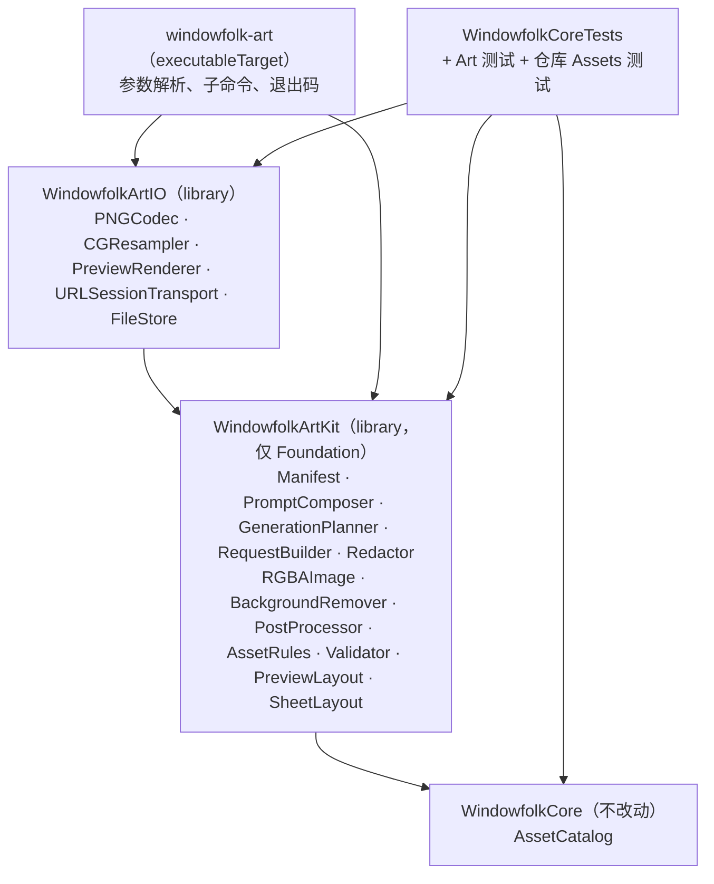
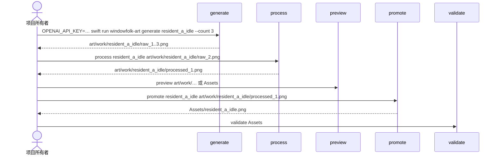

# Design Document

## Overview

本设计为「美术」spec 建立一条本机运行的出图流水线（Art_Pipeline），并用它产出 `AssetCatalog.all` 的 45 个 PNG 放入 `Assets/`。应用侧（`AssetCatalog`、`AssetProvider`、`build-app.sh`）不改动，素材按现有加载规则生效（Requirement 9）。

流水线由一个 SwiftPM 可执行 target `windowfolk-art` 提供，子命令对应需求中的工具：

| 子命令 | 组件 | 需求 |
|---|---|---|
| `generate` | Image_Generator | R3 |
| `process` | Post_Processor | R4 |
| `promote` | Promotion | R5 |
| `validate` | Asset_Validator | R6 |
| `preview` | Preview_Builder | R7 |
| `sheet generate` / `sheet compose` | Character_Sheet 制作（辅助） | R1.1、R1.5 |

核心决策：

- 纯逻辑（清单解析与格式化、提示词组合、生成计划、RGBA 缓冲区上的去背景、切帧、边界框、缩放比例、对齐、校验规则、预览布局、脱敏）放在只导入 Foundation 和 `WindowfolkCore` 的库 target `WindowfolkArtKit`，全部可以在没有图像框架的情况下做属性测试。
- PNG 编解码、高质量缩放、CoreText 文字绘制和 HTTP 放在库 target `WindowfolkArtIO`（ImageIO、CoreGraphics、CoreText、Foundation）。两者都不导入 AppKit 或 SpriteKit。
- `WindowfolkCore` 不增删任何文件（R9.5、R9.8）。Framed_Asset、Grounded_State 等分类在 `WindowfolkArtKit` 中按 Asset_Key 推导。
- 只用系统框架和 Swift 工具链，不引入 swift-argument-parser 等第三方包（R9.6）；命令行参数手工解析。`swift-property-based` 只用于测试，不进入流水线可执行文件。

### 调研结论

- 图像 API 使用 OpenAI Images API：无参考图时 `POST /v1/images/generations`（JSON），有参考图时 `POST /v1/images/edits`（multipart，多张参考图用 `image[]` 字段）。返回体 `data[].b64_json` 为 base64 图像；`background: "transparent"` 需配合 `output_format: "png"`；`n` 取 1 到 10。来源：[OpenAI Image generation guide](https://developers.openai.com/api/docs/guides/image-generation)、[Images edit reference](https://developers.openai.com/api/reference/typescript/resources/images/methods/edit)、[GPT Image 2.5 参数整理（第三方）](https://token.xhh.com/docs/api-reference/image/gpt-image-2-5)。
- 自定义尺寸约束（2.5 系列）：宽高都是 16 的倍数，宽高比在 1:3 到 3:1 之间，单边不超过 3840，总像素在 655,360 到 8,294,400 之间。6 帧的横条若按每帧正方形生成会达到 6:1，超出限制。因此多帧素材的生成画布用高于宽的帧格（见「生成画布尺寸」），后处理按边界框裁切，帧格形状不影响结果。
- 官方文档列出的 2.5 系列模型 ID 是 `gpt-image-2.5-sunburst` 和 `gpt-image-2.5-flare`；未查到不带后缀的 `gpt-image-2.5`。因此默认模型名取 `gpt-image-2.5-flare`（R3.3，见文末「已确认决策」），模型不可用时给出明确提示（见 Error Handling）。
- 已知 OpenAI 在鉴权失败的错误信息中会回显部分 Key（如 `sk-abc***wxyz`），所以脱敏必须覆盖部分片段，不能只替换完整 Key（R3.10）。

## Architecture



`Package.swift` 增加：

```swift
.target(name: "WindowfolkArtKit", dependencies: ["WindowfolkCore"]),
.target(name: "WindowfolkArtIO", dependencies: ["WindowfolkArtKit"]),
.executableTarget(name: "windowfolk-art", dependencies: ["WindowfolkArtKit", "WindowfolkArtIO"]),
// WindowfolkCoreTests 的 dependencies 追加 "WindowfolkArtKit", "WindowfolkArtIO"
```

所有 Art 测试放在 `Tests/WindowfolkCoreTests/Art/`，保持单一测试 target，满足 R6.11「测试在 `WindowfolkCoreTests` 中」。`ArchitectureTests` 只扫描 `Sources/WindowfolkCore/`，不受影响；另加一项测试扫描 `Sources/WindowfolkArtKit/`，要求只导入 Foundation 和 WindowfolkCore，保证纯逻辑层不被 CoreGraphics 渗入。

### 目录

```text
art/
  prompt-manifest.json           Prompt_Manifest（入库）
  character_sheets/
    resident_a.png               Character_Sheet（入库）
    resident_b.png
  work/                          Work_Directory（.gitignore 忽略）
    <asset_key>/raw_<n>.png       Raw_Candidate
    <asset_key>/processed_<n>.png Processed_Candidate
    backups/<asset_key>-<yyyyMMdd-HHmmss>-<n>.png
    preview/preview_dark.png, preview_light.png
    sheets/<resident>/raw_<n>.png 设定图原始输出
Assets/<asset_key>.png           Final_Asset（入库）
```

所有路径相对仓库根目录；`windowfolk-art` 要求在仓库根目录运行（当前目录下有 `Package.swift` 和 `art/`），否则以退出码 64 报错。`.gitignore` 增加 `art/work/`（R5.7）。

### 典型流程



## Components and Interfaces

### 命令行（windowfolk-art）

```text
windowfolk-art generate [<key>...] [--count N] [--dry-run]
windowfolk-art process <key> <raw.png>
windowfolk-art promote <key> <candidate.png>
windowfolk-art validate [<dir>]          默认 Assets
windowfolk-art preview [<dir>]           默认 Assets
windowfolk-art sheet generate <resident_a|resident_b> [--count N] [--dry-run]
windowfolk-art sheet compose <resident_a|resident_b> <raw.png>
```

退出码：0 成功；1 操作失败（校验未通过、部分请求失败等）；64 用法错误（未知子命令、缺参数、`--count` 不是 1 到 8 的整数）。每个子命令的 `run` 返回 `ExitStatus`，`main` 只负责把它转成进程退出码，保证 R9.7「退出码 0 只取决于输入合法且操作成功」。

### WindowfolkArtKit

#### 素材分类（AssetRules）

```swift
public enum ResidentOwner { case a, b }
public enum AlignmentMode { case groundedPerFrame, anchoredBase, nonGroundedUniform, centeredBottom, tile(AssetTiling) }

public struct AssetRules: Sendable {
    public let spec: AssetSpec
    public var owner: ResidentOwner?            // resident_a_ / resident_b_ 前缀
    public var isGrounded: Bool                 // idle、walking、carrying、waiting、running
    public var isFramed: Bool                   // 除 plank、ladder、toolbox 外全部
    public var alignment: AlignmentMode
    public var palettes: [PaletteGroup]         // Prompt_Composer 使用
    public static func rules(for key: String) -> AssetRules?
}
```

| Asset_Key | alignment | palettes |
|---|---|---|
| 居民 Grounded_State | `groundedPerFrame` | 对应居民 |
| 居民其他 7 个状态 | `nonGroundedUniform` | 对应居民 |
| `flower_*`、`decor_lamp_*` | `anchoredBase`（最下 4 行锚点） | 花：木制物件 + 植物；台灯：无 |
| `fruit`、`bubble_*`、`decor_chair`、`visit_flag`、`toolbox` | `centeredBottom` | 果子：植物；椅子、工具箱：木制物件；其余：无 |
| `plank`、`ladder` | `tile(.horizontal / .vertical)` | 木制物件 |

#### Prompt_Manifest 模型、解析与格式化

```swift
public enum PaletteGroup: String, CaseIterable { case residentA = "resident_a", residentB = "resident_b", wood, plant }
public enum PaletteColorName: String, CaseIterable { case main, shadow, highlight, outline, blush }
public struct RGB: Hashable { public var r, g, b: UInt8 }   // 由 "#RRGGBB" 解析，大小写不敏感
public struct PixelSize: Hashable { public var width, height: Int }

public struct PromptEntry: Hashable {
    public var key: String
    public var description: String
    public var frames: Int
    public var layout: FrameLayout              // 目前只有 .horizontalNoGap
    public var canvas: PixelSize
    public var references: [String]             // 相对仓库根目录的路径
}

public struct PromptManifest: Hashable {
    public var prefix: String
    public var palettes: [PaletteGroup: [PaletteColorName: RGB]]
    public var entries: [PromptEntry]           // Asset_Catalog 顺序
}

public struct ManifestIssue: Hashable, CustomStringConvertible {
    public enum Location: Hashable { case line(Int), entry(key: String, field: String), palette(group: String, color: String?), document(field: String) }
    public var location: Location
    public var message: String
}

public enum ManifestParser {
    public static func parse(_ data: Data, fileExists: (String) -> Bool) -> Result<PromptManifest, [ManifestIssue]>
}
public enum ManifestPrinter {
    public static func print(_ manifest: PromptManifest) -> Data
}
```

文件格式为 UTF-8 JSON，示例：

```json
{
  "entries" : [
    {
      "canvas" : "2048x768",
      "description" : "A horizontal sprite sheet of 4 equal frames, left to right, no gaps. …",
      "frames" : 4,
      "key" : "resident_a_idle",
      "layout" : "horizontal_no_gap",
      "references" : [ "art/character_sheets/resident_a.png" ]
    }
  ],
  "palettes" : {
    "plant" : { "highlight" : "#8FD18A", "main" : "#4DAD4D", "outline" : "#2A5A2E", "shadow" : "#357A3A" },
    "resident_a" : { "blush" : "#FF9EA8", "highlight" : "#F2F3F5", "main" : "#C7CCD4", "outline" : "#737885", "shadow" : "#9EA3AD" }
  },
  "prefix" : [ "Cute chibi sprite …", "clean 2px dark outline …" ],
  "version" : 1
}
```

选择 JSON 而不是自定义分节文本的理由：提示词里的方括号、冒号、换行无需另设转义规则，往返性质更容易成立；Foundation 自带解析和编码。

- **prefix** 存为字符串数组，模型中用 `\n` 连接成一个字符串；格式化时按 `\n` 切回数组。这样多行前缀在文件里仍可逐行阅读，且往返无损。
- **格式化**：`JSONEncoder`，选项 `[.prettyPrinted, .sortedKeys, .withoutEscapingSlashes]`，结尾补一个换行；色值统一输出为大写 `#RRGGBB`；`entries` 按 Asset_Catalog 顺序。键排序和固定选项保证同一对象每次输出逐字节相同（R2.10）。
- **解析分两步**：先用 `JSONSerialization` 判定语法；失败时从 `NSJSONSerializationErrorIndex` 取字节偏移，换算成行号报告（R2.9 语法错误给行号）。成功后用 `JSONDecoder` 读出原始字典（`JSONSerialization` 会删掉字符串值开头的 U+FEFF，不能用来取值），再逐项检查并**收集全部问题**再返回，不在第一处停止：
  - 文档级：`prefix` 缺失或拼接后为空白；四组 Palette 缺组、缺色、色值不匹配 `^#[0-9A-Fa-f]{6}$`（R1.6，问题定位到组名和颜色名）。
  - 条目级（定位到 Asset_Key 和字段名）：Asset_Key 未知、重复、缺失；`description` 长度不在 1 到 1000 字符；`frames` 与 Asset_Catalog 不等；`layout` 不是 `horizontal_no_gap`；`canvas` 不是两个正整数 `WxH`；`references` 中有路径 `fileExists` 为假；居民条目未列出本人设定图或列出另一位的设定图；非居民条目列出任一设定图（R2.6、R2.13）。
  - 设定图路径固定为 `art/character_sheets/resident_a.png` 和 `resident_b.png`，比较前对路径做 `standardizingPath`。
- 只有问题列表为空才返回 `PromptManifest`。

R2.5（画布不小于每帧像素尺寸）和 API 尺寸约束不是解析错误（R2.8 的成功条件没有包含它们）；它们由一项针对仓库内 `art/prompt-manifest.json` 的测试保证。

#### PromptComposer

```swift
public enum PromptComposer {
    public static func compose(_ manifest: PromptManifest, key: String) -> String?
}
```

输出 = `prefix` + `"\n\n"` + 每个适用 Palette 一行（`Palette <group>: main #C7CCD4, shadow #9EA3AD, …`，组顺序按 `PaletteGroup.allCases`，色名顺序按 `PaletteColorName.allCases`）+ `"\n\n"` + `description`。没有适用 Palette 时省略中间段和一个分隔。纯函数，同一输入逐字节相同（R2.12）。帧数与排列方式的英文说明写在 `description` 里（例如 `A horizontal sprite sheet of 6 equal frames, left to right, no gaps.`）。

#### 生成计划与请求构造

```swift
public struct GenerationJob: Hashable { public var key: String; public var candidateIndex: Int; public var outputPath: String }

public enum GenerationPlanner {
    /// requested 为空时只挑选 existingPNGs[key] 为空的条目（R3.2）。
    /// 序号从 max(现有 raw_<n> 序号) + 1 开始连续分配（R3.5）。
    public static func plan(manifest: PromptManifest, requested: [String], count: Int,
                            existingPNGs: [String: [String]]) -> Result<[GenerationJob], [String]>
}

public enum ModelName {
    public static let fallback = "gpt-image-2.5-flare"
    public static func resolve(_ env: [String: String]) -> String   // WINDOWFOLK_IMAGE_MODEL 去空白后为空则 fallback
}

public struct ImageRequest: Hashable {
    public enum Endpoint { case generations, edits }
    public var endpoint: Endpoint
    public var model: String
    public var prompt: String
    public var size: PixelSize
    public var references: [String]
    // 固定：background=transparent、output_format=png、n=1、quality=high
}

public enum RequestBuilder {
    public static func request(for entry: PromptEntry, prompt: String, model: String) -> ImageRequest
    /// generations：JSON 体；edits：multipart 体，每张参考图一个 image[] 部分。
    public static func body(_ r: ImageRequest, referenceData: [Data], boundary: String) -> Data
    public static func decodeResponse(_ data: Data) -> Result<Data, GenerationFailure>  // 取 data[0].b64_json
}

public enum Redactor {
    /// 替换完整 Key、Key 的任一长度 ≥ 6 的连续片段，以及形如 sk-… 的令牌，统一为 "[REDACTED]"。
    public static func redact(_ text: String, secret: String) -> String
}
```

每张候选图单独发一个 `n=1` 的请求，这样每个请求有自己的 180 秒超时、进度行和失败记录（R3.7、R3.12）。请求顺序执行，一次一个，进度行格式：`[3/12] 发送 resident_a_idle #2`、`[3/12] 完成 resident_a_idle #2`。

#### RGBA 缓冲区与后处理

```swift
public struct RGBAImage: Hashable, Sendable {
    public var width: Int, height: Int
    public var pixels: [UInt8]            // 行优先、从上到下，非预乘 RGBA，每通道 8 位
    public subscript(x: Int, y: Int) -> RGBA { get set }
    public func crop(_ r: PixelRect) -> RGBAImage
    public func opaqueBounds(threshold: UInt8 = 128) -> PixelRect?   // alpha ≥ 128
}

public protocol Resampler: Sendable {
    /// 高质量缩放；输入输出都是非预乘 RGBA。
    func resize(_ image: RGBAImage, to size: PixelSize) -> RGBAImage
}

public enum BackgroundRemover {
    public static func remove(_ image: RGBAImage, tolerance: Int = 24) -> RGBAImage
}

public struct ProcessContext {
    public var idleReferenceHeight: Int?   // Assets/ 中该居民 idle 第 1 帧 bbox 高度（R4.7）
}

public enum PostProcessor {
    public static func process(_ raw: RGBAImage, key: String, context: ProcessContext,
                               resampler: Resampler) -> Result<ProcessOutcome, PostProcessError>
}
public struct ProcessOutcome { public var image: RGBAImage; public var warnings: [String] }
public enum PostProcessError: Error { case unknownKey(String), emptyFrame(index: Int), tileSeam(String) }
```

#### Asset_Validator 规则

```swift
public enum ValidationRule: String, CaseIterable {
    case fileFormat = "文件格式", pixelSize = "像素尺寸", alphaChannel = "alpha 通道",
         cornersTransparent = "四角透明", grounded = "贴底", centered = "水平居中",
         emptyFrame = "空帧", identicalFrames = "帧内容相同", tileEdge = "平铺边缘"
}

public struct DecodedPNG { public var image: RGBAImage; public var hasAlpha: Bool }

public enum AssetVerdict: Hashable {
    case pass
    case missing
    case fail([ValidationRule], emptyFrames: [Int])   // 按 ValidationRule.allCases 顺序列出全部未通过规则
}

public enum AssetValidator {
    /// decoded 为 nil 表示文件不能解码为 PNG。
    public static func validate(key: String, decoded: DecodedPNG?) -> AssetVerdict
    public static func report(directoryListing: [String], verdicts: [String: AssetVerdict]) -> ValidationReport
}
public struct ValidationReport { public var lines: [String]; public var unknownFiles: [String]; public var allPassed: Bool }
```

规则顺序：先查 文件格式 → 像素尺寸（调用 `AssetCatalog.validation(fileName:pixelWidth:pixelHeight:)`，R6.10）→ alpha 通道；前两项任一失败即停止，不做帧级检查（R6.2）。帧级检查按 `AssetSpec.expectedPixelWidth / frames` 切帧，各规则独立计算后合并。

#### 预览与设定图布局

```swift
public struct PreviewLayout {
    public struct Row { public var key: String; public var labelOrigin: PixelPoint; public var strips: [Strip] }
    public struct Strip { public var scale: Int; public var frameRects: [PixelRect] }  // scale 2 或 1
    public var canvas: PixelSize
    public var rows: [Row]
    public static func make() -> PreviewLayout
}

public enum SheetLayout {
    public static let viewCell = PixelSize(width: 512, height: 640)   // 三个视图格，上方一行
    public static let viewMinHeight = 256
    public static let swatchSize = 48, swatchPitch = 64, swatchRowTop = 656
    public static var canvas: PixelSize { PixelSize(width: 1536, height: 720) }
    public static func swatchRect(_ i: Int) -> PixelRect   // x = 16 + i·64, y = 656
    public static func compose(views: [RGBAImage], palette: [RGB], resampler: Resampler) -> RGBAImage
}
```

#### 后处理算法

`PostProcessor.process(raw, key)` 的步骤（`fw`、`fh` 为每帧目标像素宽高，`N` 为帧数）：

1. **查规则**：`AssetRules.rules(for:)` 为 nil 时返回 `unknownKey`。
2. **已是规格尺寸的输入**（R4.3 的例外）：`raw` 尺寸等于 Expected_Pixel_Size 时视为已处理过的图，跳过第 3 步去背景和第 6 步缩放（含 R4.7 的高度调整），以 1:1 比例保留每帧像素；第 7 步改为「只平移」：按 R4.5、R4.8、R4.9、R4.15 中适用的对齐规则，已满足贴底（底部空隙 0 到 2 像素）和居中（偏差 ≤ 1 像素）的帧不移动，否则整帧平移到第 7 步规定的位置，不重采样。第 8、9 步照常执行。这条规则让幂等性质（R4.13）成立，并避免 Plank、Ladder、Toolbox 这类四角不透明的成品图被第 3 步当成背景整片抹掉。API 返回的图像至少 655,360 像素，不会命中这条分支。
3. **去背景**（R4.3，仅尺寸不等于 Expected_Pixel_Size 的输入）：四角中 alpha > 0 的像素取平均 RGB 作为背景色；没有这样的角时跳过。从四条边上的全部像素出发做 4 邻域洪泛，可通过的像素是 alpha = 0 的像素，或 R、G、B 每个通道与背景色相差都不超过 24 的像素；被洪泛到的像素设为 `(0,0,0,0)`。
4. **切帧**（R4.2）：`q = W / N`（整除），第 i 帧（从 0 起）占列 `[i·q, (i+1)·q)`，最后一帧到 `W` 为止。
5. **边界框**：每帧求 alpha ≥ 128 的边界框 `b_i`；任一帧为空返回 `emptyFrame(index: i+1)`（R4.12）。
6. **缩放比例**（R4.4、R4.6）：
   - 一般情况：`s = min_i min(fw / b_i.w, fh / b_i.h)`，所有帧共用。
   - `nonGroundedUniform`：先在帧格坐标里取所有 `b_i` 的并集 `U`，`s = min(fw / U.w, fh / U.h)`。为了保留帧间位移，必须让并集放得进一帧，因此这里的比例可能小于按单帧计算的值。
   - R4.7（Grounded 居民且 `Assets/` 有该居民 idle）：`H` = idle 第 1 帧边界框高度，`s_t = 2H / (min_i b_i.h + max_i b_i.h)`，`s = min(s_t, 一般情况的 s)`。缩放后仍有帧与 `H` 相差超过 10% 时（原始各帧高度本身差得太多），在 `warnings` 中报告该帧序号，处理照常成功。
7. **重采样与放置**：
   - 一般情况：每帧裁出 `b_i`，用 `Resampler` 缩放到 `(min(fw, round(b_i.w·s)), min(fh, round(b_i.h·s)))`，再按缩放后小图自身的不透明边界框放置：
     - `groundedPerFrame`、`centeredBottom`：最下方不透明行放在 `fh − 1`，边界框水平中心对齐 `fw / 2`（取整误差 ≤ 0.5 像素）（R4.5）。
     - `anchoredBase`：用小图最下方 4 行不透明像素的边界框中心作为水平锚点（R4.8、R4.9），底边同上。三张花和台灯两种外观以花盆或底座锚点居中，不以整体边界框居中，不适用 R4.5。
     - `tile`：水平和竖直都居中。
   - `nonGroundedUniform`（R4.15）：每帧裁出同一个矩形 `U`，缩放到同一尺寸，并放在同一偏移处：缩放后并集的最下方不透明行在 `fh − 1`，并集水平中心对齐 `fw / 2`。帧间相对位置因此保持不变。
8. **四角清理**（R4.14）：Framed_Asset 每帧四角各 2×2 像素设为 `(0,0,0,0)`。
9. **平铺接缝**（R4.10、R4.11）：`plank` 对每一行把最左列和最右列像素都改为两者的逐通道平均值；`ladder` 对每一列处理最上行和最下行。之后按阈值（alpha ≤ 16，RGB ≤ 24）复查，不满足时返回 `tileSeam`（防御性检查，正常情况下平均后差值为 0 或 1）。
10. **拼接**：N 帧从左到右拼成 `fw·N × fh`，帧间无间隔。

`process` 子命令读取原始图、构造 `ProcessContext`（读 `Assets/resident_x_idle.png` 第 1 帧高度）、调用上面的纯函数，成功时把结果写到 `art/work/<key>/processed_<n>.png`（`n` 为现有最大序号加 1，`.withoutOverwriting`），打印路径和警告。

### WindowfolkArtIO

| 组件 | 职责 |
|---|---|
| `PNGCodec` | `decode(Data) -> DecodedPNG?`：`CGImageSourceCreateWithData`，要求 `CGImageSourceGetType == "public.png"`；`hasAlpha` 取自 `CGImage.alphaInfo`（非 `none`/`noneSkip*`）；画进 sRGB、`premultipliedLast` 的 8 位 `CGContext` 后反预乘得到 `RGBAImage`。`encode(RGBAImage) -> Data`：用 `CGImage(… alphaInfo: .last …)`（非预乘）交给 `CGImageDestination` 输出 8 位 RGBA PNG。 |
| `CGResampler` | `Resampler` 实现：预乘 → `CGContext.interpolationQuality = .high` 绘制到目标尺寸 → 反预乘。 |
| `PreviewRenderer` | 按 `PreviewLayout` 用 CoreGraphics 填背景、绘帧（`interpolationQuality = .none` 画 2 倍条，`.high` 画 1 倍条），用 CoreText（`CTLineDraw`，系统字体 12pt，即 12 像素）写 Asset_Key 和标记文字。 |
| `URLSessionTransport` | `ImageTransport` 协议实现。`URLSessionConfiguration.ephemeral`，`timeoutIntervalForRequest = timeoutIntervalForResource = 180`，不缓存、不存 Cookie；Key 只放进 `Authorization: Bearer` 头。 |
| `FileStore` | 目录列举、原子写（`Data.write(options: [.atomic, .withoutOverwriting])` 用于新文件，`.atomic` 用于覆盖）、备份复制。 |

```swift
public protocol ImageTransport: Sendable {
    func send(_ request: ImageRequest, body: Data, contentType: String, apiKey: String) async -> Result<Data, GenerationFailure>
}
public enum GenerationFailure: Error, Hashable {
    case http(status: Int, message: String)   // message 已经过 Redactor
    case modelUnavailable(String)
    case unauthorized
    case timeout
    case undecodable
    case transport(String)
}
```

测试使用 `FakeTransport`（按脚本返回成功或失败），不发网络、不需要 Key。

## Data Models

### 生成画布尺寸

满足 R2.5（每帧不小于目标像素）和 API 约束（16 的倍数、宽高比 1:3 到 3:1、总像素 655,360 到 8,294,400）：

| 素材 | 帧数 | canvas | 每帧格 |
|---|---|---|---|
| 居民 6 帧 | 6 | 2304×768 | 384×768 |
| 居民 4 帧 | 4 | 2048×768 | 512×768 |
| 居民 2 帧 | 2 | 1536×768 | 768×768 |
| 三张花 | 1 | 1024×1232 | 同 |
| fruit、气泡、ladder、decor_chair | 1 | 1024×1024 | 同 |
| plank | 1 | 1536×576 | 同（与 16:6 同比例） |
| toolbox | 1 | 1536×864 | 同（接近 72:40） |
| decor_lamp_off / on | 1 | 768×1536 | 同 |
| visit_flag | 1 | 1024×1536 | 同 |

多帧的 `description` 写明「each frame cell is taller than wide; the character stands at the bottom of its cell」。设定图请求用 1536×1024（三视图各 512×1024）。

### Palette 初始色值

取自 `AssetProvider` 占位图配色，并按 art-spec 第 1 节补齐阴影和高光：

| 组 | main | shadow | highlight | outline | blush |
|---|---|---|---|---|---|
| resident_a（都都，银渐层） | `#C7CCD4` | `#9EA3AD` | `#F2F3F5` | `#737885` | `#FF9EA8` |
| resident_b（嘟嘟，金丝熊） | `#F5C24D` | `#D99A3A` | `#FFF1D6` | `#A8751F` | `#FAB39E` |
| wood（木制物件） | `#E6BD80` | `#B8834F` | `#F5DDB5` | `#73401F` | — |
| plant（植物） | `#4DAD4D` | `#357A3A` | `#8FD18A` | `#2A5A2E` | — |

眼睛颜色（都都翠绿 `#3FB58A`、嘟嘟黑 `#2A2422`）写在两位居民条目的描述中，不进入 Palette（R1.2 只规定 5 个颜色）。

### Character_Sheet 布局

`SheetLayout` 固定 1536×720 的画布：上方三个 512×640 视图格依次放正面、朝右侧面、背面，每个视图缩放到不透明边界框高度为 560 像素（≥ 256，R1.1），贴格底、水平居中；下方从 x=16、y=656 开始，按 main、shadow、highlight、outline、blush 顺序画 5 个 48×48 纯色块，间距 64。色块由程序直接填充，中心像素与 Palette 完全相等（R1.5）。

`sheet generate` 用固定的设定图提示词（`CharacterSheetPrompts`，内容取自 art-spec 第 1 节，加上公共前缀和该居民 Palette）调用 generations 接口，输出到 `art/work/sheets/<resident>/raw_<n>.png`。`sheet compose` 把原始图三等分、去背景、按上面布局排版，写入 `art/character_sheets/<resident>.png`。因为设定图尚未存在时清单无法通过解析（参考图不存在），`sheet` 子命令以 `fileExists` 对两张设定图路径恒返回真的方式调用解析器，只取前缀和 Palette。

### 输出与报告

- `ValidationReport.lines` 每行：`<asset_key>  通过` / `<asset_key>  缺失` / `<asset_key>  未通过：像素尺寸、四角透明（空帧：第 2 帧）`。未知文件之后单独列出，标为「未知文件」。
- `GenerationReport`：每个 Asset_Key 的成功路径列表与失败原因列表。全部成功时每个 Key 一行列出新文件路径；有失败时列出 `<key>  成功 <n> 张  失败原因：<reason>`（R3.7、R3.11、R3.13）。

## Correctness Properties

*A property is a characteristic or behavior that should hold true across all valid executions of a system-essentially, a formal statement about what the system should do. Properties serve as the bridge between human-readable specifications and machine-verifiable correctness guarantees.*

生成器约定：`Gen.manifest` 生成合法清单（45 条，随机描述含引号、方括号、换行和中文，随机画布与色值，居民条目引用本人设定图）；`Gen.rawImage(key)` 生成合成 RGBA 原始图：纯色或透明背景上每帧画一个随机大小、随机位置的实心圆角矩形，颜色与背景色至少有一个通道相差 > 24，整体尺寸不等于该键的 Expected_Pixel_Size（保证走去背景和缩放分支）；`fileExists` 用内存集合代替。合并说明：R2.10 并入属性 1；R2.13 并入属性 2；R3.3、R3.4 并入属性 5；R3.11、R3.13 并入属性 6；R4.6 并入属性 11；R4.8、R4.9、R4.14 并入属性 12；R6.8、R6.9 并入属性 20；R6.12 并入属性 10。

### Property 1: 清单往返与稳定格式化

*For any* 合法清单对象 `m`，`parse(print(m))` 成功且等于 `m`，并且 `print(m)` 两次调用逐字节相同、`print(parse(print(m)))` 与 `print(m)` 逐字节相同。

**Validates: Requirements 1.2, 2.8, 2.10, 2.11**

### Property 2: 非法清单被拒绝并定位

*For any* 合法清单和从变异集合（删除或重复条目、加入未知键、清空描述或描述超过 1000 字符、改帧数、改 layout、坏画布、删 Palette 组或颜色、坏色值、参考图指向不存在文件、居民引用另一位设定图、非居民引用设定图）中随机选取的非空变异子集，解析结果为失败，且每个变异都对应至少一条问题，其位置为相应的 Asset_Key 与字段名或 Palette 组名与颜色名；在 JSON 文本第 k 行插入非法字符时，问题位置为第 k 行。

**Validates: Requirements 1.6, 2.1, 2.2, 2.4, 2.6, 2.9, 2.13**

### Property 3: 提示词组合确定且有序

*For any* 合法清单和其中任一 Asset_Key，`compose` 的结果以 `prefix` 开头、以该条目 `description` 结尾，包含且只包含 `AssetRules.palettes` 所列组的全部色值，两次调用逐字节相同。

**Validates: Requirements 2.12**

### Property 4: 生成计划只补缺且序号不冲突

*For any* 清单、请求键列表（可为空）、`count ∈ 1...8` 和每个键已有的 PNG 文件名集合：请求键非空时，计划为每个请求键恰好 `count` 个任务；为空时，只为没有 PNG 的键各安排 `count` 个任务，全部已有时计划为空；每个任务的输出文件名不与已有文件重名，同一键的新序号从已有最大序号加 1 起连续递增。

**Validates: Requirements 3.1, 3.2, 3.5**

### Property 5: 请求内容完整

*For any* 条目、环境变量 `WINDOWFOLK_IMAGE_MODEL` 的任意取值（含未设置、空串和纯空白），构造出的请求：模型名在取值去空白后为空时为 `gpt-image-2.5-flare`，否则为原值；提示词等于 `compose` 结果；尺寸为条目画布；`background` 为 `transparent`；参考图非空时使用 edits 接口且请求体中每张参考图恰好一个 `image[]` 部分，为空时使用 generations 接口。

**Validates: Requirements 3.1, 3.3, 3.4**

### Property 6: 请求失败互不影响

*For any* 生成计划和为每个任务随机指定的结果（成功、HTTP 错误、不可解码、超时），运行后 Work_Directory 中新增的文件恰好对应成功任务、已有文件不变；退出码为 0 当且仅当全部成功；有失败时报告恰好列出有失败的 Asset_Key，每项的成功张数等于该键成功任务数（可为 0）并附失败原因；全部成功时每个键一行列出其新文件路径。

**Validates: Requirements 3.7, 3.11, 3.13**

### Property 7: Key 不泄露

*For any* 长度 ≥ 8 的 Key 和任意文本（随机嵌入完整 Key、Key 的连续片段以及 `sk-…***…` 形式的掩码），`Redactor.redact` 的结果不包含 Key 的任何长度 ≥ 6 的连续片段；端到端地，当 FakeTransport 的错误信息回显 Key 时，标准输出、标准错误和写出的文件中都不含这样的片段。

**Validates: Requirements 3.10**

### Property 8: 切帧覆盖全宽且不重叠

*For any* 宽度 `W ≥ N` 和帧数 `N ∈ 1...12`，切出的 N 个列区间依次相邻、覆盖 `[0, W)`，前 N−1 段宽度都等于 `W / N`，最后一段宽度为 `W / N + W % N`。

**Validates: Requirements 4.2**

### Property 9: 去背景只移除与边缘相连的背景

*For any* 不透明纯色背景上画有若干与背景色相差 > 24 的图形的合成图，去背景后：所有原背景像素 alpha 为 0，图形像素与输入完全相同；对四角 alpha 都为 0 的输入，输出与输入相同。

**Validates: Requirements 4.3**

### Property 10: 输出符合素材规格

*For any* Asset_Key 和该键的合成原始图，处理成功时输出尺寸等于 Expected_Pixel_Size，`AssetCatalog.validation(fileName:pixelWidth:pixelHeight:)` 返回 `.valid`，并且 Asset_Validator 对它不报「像素尺寸」「空帧」。

**Validates: Requirements 4.1, 6.12**

### Property 11: 所有帧共用最大适配比例

*For any* 多帧 Asset_Key 和合成原始图，输出中任意两帧不透明边界框的宽高之比与原始图对应两帧的比值相差在取整误差内（每边 ±1 像素），且至少有一帧（`nonGroundedUniform` 为帧并集）的宽或高与每帧像素尺寸相差不超过 1 像素。

**Validates: Requirements 4.4, 4.6**

### Property 12: 锚点对齐与四角透明

*For any* 对齐方式为 `groundedPerFrame`、`centeredBottom` 或 `anchoredBase` 的 Asset_Key 和合成原始图，输出每帧最下方不透明行距底边不超过 2 像素，锚点（前两种为整体边界框，`anchoredBase` 为最下方 4 行的边界框）水平中心与帧中心相差不超过 1 像素；Framed_Asset 的每帧四角 2×2 像素 alpha 全为 0。

**Validates: Requirements 4.5, 4.8, 4.9, 4.14**

### Property 13: 与 idle 高度一致

*For any* Grounded 居民 Asset_Key、各帧边界框高度彼此相差不超过 5% 的合成原始图，以及不超过每帧像素高的参考高度 `H`，输出每帧不透明边界框高度与 `H` 相差不超过 10%，内容不超出帧。

**Validates: Requirements 4.7**

### Property 14: 非 Grounded 居民保留帧间位移

*For any* 非 Grounded 居民 Asset_Key 和合成原始图，输出中任意两帧边界框左上角的位移等于原始图中对应位移乘以 `s`（每轴 ±1 像素），且全部帧并集的最下方不透明行距底边不超过 2 像素、水平中心与帧中心相差不超过 1 像素。

**Validates: Requirements 4.15**

### Property 15: 平铺边缘无缝

*For any* `plank` 或 `ladder` 的合成原始图，输出 `plank` 最左列与最右列（`ladder` 最上行与最下行）每对像素 alpha 差 ≤ 16、R/G/B 差 ≤ 24。

**Validates: Requirements 4.10, 4.11**

### Property 16: 后处理幂等

*For any* Asset_Key 和合成原始图，令 `p = process(raw)`，则 `process(p)` 成功、尺寸与 `p` 相同，每帧不透明边界框四条边的位置与 `p` 相差不超过 1 像素，且 `process(p)` 中 alpha 为 0 的像素数不多于 `p` 中的（尺寸已符合规格的输入不经过去背景，`plank`、`ladder`、`toolbox` 的不透明四角不会被抹掉）。

**Validates: Requirements 4.3, 4.13**

### Property 17: 空帧报错且不写文件

*For any* Asset_Key 和清空了随机一帧的合成原始图，`process` 返回 `emptyFrame`，序号等于被清空帧（从 1 开始）；`process` 子命令以非零退出码结束，Work_Directory 的文件列表与内容不变。

**Validates: Requirements 4.12**

### Property 18: 校验器恰好报告注入的缺陷

*For any* Asset_Key、该键的合规合成图，以及从适用缺陷中随机选取的子集（四角放一个 alpha=1 的像素、全部帧内容上移 ≥ 3 像素、全部帧内容横移 ≥ 7 像素、清空一帧、所有帧复制为第 1 帧、改动接缝边一列或一行、去掉 alpha 通道；「清空一帧」与「复制为第 1 帧」不同时选），`AssetValidator.validate` 报告的未通过规则集合恰好等于所选缺陷对应的规则集合，空帧序号正确。文件不能解码时只报「文件格式」；尺寸不符时只报「像素尺寸」和可能的「alpha 通道」，不报帧级规则。

**Validates: Requirements 6.2, 6.3, 6.4, 6.5, 6.6, 6.7**

### Property 19: 尺寸结论与 AssetCatalog 一致

*For any* Asset_Key 和任意像素宽高（1 到 1024），Asset_Validator 报「像素尺寸」当且仅当 `AssetCatalog.validate(fileName:pixelWidth:pixelHeight:)` 返回 false。

**Validates: Requirements 6.10**

### Property 20: 目录报告

*For any* 目录内容（45 个键各自随机为缺失、合规或带缺陷，外加随机的未知 `.png` 文件名，包括大小写不同的键名），报告按 Asset_Catalog 顺序恰好 45 行、状态与每个键一致，未知文件全部在 45 行之后列出，退出码为 0 当且仅当 45 个键都通过（与未知文件无关）。

**Validates: Requirements 6.1, 6.8, 6.9**

### Property 21: Promotion 只写通过校验的图

*For any* Asset_Key、随机合规或不合规的候选图、`Assets/` 中该键是否已有文件以及其他随机文件：候选合规时 `Assets/<key>.png` 与候选逐字节相同，原文件（若有）被逐字节复制到一个新的备份文件且已有备份不变；不合规时 `Assets/<key>.png` 保持原内容（原本没有则仍不存在），退出码非零并列出全部未通过规则；两种情况下候选文件与 `Assets/` 中其他文件都不变。

**Validates: Requirements 5.1, 5.2, 5.3, 5.4**

### Property 22: 预览布局

*For any* 45 个键各自随机的状态（正常、缺失、不合规及其规则集合），`PreviewLayout` 的行按 Asset_Catalog 顺序排列；每行相邻帧矩形间隔 ≥ 4 像素；标签矩形高度 ≥ 10 且不与任何帧矩形相交；居民键有比例 2 和比例 1 两条，比例 1 的帧为 `pt 宽 × pt 高`，其余键只有比例 2 一条；缺失或不合规的键用一个 Expected_Pixel_Size 大小的标记矩形，标记文字为「缺失」或其未通过规则名称。

**Validates: Requirements 7.3, 7.4, 7.5**

### Property 23: 设定图色块与视图

*For any* 5 色 Palette 和三张合成视图，`SheetLayout.compose` 输出中第 i 个色块中心像素 RGB 等于 Palette 第 i 色且 alpha 为 255，每个色块不小于 32×32，三个视图的不透明边界框按从左到右的顺序位于各自视图格内且高度 ≥ 256。

**Validates: Requirements 1.1, 1.5**

## Error Handling

| 场景 | 处理 | 需求 |
|---|---|---|
| 不在仓库根目录运行 | 退出码 64，提示需要在含 `Package.swift` 和 `art/` 的目录运行 | R9.7 |
| 清单解析失败 | 逐条打印 `ManifestIssue`（行号，或 Asset_Key 加字段名，或 Palette 组名加颜色名），退出码 1，不发请求 | R1.6、R2.9、R3.8 |
| `OPENAI_API_KEY` 缺失或空白 | 发请求前退出码 1，提示设置该变量 | R3.6 |
| 未知 Asset_Key、参考图不存在、`--count` 非法 | 发请求前打印每个出错项；`--count` 为用法错误，退出码 64，其余退出码 1 | R3.8 |
| HTTP 错误、超时（180 秒）、无法解码 | 不写文件，记录原因（经 Redactor），继续下一个请求；最后报告并以退出码 1 结束 | R3.7 |
| 模型不可用（HTTP 404，或错误码 `model_not_found`） | 原因记为「模型 <名> 不可用，可用 WINDOWFOLK_IMAGE_MODEL 指定其他模型，例如 gpt-image-2.5-sunburst」；剩余请求不再发送，直接记为同一原因的失败 | R3.3、R3.7 |
| 鉴权失败（HTTP 401） | 原因记为「API Key 无效」，不回显服务器原文；剩余请求同样不再发送 | R3.7、R3.10 |
| 后处理未知键、无法解码、空帧、接缝不达标 | 打印 Asset_Key、文件路径、原因（空帧带序号），退出码 1，不写文件 | R4.12 |
| Promotion 键未知、候选不存在或不可读 | 校验前退出码 1，打印键或路径 | R5.5 |
| Promotion 备份或写入失败 | 备份失败时不写入；写入用原子替换，失败时原文件保持完整；打印失败步骤（备份或写入）和原因，退出码 1 | R5.6 |
| validate / preview 目录不存在或不可读 | 不输出逐项结果、不写总览图，打印目录路径，退出码 1 | R6.13、R7.7 |

脱敏：所有写到标准输出、标准错误或文件的字符串都经过 `Redactor.redact(_, secret: apiKey)`；服务器错误体只取 `error.message` 字段，且同样脱敏。请求对象、`ImageRequest` 的 `description`、试运行输出都不含 Key（Key 只在 `URLSessionTransport` 构造请求头时出现）。

## Testing Strategy

### 属性测试

- 库：已有依赖 [swift-property-based](https://github.com/x-sheep/swift-property-based)（`PropertyBased`，配合 Swift Testing 的 `propertyCheck`），不自行实现 PBT。
- 每个属性一个测试，至少 100 次迭代（`propertyCheck(count: 100, …)`）。图像类属性（9 至 18、23）的合成图控制在每帧 ≤ 96×96 像素以保持速度；需要高质量缩放的属性使用 `CGResampler`，其余用测试内的最近邻 `Resampler`。
- 每个测试前加注释，格式：`// Feature: 美术, Property 12: 锚点对齐与四角透明`。
- 文件系统类属性（6、17、21）在 `FileManager.default.temporaryDirectory` 下的独立临时目录中运行，生成任务用 `FakeTransport`。

### 单元测试与示例

- 仓库清单 `art/prompt-manifest.json`：通过解析；45 条；前缀包含 R1.3 的 10 点关键词；6 条居民描述写明不画物件、梯子、椅子（R2.7）；每个画布满足 R2.5 和 API 尺寸约束（16 的倍数、宽高比 1:3 到 3:1、总像素 655,360 到 8,294,400）。
- 设定图文件存在时：色块中心像素与 Palette 相等，视图高度 ≥ 256（R1.1、R1.5）。
- `docs/art-spec.md` 新增的「出图流水线」一节：列出的路径都存在，列出的色值与清单相等，步骤顺序正确（R1.7）。
- Image_Generator：无 Key 时 FakeTransport 调用次数为 0（R3.6）；预检错误不发请求（R3.8）；试运行打印每个请求且不写文件（R3.9）；进度行格式（R3.12）。
- Promotion：注入写入失败的 `FileStore` 时原文件完整（R5.6）；未知键与缺失文件（R5.5）。
- Preview_Builder：两张图背景色在阈值内且为纯色（采样标签区外的像素），缺失项标记，汇总输出（R7.1、R7.2、R7.6、R7.7）。
- 快照：`AssetCatalog.all` 的键、尺寸、帧数、平铺方式与本 spec 开始前一致（R9.5）；`Package.swift` 中流水线 target 只依赖仓库内 target（R9.6）；`WindowfolkArtKit` 只导入 Foundation 与 WindowfolkCore；现有 `ArchitectureTests` 保持通过（R9.8）。

### 仓库 Assets 测试（R6.11、R6.14、R6.15）

`RepositoryAssetsTests` 从 `#filePath` 向上找到仓库根目录，读 `Assets/`：

- 用 `.enabled(if: RepositoryAssets.hasAnyFinalAsset, "Assets/ 中尚无 Final_Asset")` 让没有任何素材时测试显示为跳过。
- 对每个存在的键调用 `PNGCodec.decode` 与 `AssetValidator.validate`，不合规时 `Issue.record("<key>: <规则名称…>")`。
- 有 1 到 44 个时打印缺失数量和名单，不记录 Issue。
- 全部 45 个都存在时，另外检查 R8.6、R8.8、R8.9、R8.10 中可计算的几何条件（toolbox 贴底、`decor_lamp_on` 存在 alpha 1 至 254 的像素且四角透明、花盆和灯座锚点相差 ≤ 1 像素、planting / celebrating / sleeping 的边界框关系）。

整套测试不访问网络、不需要 Key：`swift test`。

### 人工与集成检查

- R1.4、R2.3、R8.2 至 R8.5、R8.7、R8.11：项目所有者在 `preview` 生成的深色和浅色总览图上逐项核对，结果记入 tasks 的检查清单。
- R9.1 至 R9.4：在仓库根目录 `swift run Windowfolk` 查看日志中的「加载 45 / 45 项 PNG」；运行 `build-app.sh` 后 `open Windowfolk.app` 再看一次。这两项依赖 GUI 和 `.app`，不进入自动测试。

## 已确认决策

项目所有者已确认以下三项，需求文档已同步修改（R3.3、R4.3、R4.5），本设计正文按此实现。

### 决策 1：默认模型名为 `gpt-image-2.5-flare`

官方文档中的 2.5 系列模型 ID 是 `gpt-image-2.5-sunburst` 和 `gpt-image-2.5-flare`，没有不带后缀的 `gpt-image-2.5`。`ModelName.fallback` 取 `gpt-image-2.5-flare`（R3.3、Property 5）；需要以参考图为基础做精细编辑时，可用 `WINDOWFOLK_IMAGE_MODEL=gpt-image-2.5-sunburst` 覆盖。

### 决策 2：花与台灯以花盆、灯座为锚点居中

三张花和台灯两种外观不按 R4.5 的整体边界框居中，按 R4.8、R4.9 以最下方 4 行不透明像素的边界框中心为水平锚点（`anchoredBase`，后处理算法第 7 步、Property 12）。花朵偏向一侧时花盆位置不变，三张花换阶段时花盆不跳动。

### 决策 3：已是规格尺寸的输入跳过去背景与缩放

尺寸已等于 Expected_Pixel_Size 的输入（Processed_Candidate 或 Final_Asset）跳过去背景（R4.3）和缩放（R4.4、R4.7），以 1:1 比例保留像素，只做平移对齐（后处理算法第 2 步）。这样 R4.13 的幂等性质成立，Plank、Ladder、Toolbox 的不透明四角不会被抹掉（Property 16）。API 输出至少 655,360 像素，不会命中这条分支。
