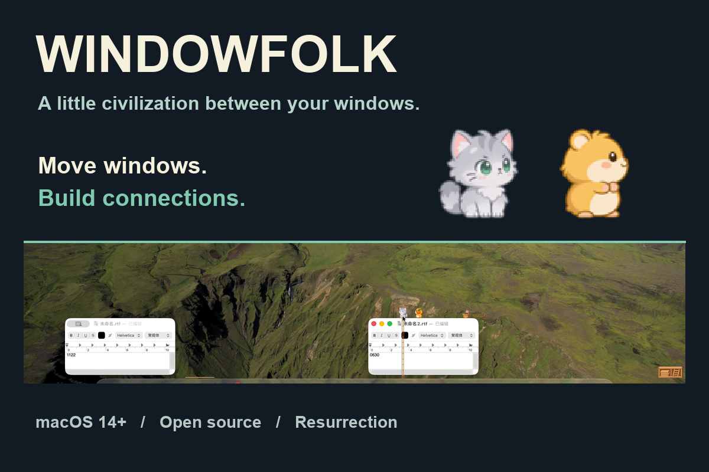

# 窗间 · Windowfolk

> 你的窗口，是它们的世界。
>
> A little civilization between your windows.

**窗间是一个住在电脑窗口之间的微型世界。** 应用窗口的上沿是道路，窗口之间的空隙是峡谷。移动窗口、搭起木板和梯子，帮助小居民搬运物件、拜访邻居，也让它们在你的桌面上慢慢安家。

你不直接指挥居民，而是改变它们生活的环境：把两扇窗口拉近、架起一座桥，一盆花就有机会送到邻居手中。**改变布局 → 连接通路 → 居民行动 → 留下变化。**

Windowfolk is a tiny world living between your application windows. Move windows, build bridges, and help its residents carry gifts, visit each other, and make themselves at home.

**For judges:** [English guide and testing instructions](docs/README.en.md) · [How we used Kiro](docs/kiro-usage.md) · [Download the Mac app](https://github.com/HY-love-sleep/windowfolk/releases/latest)

[](https://www.youtube.com/watch?v=8utV-wg0Fo4)

[英文参赛演示 · 2:55](https://www.youtube.com/watch?v=8utV-wg0Fo4) · [下载 macOS 通用版本 v0.2.0](https://github.com/HY-love-sleep/windowfolk/releases/tag/v0.2.0)

## 窗间里有什么

- **两位居民**：都都是一只银渐层小猫，嘟嘟是一只金丝熊。它们会在窗沿和地面上走动、休息、拜访邻居。
- **窗口与通路**：从工具箱拖出木板和梯子，连接窗口或地面。窗口位置改变时，通路也会随之变化。
- **开放式心愿**：居民可能想送花、找椅子、要一盏灯、去别的窗口看看，或一起玩追逐。帮助它们完成心愿，也可以随它们自在生活。
- **装饰与昼夜**：椅子、台灯等物件会随心愿解锁。布置好后，居民可以坐下休息，夜里也会在灯旁睡觉。
- **居民日记**：窗间会根据发生的事件生成日记。可选的大语言模型功能能为日记和居民的「小心思」生成文字，默认关闭。

项目保留了「送花过桥」的完整故事：送花、种花、开花，邻居还会回赠一颗果子。在当前版本中，送花是居民可能提出的心愿之一。

更多创意背景见 [项目创意](docs/concept.md)。

## 运行

### 环境要求

- macOS 14 或更高版本；目前仅使用主显示器。
- Xcode 或 Command Line Tools，Swift 6。
- 首次构建需要联网下载项目依赖。

窗间运行在菜单栏，没有 Dock 图标。它读取窗口的位置、大小、层级和所属应用名称，不读取窗口标题或画面，不需要屏幕录制或辅助功能权限。

### 构建并启动

在仓库根目录执行：

```sh
./build-app.sh
open Windowfolk.app
```

脚本会在仓库根目录生成 `Windowfolk.app`，也可以在 Finder 中双击打开。脚本默认尝试构建 Apple Silicon 和 Intel 通用版本；通用构建失败时会退回本机架构，并在输出中说明。

### 开始体验

1. 在主显示器上打开两个普通应用窗口，为两位居民留出窗沿；窗口不要全屏，也尽量不要完全遮住彼此的上沿。
2. 启动窗间，观察都都和嘟嘟的行动与心愿。心愿会随时间出现，并非每次启动都立即送花。
3. 把窗口拉近，从屏幕右下角的工具箱拖出木板或梯子，帮助居民到达原本去不了的地方。
4. 当椅子、台灯等物件解锁后，可以从工具箱取出并布置在世界里，也可以拖回工具箱收起。

想立即查看送花场景时，可在菜单栏的「调试 → 触发心愿 → 送花」中尝试触发；心愿仍需满足相应条件。花种下后可用「调试 → 快进」推进生长。

## 菜单与设置

点击菜单栏中的窗间图标：

- **显示路面**：用彩色线段显示居民可以行走的窗沿、地面和木板，方便检查布局。
- **日记**：查看居民日记，并可选择写今天的日记。
- **设置…**：配置可选的日记 LLM 和「小心思」。需要填写兼容的服务地址、模型名和 API Key；Key 保存在 macOS 钥匙串中。开启后，应用会将生成所需的事件摘要发送给所配置的服务。
- **调试**：触发心愿、快进花的生长、切换昼夜、解锁物件或重置世界等，方便体验和演示。
- **退出**：保存世界并退出。

LLM 默认关闭；不配置时，日记使用模板生成，「小心思」不会出现，其余玩法仍可使用。

## 数据与隐私

应用数据保存在 `~/Library/Application Support/Windowfolk/`：

- `world.json`：世界存档，运行时定期保存，退出时也会保存。
- `events.jsonl`：世界中的关键事件记录。
- `diary.jsonl`：生成的居民日记。
- `settings.json`：LLM 功能设置；API Key 单独保存在 macOS 钥匙串中。

当前版本使用 v2 存档格式。读取 v1 存档时，应用会备份旧文件并重新开局，不会自动迁移旧世界。

## 开发

在仓库根目录运行：

```sh
swift run Windowfolk
swift test
```

### 美术素材

游戏素材位于 [`Assets/`](Assets/)，包括两位居民的动作、物件和气泡。缺失或不符合规格的单项素材会回退到程序生成的占位图形，不影响其他素材加载。

替换 PNG 后，开发运行需要退出并重新启动；使用 `Windowfolk.app` 时需要先重新运行 `./build-app.sh`，再启动应用。素材尺寸、命名和出图流程见 [素材规格](docs/art-spec.md)，角色设定图位于 [`art/character_sheets/`](art/character_sheets/)。

### 项目文档

- [项目创意](docs/concept.md)：窗间的核心想法。
- [v1 演示脚本](docs/demo-script.md)：早期「送花过桥」布局和验收记录。当前 V2 以心愿调度开始剧情，操作与脚本中的 v1 开局有所不同。
- [v1 实机验证记录](docs/validation/2026-11-12/report.md)：早期版本的验证结果和未覆盖项目。
- [V2 实机验证记录](docs/validation/2026-11-20/report.md)：五类心愿、断桥救援、装饰昼夜、追逐、日记和保存恢复。
- [V2 需求](.kiro/specs/V2/requirements.md)：自由玩法、心愿和日记等功能的设计要求。
- [美术规格](docs/art-spec.md)：素材清单及制作流程。

## License

[MIT](LICENSE)
