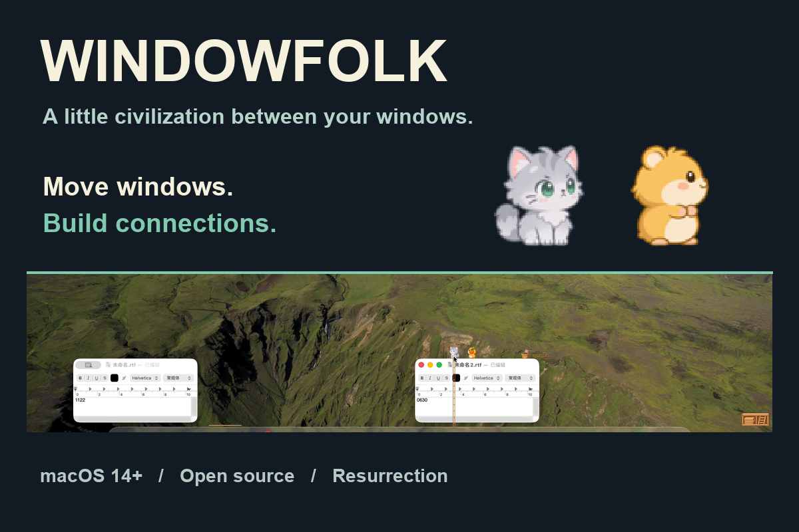

# Windowfolk

> A little civilization between your windows.

Windowfolk resurrects the playful desktop companions of the early internet as a tiny world on your actual macOS windows. Window tops become roads, gaps become canyons, and moving a window changes what its residents can reach.

You change the environment rather than directly controlling the characters: connect two windows with a plank, rescue a stranded resident with a ladder, and watch a flower delivery become a planted flower and a return gift.

[](https://www.youtube.com/watch?v=8utV-wg0Fo4)

[Watch the 2:55 English demo](https://www.youtube.com/watch?v=8utV-wg0Fo4). It covers all five wish types, rescue, diaries, and persistence; speed changes and demonstration controls are labeled.

## Get the app

Download `Windowfolk-macOS-universal.zip` from the [latest GitHub release](https://github.com/HY-love-sleep/windowfolk/releases/latest), extract it, and open `Windowfolk.app`. Requires macOS 14 or later. The app is built for Apple Silicon and Intel and uses the primary display. It appears in the menu bar, with no Dock icon.

The downloadable hackathon build is ad-hoc signed and is not Apple-notarized. If macOS blocks it, you can build locally from source:

```sh
git clone https://github.com/HY-love-sleep/windowfolk.git
cd windowfolk
./build-app.sh
open Windowfolk.app
```

Building requires Xcode or Command Line Tools with Swift 6 and an internet connection to resolve dependencies. Once built, the core game works without a network connection, account, API key, or paid service.

## Try it in five minutes

The interface currently uses Chinese. The menu translations below make the demo reproducible.

1. Open two ordinary application windows on your primary display. Avoid fullscreen and leave their top edges exposed. Start Windowfolk and look for a silver cat and a golden hamster.
2. Drag a plank from the left half of the toolbox at the bottom right to connect window tops. Drag a ladder from the right half to connect different heights or reach the floor.
3. From the menu-bar icon, choose **调试 → 触发心愿 → 送花** (Debug → Trigger wish → Deliver flowers). If a wish is already active or its prerequisites are not met, it may not start immediately. **调试 → 重置世界** (Debug → Reset world) starts a fresh world and erases the current game's progress; use it only for disposable demo progress.
4. Let the resident cross. Move a supporting window during the crossing to see hanging and falling; add a ladder to help the resident recover and continue. After planting, **调试 → 快进** (Debug → Fast-forward) advances flower growth. A blooming flower leads to a fruit gift in return.
5. Try the other entries under **触发心愿**: **椅子** (chair), **台灯** (lamp), **去看看** (visit), and **追逐** (chase). Wishes unlock furniture in the toolbox. Place a chair on a ledge to let a resident sit; at night, a nearby lamp lets a resident sleep. A visit flag marks a target window. Chasing can end in a catch or an escape.
6. Open **日记** (Diary) and choose **写今天的日记** (Write today's diary) to generate a template diary from recorded events. Choose **退出** (Quit), then reopen the app to check saved progress.

Wishes also appear naturally during ordinary play. Debug menu commands are shortcuts for demonstration; the gameplay still uses the real window layout and simulation.

## Features

- Five wish types: flower delivery, chair, lamp, visit, and chase.
- Window-aware navigation, movable bridges, hanging, falling, and ladder rescue.
- Placeable and removable furniture, sitting, day/night sleeping, and waking.
- Autonomous wandering, neighbor visits, flower growth, and reciprocal gifts.
- Event-based resident diaries and world persistence.
- Optional LLM diaries and short resident thoughts, both disabled by default. Configure an endpoint, model, and your own API key in **设置…** (Settings). Without a model, diaries use templates and all core gameplay remains available.

## Privacy and limitations

Windowfolk reads window geometry, stacking order, and owning application names. It does not read window titles or pixels and does not require Screen Recording or Accessibility permission for normal gameplay. Optional LLM features send the event summaries needed for generation to your configured service; API keys are stored in macOS Keychain.

Save files, events, diaries, and settings live under `~/Library/Application Support/Windowfolk/`. Version 1 saves are backed up and reset when loaded by version 2. Furniture and other saved objects are restored onto the floor rather than to old application-window ledges.

The current release supports the primary display. Fullscreen, sleep/wake, multiple machines, and long-duration performance were not part of the latest demo validation. The optional AI generation features were not enabled in the recorded demo.

## Development and validation

```sh
swift run Windowfolk
swift test
```

On November 20, 2026, all 754 tests across 178 suites passed. The [V2 on-device report](validation/2026-11-20/report.md) covers actual desktop interaction and save/restart checks. See [Kiro usage](kiro-usage.md) for the spec-driven development process and checked-in evidence.

The project uses Swift, AppKit, SpriteKit, SwiftUI, Core Graphics, and the MIT-licensed [swift-property-based](https://github.com/x-sheep/swift-property-based) testing library. The 45 game PNGs and two character reference sheets were created for this project using an image-generation workflow; prompts and asset specifications are in the repository. The desktop-pet projects linked in the concept document are references, not imported game code or artwork.

## License

[MIT](../LICENSE).
