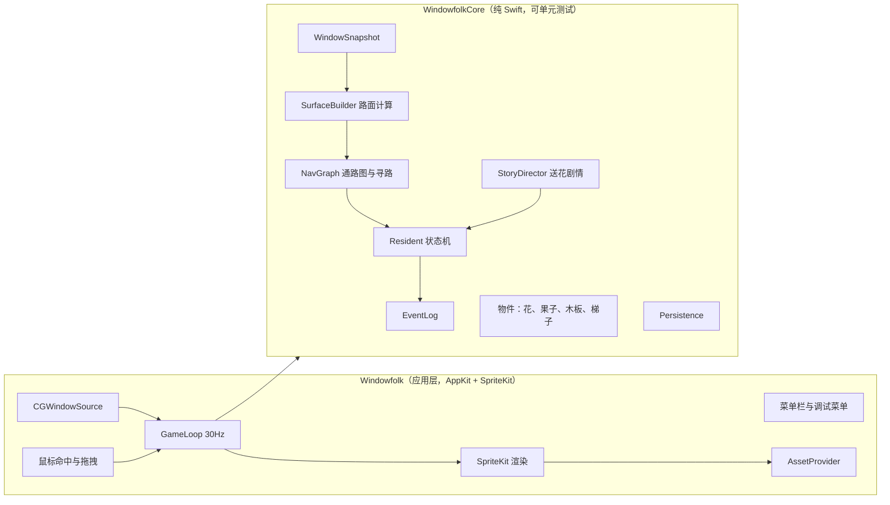
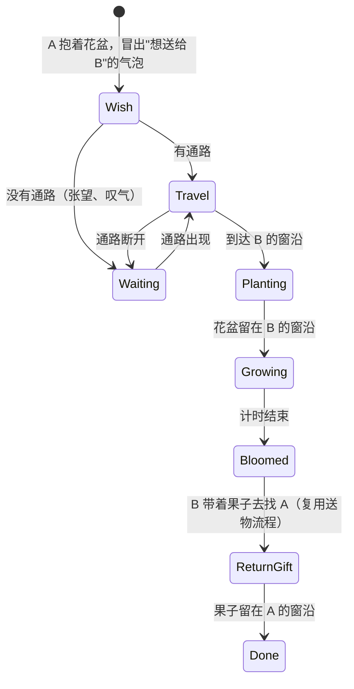

# 实现计划：窗间 v1「送花过桥」

> 状态：草案。等项目所有者与 Kiro 形成完整 spec 后再开始实现。
>
> 创意见 [concept.md](concept.md)，参考项目列在 concept.md 末尾。

## 问题陈述

做一个 macOS 菜单栏应用，把真实系统窗口的上沿当成道路，屏幕底部当成地面。玩家用工具箱里的木板和梯子连接通路，帮一个居民把花送给邻居。花种下后会生长、开花，邻居再回赠一颗果子。整个过程要能在比赛演示视频里完整、稳定地跑完。

## 需求

### 已确认

- **地形**：真实系统窗口，仅支持 macOS。
- **范围**：把"送花过桥"做完整，其他创意以后再加。
- **窗口关闭**：窗口上的物件掉到地面。
- **木板**：从工具箱拖出来架在两个窗沿之间。窗口挪开后木板掉到地面，可以拖回去重新用。居民正在桥上时会抓住桥边挂一会儿，然后掉下去。
- **居民掉到地面**：在地面上走动、张望，等玩家帮忙。
- **工具箱**：放木板和梯子。
- **退出后再打开**：只保存地面上的东西，窗沿上的物件在启动时落到地面。
- **结局**：花种下后过一段时间开花，邻居回赠一颗果子。
- **LLM**：这一版不做。事件记录格式提前设计好，以后优先接入日记或小心思。
- **美术**：先用占位图形，素材以后用 gpt-image-2.5 生成后替换。

### 假设（已认可）

- **系统版本**：最低 macOS 14，用 Swift 6 和 SwiftPM 构建，不建 Xcode 工程。
- **显示器**：只支持主显示器，其他显示器上的窗口忽略。
- **区分"关闭"和"暂时看不见"**：窗口最小化或在其他桌面空间时，窗口 ID 仍然存在，上面的居民和物件跟着隐藏，窗口回来时一起回来。只有窗口 ID 消失才算关闭，东西才会掉落。
- **启动时居民落位**：居民不保存，每次启动从屏幕上方跳到离原位置最近的窗沿。
- **玩家操作范围**：不能直接拖动居民；可以戳居民让它反应；可以拖动地面上的物件（木板、梯子、掉落的花和果子）。
- **全屏应用**：前台是全屏应用时，整个世界隐藏。
- **开花时间**：默认几分钟，调试菜单可以快进，方便录演示视频。

## 背景与技术要点

- **读取窗口**：`CGWindowListCopyWindowInfo` 返回窗口 ID、所属进程、边界、层级，结果按从前到后排序。只保留 `layer == 0`、不透明、尺寸足够大、不属于本应用的窗口。只读边界不需要任何权限（不读窗口标题）。轮询约 30Hz。
- **可行走路面**：每个窗口的上沿线段，减去所有在它前面并盖住这条线的窗口所占的 x 区间，剩下的若干段才是路面。地面取主屏 `visibleFrame` 的底边（Dock 上方）。
- **跟随窗口**：居民和物件记录 attachment（窗口 ID 加相对左边缘的偏移量，或者地面加 x 坐标）。每帧按窗口当前位置重算屏幕坐标。
- **鼠标穿透**：覆盖窗口默认 `ignoresMouseEvents = true`。每帧检查鼠标是否在可交互的东西上（居民、物件、工具箱），是则临时关闭穿透。
- **工具箱**：地面右下角的小木箱，画在同一个覆盖层里，避免跨窗口拖拽。
- **渲染**：SpriteKit `SKView` 铺满覆盖窗口。所有图形通过 `AssetProvider` 获取：有 PNG 用 PNG，没有则生成占位图形。
- **坐标**：Core 内部统一用左上角为原点，只在应用层一处转换为 AppKit 的左下角坐标（参考 DesktopPetMac 的 `DesktopGeometry`）。

## 方案设计

### 模块划分

`WindowfolkCore` 不依赖 AppKit。测试时用 `FakeWindowSource` 构造窗口布局，地形、物理和剧情都能在 `swift test` 里验证。

### 核心规则（数值均为可调常量）

- **路面类型**：窗沿、地面、木板、梯子。
- **通路图的边**：
  - 同一段路面上直接行走。
  - 小跳：高差不超过约 24pt，水平间隙不超过约 16pt。
  - 往下跳：高差不超过约 120pt。
  - 走木板。
  - 爬梯子。
- **木板**：两端分别吸附到两个窗沿上。两端距离不超过约 160pt、高差不超过约 40pt 时有效。拖动预览时，有效显示绿色，无效显示红色。任一端窗口关闭或超出限制时，木板失效并掉落为地面物件。
- **梯子**：下端放在地面或较低的窗沿上，上端搭在某个窗口上沿。长度固定约 200pt，超出范围就掉落。
- **掉落**：东西所在的路面消失时受重力下落，落到下方第一段路面或地面上。
- **居民状态**：`idle`、`walking`、`carrying`、`waiting`、`falling`、`hanging`、`climbing`、`planting`、`celebrating`。

### 剧情状态

花和果子都是挂在窗口上的物件，同样遵守"窗口关闭就掉落"。花的生长阶段会保存；花掉在地面上也继续生长。

### 事件记录

事件以 JSONL 格式写入 `~/Library/Application Support/Windowfolk/events.jsonl`，每行包含 `time`、`type`、`actor`、`target`、`detail`，例如 `crossed_bridge`、`planted`、`fell`、`bloomed`。这一版只写不读，留给以后的日记功能。只记录应用名称，不记录窗口标题。

## 任务分解

### Task 1：搭建工程骨架，显示透明覆盖层

- **目标**：应用启动后菜单栏有图标，屏幕上有一层透明、鼠标可穿透的覆盖窗口。
- **实现要点**：
  - `Package.swift` 定义 `WindowfolkCore`（库）、`Windowfolk`（可执行文件）、`WindowfolkCoreTests` 三个 target，平台 macOS 14。
  - `NSApplication` 使用 `.accessory` 激活策略（无 Dock 图标），`NSStatusItem` 菜单先只有"退出"。
  - 覆盖窗口：无边框、透明背景、层级 `.floating`、`ignoresMouseEvents = true`、主屏大小，内含 `SKView`；collectionBehavior 设为 `canJoinAllSpaces`、`stationary` 等。
  - 确认 `swift test` 在本机可运行（Swift Testing 或 XCTest 选一个），写一个占位测试。
- **测试**：`swift build` 和 `swift test` 通过。
- **演示**：`swift run` 后菜单栏出现图标，屏幕中央有一个占位圆点，点击会穿透到下面的应用。

### Task 2：读取窗口并计算可行走路面，用调试线画出来

- **目标**：实时得到所有可行走路面，并能在屏幕上看到。
- **实现要点**：
  - Core 定义 `WindowSnapshot`（id、ownerName、frame、zIndex），使用左上角原点坐标；定义 `WindowSource` 协议，提供 `FakeWindowSource`。
  - 应用层实现 `CGWindowSource`：过滤窗口、只保留主屏窗口、转换坐标。
  - 实现 `SurfaceBuilder`：窗口上沿减去遮挡区间，加上地面；每段路面带所属窗口 ID。
  - 加 30Hz `GameLoop`。菜单加"显示路面"开关，打开后用彩色线段画出所有路面。
- **测试**：单窗口；部分遮挡；完全遮挡；前面的窗口在上沿下方（不遮挡）；本应用窗口被排除；地面始终存在。
- **演示**：打开"显示路面"，拖动窗口、让窗口互相遮挡，线段实时变化，被盖住的部分断开。

### Task 3：一个会走、会跟随窗口、会掉落的居民

- **目标**：一个占位居民在窗沿上随意走动，窗口移动时跟随，窗口关闭时掉落。
- **实现要点**：
  - Core 实现 `Attachment`（窗口 ID 加偏移，或地面加 x）、简单重力和落地检测。
  - 区分关闭和暂时看不见：用 `kCGWindowListOptionAll` 查询窗口 ID 是否仍存在；最小化或在其他桌面空间时，居民隐藏并暂停。
  - 走到路面尽头或被遮挡截断处时转身。
  - 应用层引入 `AssetProvider`，居民用占位图形（带眼睛的圆角方块），按状态换颜色或做简单拉伸动画。
- **测试**：窗口移动后居民跟随；窗口关闭后落到下方窗沿或地面；最小化时不掉落；路面变短时位置被限制在路面内。
- **演示**：居民在窗口上沿走；拖窗口它跟着走；关窗口它掉下去；最小化再恢复它还在原位。

### Task 4：鼠标交互与工具箱木板

- **目标**：从工具箱拖出木板架在两个窗沿之间；窗口挪开时木板掉落，掉落后可以拖回去。
- **实现要点**：
  - 命中检测驱动的鼠标穿透：鼠标在居民、物件或工具箱上时，覆盖层才接收点击。
  - 工具箱是地面右下角的木箱。拖出木板时两端自动吸附附近窗沿，按规则显示绿色或红色预览。
  - Core 实现 `Plank`：两端各一个 attachment，每帧校验，失效时变成地面物件。
  - 地面物件可以拖动，放下的位置有效就重新架上，无效就弹回地面。
  - 戳居民时它跳一下并冒出"?"气泡。
- **测试**：木板有效性（距离、高差、遮挡）；一端窗口关闭后掉落；窗口拉远后掉落；掉落后能重新架上。
- **演示**：架木板，拖开窗口后木板掉落，拖回去又能架上；点击其他地方仍穿透到下面的应用。

### Task 5：通路图与寻路，居民能走过木板

- **目标**：居民能沿通路走到指定窗沿，路断时停下等待，路通时继续。
- **实现要点**：
  - Core 实现 `NavGraph`：节点是路面，边包括行走、小跳、往下跳、走木板；用 BFS 或 A* 寻路。
  - 拓扑变化时重算通路图，移动中的居民重新规划路线。
  - 无通路时进入 `waiting`：面向目标张望，冒出"..."气泡。
  - 居民在桥上时木板失效，进入 `hanging`，约 1.5 秒后掉落。
  - 加入第二个居民。调试菜单加"让 A 去找 B"。
- **测试**：无通路时等待；架木板后找到路线；间隙够小时直接跳过去；中途断开后重新规划；从桥上掉落的流程。
- **演示**：窗口分开时 A 张望；架上木板后 A 走过去；拖开窗口，A 挂在桥边然后掉到地面。

### Task 6：梯子与地面救援

- **目标**：居民掉到地面后，玩家放梯子让它爬回窗沿。
- **实现要点**：
  - 工具箱加入梯子：下端放在地面或较低窗沿，上端吸附窗口上沿，超长时显示红色预览。
  - `NavGraph` 增加爬梯子的边，居民增加 `climbing` 状态。
  - 居民在地面且有目标时，在离目标最近的位置来回走动、抬头张望。
  - 梯子失效时的掉落规则和木板一致。
- **测试**：梯子有效性；从地面经梯子回到窗沿；窗口移得太高后梯子掉落；可以从窗沿下梯子到地面。
- **演示**：关闭 A 的窗口，A 掉到地面张望；放梯子搭到 B 的窗口上，A 爬上去找到 B。

### Task 7：物件与搬运

- **目标**：居民能抱着花盆移动，物件挂在窗沿上并遵守掉落规则。
- **实现要点**：
  - Core 实现 `Item`（花盆、果子）：有 attachment，可以被持有；花有生长阶段：花盆、发芽、开花。
  - `carrying` 状态下移动略慢，爬梯子时物件跟着；居民掉落时物件一起掉，落地后重新捡起。
  - 窗沿物件在窗口关闭时掉落，窗口暂时看不见时跟着隐藏。
  - 地面上的花和果子玩家可以拖动，放到窗沿后挂在该窗口上。
- **测试**：搬运时跟随居民；居民掉落时物件一起掉；窗口关闭后物件掉落；最小化时不掉落；被拖到窗沿后挂在该窗口上。
- **演示**：调试菜单"给 A 一个花盆"，A 抱着它走过桥；关闭窗口，窗沿上的花盆掉到地面。

### Task 8：送花剧情与事件记录

- **目标**：完整的送花剧情自动跑完，从许愿到回赠果子。
- **实现要点**：
  - 实现 `StoryDirector`，按剧情状态图驱动。首次启动时在主屏上选两个水平距离最远、面积足够大的窗口，作为 A 和 B 的家。
  - 用图标气泡表达想法：花盆加 B 的头像表示想送花，"..."表示没路，心形表示完成。不用文字台词。
  - 种花动画：两人一起蹲下然后跳一下。开花计时用可注入的时钟，调试菜单提供"快进"。
  - 开花后 B 带着果子去找 A，复用 Task 5 和 Task 7 的流程。
  - 实现 `EventLog`，以 JSONL 写入 Application Support 目录。
- **测试**：用假时钟测试剧情状态机的每一步转换；剧情中通路断开或居民掉落后能继续；事件记录的格式和字段。
- **演示**：不用调试菜单，从启动开始：A 许愿、张望；玩家拉近窗口、架上木板；A 送花，两人种花；快进后开花；B 走过去把果子交给 A。

### Task 9：保存与恢复

- **目标**：退出后再打开，地面物件、花的生长阶段和剧情进度都还在。
- **实现要点**：
  - 实现 `Persistence`，保存为 `world.json`：版本号、地面物件（类型、x、状态）、剧情阶段、花的生长阶段和起始时间。退出时和每隔约 30 秒各保存一次。
  - 退出时，窗沿上的物件（包括木板、梯子）记下屏幕 x 坐标，下次启动时从上方落到地面。
  - 启动时居民从屏幕上方落到离原位置最近的窗沿；剧情从保存的阶段继续。
  - 读取失败或版本不匹配时，备份旧文件并重新开始。
- **测试**：保存和读取一致；窗沿物件在启动时落到地面；文件损坏时的回退；各剧情阶段都能恢复。
- **演示**：种花后退出再打开，花盆从上方落到地面，生长阶段不变；把它拖回 B 的窗沿，剧情继续。

### Task 10：边界情况、素材替换接口和演示准备

- **目标**：日常使用中没有明显问题；素材可以直接替换；演示能稳定录制。
- **实现要点**：
  - 前台是全屏应用时隐藏世界；睡眠唤醒、分辨率变化后重建地形。
  - 窗口没有变化时轮询降到约 10Hz，有变化时恢复到 30Hz。
  - 编写 `docs/art-spec.md`：每个角色和物件的尺寸、各状态帧数、文件命名、透明背景要求、sprite sheet 格式，以及用 gpt-image-2.5 生成时保持角色一致的注意事项。`AssetProvider` 按规格加载 PNG，缺失时回退到占位图形。
  - 编写 `build-app.sh`，打包成 `.app`。
  - 编写 `docs/demo-script.md`：录制视频时的窗口布局和操作步骤。
  - 更新 README，说明如何运行。
- **测试**：全屏时隐藏、退出全屏后恢复；放入示例 PNG 后对应的占位图形被替换。
- **演示**：按 `docs/demo-script.md` 完整跑一遍剧情，中间切换桌面空间、最小化窗口都不出错。

## 待定事项

在形成正式 spec 前还需要讨论的内容，随讨论更新：

- 居民的具体形象和名字（目前用 A、B 指代）。
- 各项数值常量（跳跃距离、木板长度、梯子长度、开花时长）需要实际试玩后调整。
