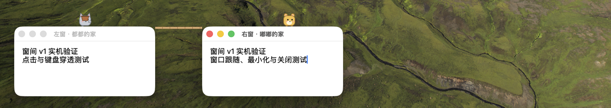
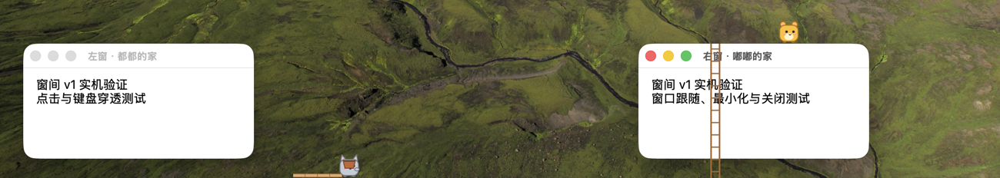
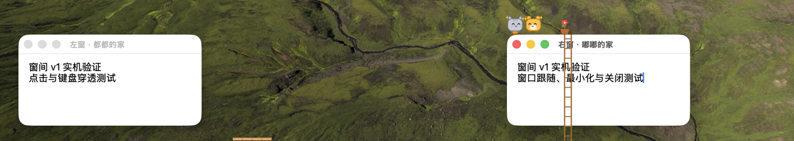
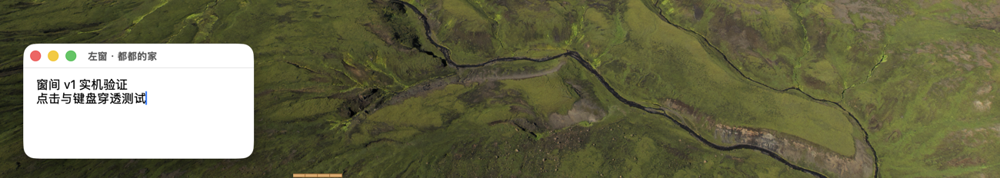
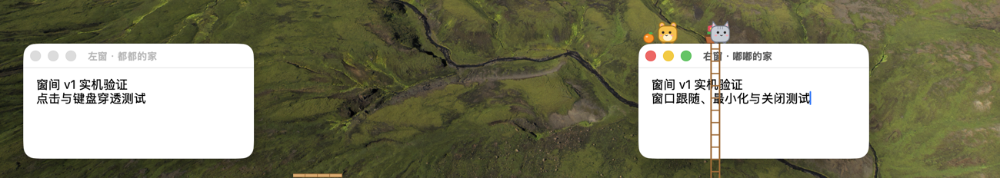

# 窗间 v1 实机验证记录

日期：2026-11-12。版本：0.1.0（build 10），提交：`7e2c4e0`。

## 结论

核心玩法已通过两条实机流程：一次直接过桥送花，一次完整的「架桥 → 断桥悬挂 → 掉落 → 梯子救援 → 种花 → 开花 → 回赠果子」。最小化与恢复也通过了截图核对。已执行的流程未发生崩溃，未确认产品缺陷。

本次是有范围的实机验证，不代表 `docs/demo-script.md` 中全部发布验收项通过，尤其未完成连续三次完整救援流程和两小时稳定性验收。

## 环境与方法

- macOS 26.6.2，Swift 6.4.2。
- 主显示器 1512 × 982 pt，另接一台显示器；游戏在主显示器验证。
- 当前 Dock 自动隐藏，实测 Ground 为屏幕底部 y = 982。
- 使用原生 AppKit 创建两个独立的真实系统窗口，初始位置分别为 `(100, 807, 300, 150)` 和 `(1000, 807, 300, 150)`，窗沿距 Ground 175 pt。
- 当前会话没有专用 computer use 工具；实际采用系统截图、系统鼠标事件和辅助功能菜单操作。并非仅调用 Core 或修改世界状态模拟结果。
- 核心交互通过真实拖拽完成；菜单仅用「快进」推进花的生长。准备阶段通过辅助功能摆放测试窗口。
- 用截图核对画面，用应用自身的事件日志与退出存档核对剧情结果。截图已裁剪为测试区域。

## 已执行结果

| 验证内容 | 结果 | 证据与范围 |
| --- | --- | --- |
| 正式打包 | 通过 | `build-app.sh` 退出码 0；产物包含 arm64、x86_64；签名校验成功。见 [构建日志](build.log)。 |
| 构建失败提示 | 通过 | 在临时副本中缺少 Info.plist 时退出码 1，并报告失败步骤。未改动仓库的 Info.plist。见 [失败日志](build-failure.log)。 |
| 已有自动化测试 | 通过 | 63 个 suite、298 个测试全部通过。见 [测试日志](swift-test.log)。 |
| 应用启动与覆盖层 | 通过 | 从正式 .app 启动；可见居民、工具箱和透明覆盖层；运行策略为 accessory。未单独计量“五秒内显示”。 |
| 窗口移动与穿透 | 通过 | 穿过覆盖层拖动右窗标题栏，右窗从 x = 1000 移到 x = 500；居民跟随。 |
| 工具箱拖出木板 | 通过 | 鼠标从木板区拖到窗口间隙，生成 `plank_placed`，居民开始行走。 |
| 直接过桥送花 | 通过 | 第一轮出现 `crossed_bridge`、`planted`、`sprouted`、`bloomed`、`gift_delivered`；退出存档 `story.stage = done`。见 [事件](happy-path-events.jsonl)、[退出存档](happy-path-save.json)。 |
| 桥上断路、悬挂和掉落 | 通过 | 第二轮在都都上桥时将右窗从 x = 500 拖到 x = 900；出现 `plank_dropped`、`fell`（`from_state = hanging`）、`landed`。 |
| 梯子救援 | 通过 | 从工具箱右半区拖出梯子，出现 `ladder_placed`、`climbed_ladder`（direction = up），随后种花。 |
| 救援后的完整剧情 | 通过 | 第二轮仅用「快进」推进生长，出现 `planted`、`sprouted`、`bloomed`、`gift_delivered`。见 [完整事件](recovery/events.jsonl)。 |
| 最小化与恢复 | 通过 | 最小化右窗时，该窗上的两位居民、花、果子和梯子一起隐藏；恢复后重新显示。该区间无额外掉落事件。采用截图核对，未计量 1 pt 精度。 |
| 退出保存 | 通过 | 菜单退出后生成有效存档；第一轮存档确认到达 done。未单独计量“两秒内退出”。 |

第一条流程的事件记录为 09:39:52 至 09:42:34。第二条完整救援流程为 09:53:49 至 09:54:41，全程约 52 秒（使用快进，不包含准备时间）。

## 关键截图

架桥：

桥断后悬挂：

梯子救援：

开花与回礼流程结束：

最小化前、最小化后与恢复：

## 待验证与限制

- **关闭窗口后的掉落**：本次临时窗口程序保留了关闭后的 NSWindow，窗口 ID 仍存在，不能用于可靠验证“窗口销毁后掉落”。需用 TextEdit 或 Finder 窗口复测。不能将此次现象判为产品缺陷。
- **输入焦点**：已尝试点击工具箱后继续输入，但没有得到可靠的文本输入证据，未判定通过。需专门复测 TextEdit 输入不中断。
- **其他鼠标事件**：未完整验证右键、滚动、快速移入移出命中区、居民经过静止指针，以及下层应用是否完全收不到交互对象上的事件。
- **空间与全屏**：未完成受控的桌面空间切换、主显示器全屏进入与退出验收。外接显示器上的日常窗口变化不等同于这些验收项。
- **恢复与显示变化**：未验收重启后物件落地、睡眠唤醒、分辨率与 Dock 布局变化。
- **权限**：本机自动操作工具已有截图和辅助功能权限，没有重置系统权限，不能据此证明全新账户首次运行不弹权限对话框。
- **稳定性与性能**：未完成三次独立完整救援流程、60 秒 CPU 测量和两小时连续运行。

## 现场恢复

测试前备份了原有 `world.json` 和 `events.jsonl`。测试后退出应用、关闭临时窗口，恢复了原文件，并核对内容哈希一致。正式应用已重新构建；产品源码未修改。本目录保存验证报告、经裁剪的截图和测试记录。
